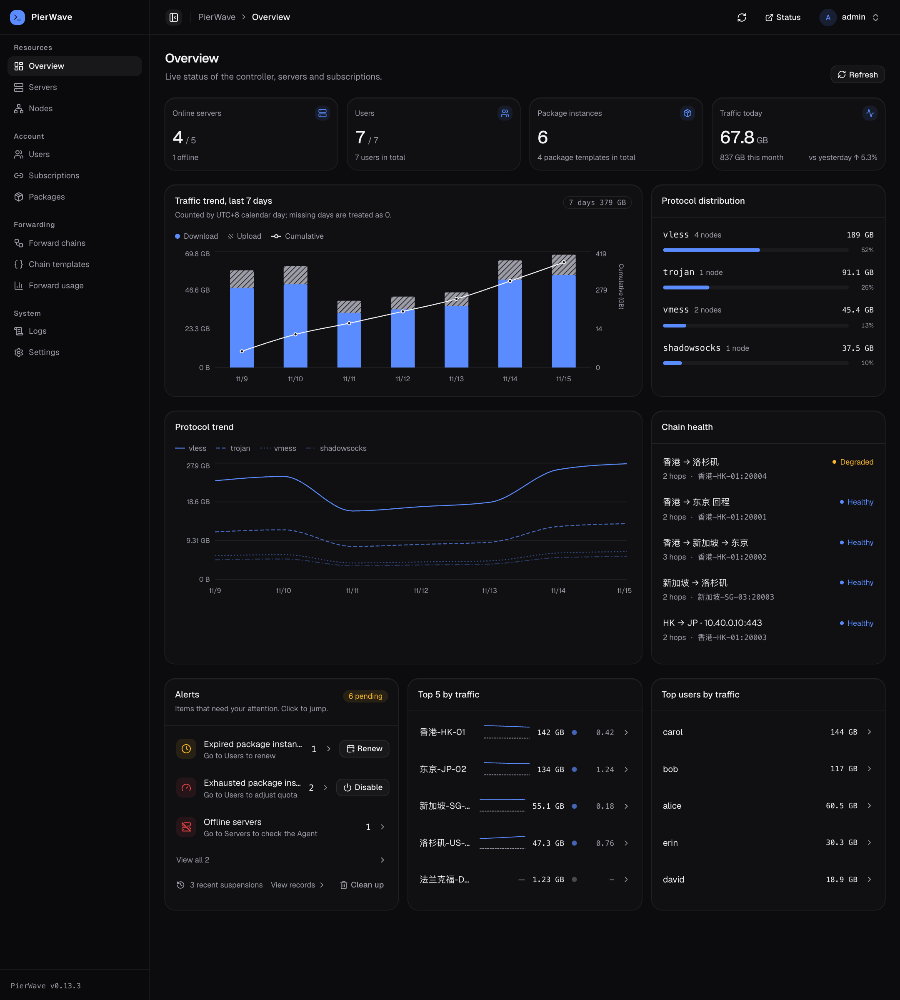
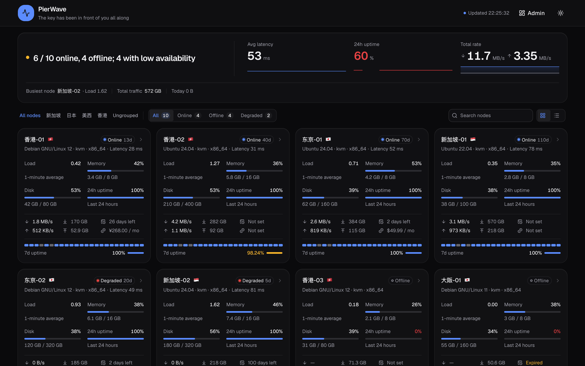
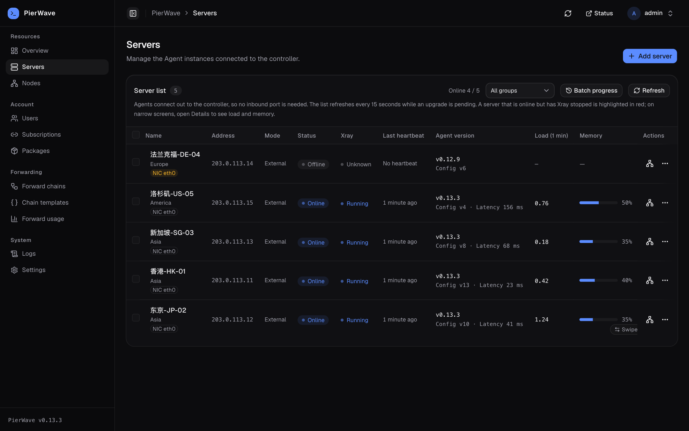
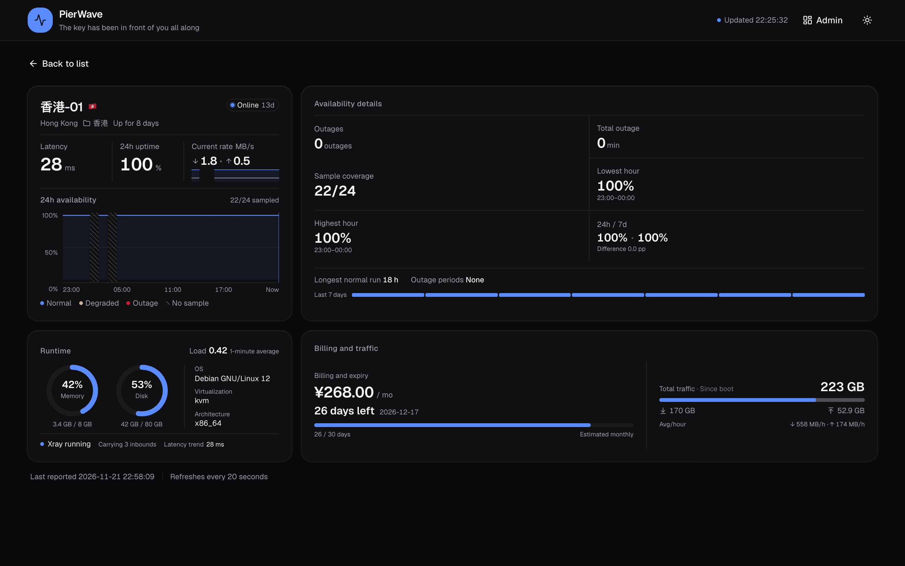
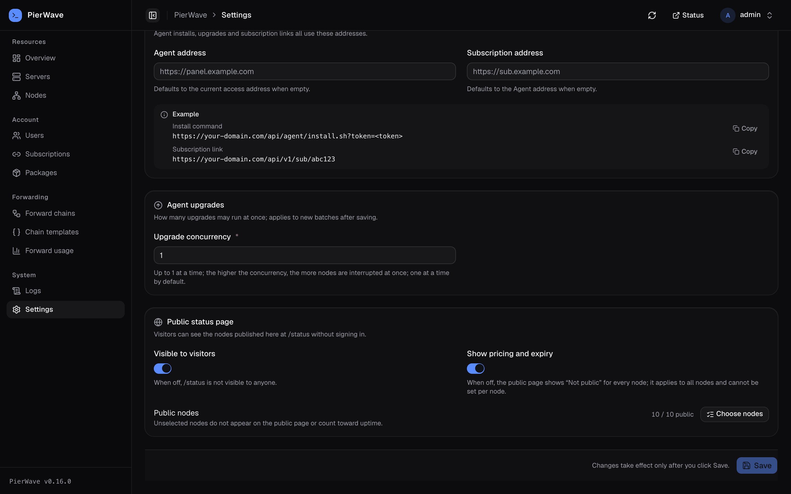
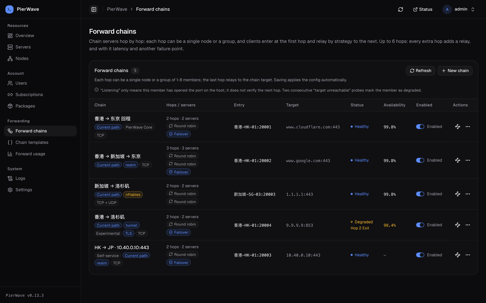
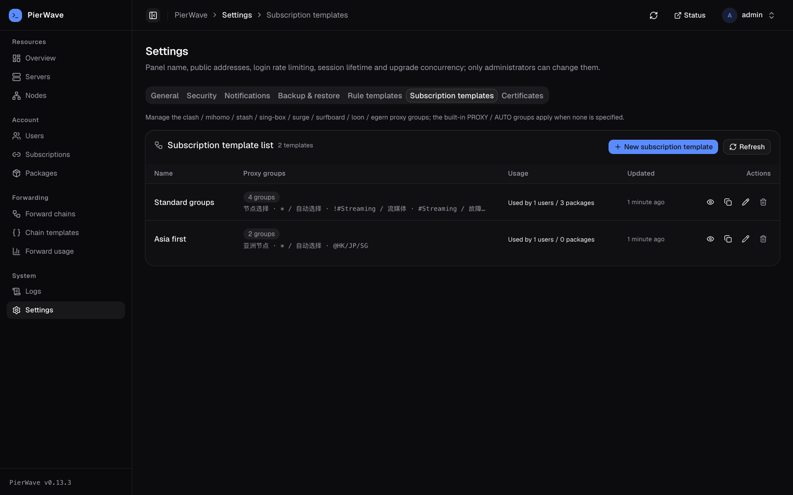
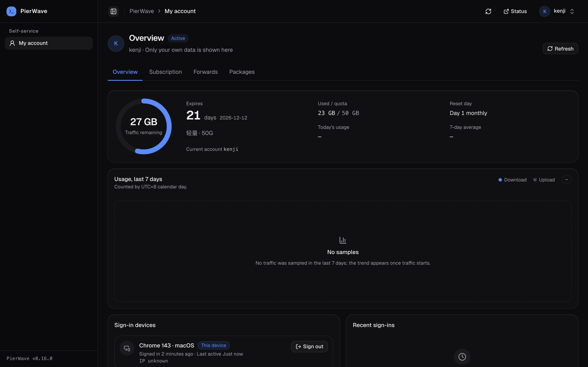
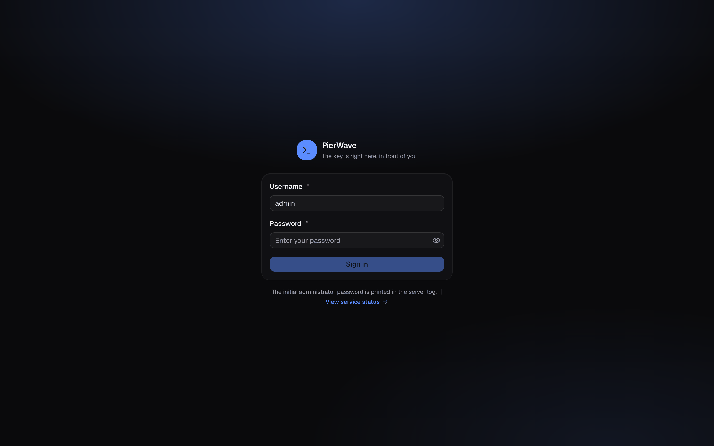

# PierWave

**English** | [简体中文](README.zh-CN.md)

A Rust control plane for Xray: a master, an agent on every host, and a web UI. Agents dial **out** to the
master, so servers behind NAT never expose an inbound management port. Configuration is shipped as desired
state and converged locally; master and agent are each a single binary.



## What it solves

Running Xray on a few hosts is rarely about installing Xray. The hard parts are which node runs where, how
much each user consumed, and what happens when the quota runs out. PierWave puts all of it behind one control plane:

- **Agents only dial out.** A reverse WebSocket means no management port per server, and NAT is a non-issue.
- **Desired state, not commands.** The master ships a full config; the agent validates, backs up, swaps atomically and rolls back on failure.
- **Derived credentials.** Every `(user, node)` UUID is HMAC-derived and never stored, so subscriptions and server configs agree.

## Features

### Servers and agents
- One-time token on create (only the hash is stored); rotate it to reissue the install command.
- The agent dials out over WebSocket; heartbeats carry version, load, memory, disk, NICs and traffic counters.
- NIC pinning, allowed port ranges and extra ports, internal addresses for hop dialing; batch upgrades verify Ed25519 + SHA256.

### Nodes
- Protocol × transport × security: vless/vmess/trojan/shadowsocks/socks/http, tcp/ws/grpc/http/h2/quic/kcp/httpupgrade/xhttp, none/tls/reality.
- TLS certificates ship with desired state (keys 0600); REALITY public keys are derived. Nodes carry tags, a region and a bandwidth cap.
- NAT: set a separate public port; subscriptions and probes use `public_port`, while the agent still listens on `port`.

### Subscriptions
- 14 formats: clash/mihomo/stash/surge/egern/surfboard/loon/qx/singbox/uri/shadowrocket/v2ray, plus singbox-full/surge-full.
- `?target=` wins, otherwise UA sniffing; `Subscription-Userinfo` lets clients show quota and expiry.
- Subscription templates make proxy groups declarative (select/url-test/fallback/load-balance, filtered by tag/region/protocol); rule templates bind to users or packages.

### Users and packages
- Several package instances per user, each with its own quota, expiry and reset day; billing is waterfall by creation order.
- Direction (both/upload/download) × node ratio, through one conversion path.
- Exhausted or expired instances leave the server config and return after renewal; the overview renews expired instances and disables over-quota users in bulk.

### Forwarding and chains
- Four engines: native, realm (supervised subprocess), nftables (kernel DNAT), tunnel (our own TLS/Noise relay).
- 1–6 hops, single hosts or groups; six strategies: round-robin, failover, lowest latency, IP hash, weighted, least-connections.
- Ports are auto-allocated; chain templates plus user self-service chains. Single-hop forwards are metered and reconciled daily.

### Observability
- Overview: online servers, today/month traffic, protocol mix and trend, top servers/users, chain health and alerts.
- Public status page without login: 24h/7d availability, load/memory/disk, current rate and totals; it can be disabled.
- Rates are heartbeat counter deltas; availability approximates TCP probe success. Alerts go to Telegram/webhook (six events, cooldowns).

### Operations
- Backups are one SQLite snapshot (`VACUUM INTO` + gzip), optionally uploaded to WebDAV and pruned by retention.
- Update checks cover master and agent versions; audit log, read-only MCP stdio server and an admin Telegram bot.

## Architecture

```
        browser / subscription clients
                    │ HTTPS
       ┌────────────▼────────────────────────┐
       │ pierwave-master                     │
       │ axum API · SPA · subscriptions ·    │
       │ scheduler / enforcement             │
       └───────┬─────────────────────▲───────┘
               │ desired state + files│ heartbeat / traffic / probes
               │ (agent dials in)     │
       ┌───────▼────────┐    ┌────────┴────────┐
       │ pierwave-agent │    │ pierwave-agent  │
       └───────┬────────┘    └────────┬────────┘
               │ local stats API        │
           xray-core               xray-core
```

The master only renders desired state: node configs, certificate files, forwards and tunnels. The agent runs
`xray -test`, writes certificates with their target modes, swaps the config atomically and keeps the old one on
failure. Heartbeats carry facts only; the agent's single action is "converge to desired state".

## Screens

| Public status | Servers |
|---|---|
|  |  |

| Node detail | Settings |
|---|---|
|  |  |

| Forward chains | Subscription templates |
|---|---|
|  |  |

The user view returns only the signed-in user's data: quota, subscription link, self-service forwards, packages and sign-in devices.

| User view | Sign-in |
|---|---|
|  |  |

## Quick start

### Docker

```bash
git clone https://github.com/jacob-bytes/pierwave.git && cd pierwave
cp .env.example .env      # set PIERWAVE_ADMIN_PASSWORD
docker compose up -d
```

The panel listens on `http://<host>:8787`; the database and agent release cache live in `./data` (bind-mounted),
so recreating the container keeps your data. Do not containerize the agent: it supervises the host's xray
process and systemd unit.

### systemd

```bash
git clone https://github.com/jacob-bytes/pierwave.git && cd pierwave
sudo bash scripts/install.sh install
sudo scripts/install.sh status
```

The script verifies the release (Ed25519 + SHA256), writes the systemd unit, generates an admin password, prints it once and runs a health check. Later:

```bash
sudo scripts/install.sh upgrade
sudo scripts/install.sh uninstall --purge   # also deletes the data directory
```

### Install an agent

Create a server in the panel, copy the one-time command and run it on the target host:

```bash
curl -fsSL https://<master>/api/agent/install.sh?token=<token> | sudo bash
```

The installer picks the architecture, downloads the agent, writes `/etc/pierwave-agent/config.toml` (0600),
installs a systemd unit and starts it. Prebuilt Linux binaries (musl, x86_64 / aarch64) are on the
[Releases](https://github.com/jacob-bytes/pierwave/releases) page; drop `pierwave-agent-<target>` into the
`PIERWAVE_AGENT_DIST` directory for offline installs. Paths, environment variables and reverse-proxy
requirements are in [docs/DEPLOY.md](docs/DEPLOY.md).

## Security

Server tokens are stored as hashes only; per-`(user, node)` credentials are HMAC-derived; a chain whose
certificates or capabilities are missing is rejected as a whole (fail closed), never downgraded to plaintext.

## Documentation

- [Deployment](docs/DEPLOY.md) · [Backup encryption](docs/BACKUP_ENCRYPTION.md) · [Plan](docs/PLAN.md)
- [Subscriptions](docs/SUBSCRIBE.md) · [Chain templates](docs/CHAIN-TEMPLATES.md) · [Telemetry](docs/TELEMETRY.md)
- [Error codes](docs/ERRORS.md) · [MCP](docs/MCP.md) · [User forwards](docs/USER-FORWARDS.md)

## Development

```bash
make check    # fmt + clippy(-D warnings) + test + web build + web test
make e2e      # real master + agent: delivery, metering and subscription loop
make size     # what each build cache takes on disk
make clean    # drop target/ and web/dist (keeps offline dependency caches)
```

`target/` grows with every build and every cross target; if the checkout reaches
tens of gigabytes, `make size` finds it and `make clean` reclaims it. Keep
`.cargo-home/` — it holds the offline dependency cache and is not cheap to
rebuild on a throttled network.

## License

[AGPL-3.0](LICENSE). You may self-host, modify and redistribute; a modified version run as a network service
must publish its changes. Commercial licensing is available on request.

Before contributing, read [CONTRIBUTING.md](CONTRIBUTING.md): submitting a PR means licensing your contribution
under AGPL-3.0 and granting the maintainer a right to relicense.
