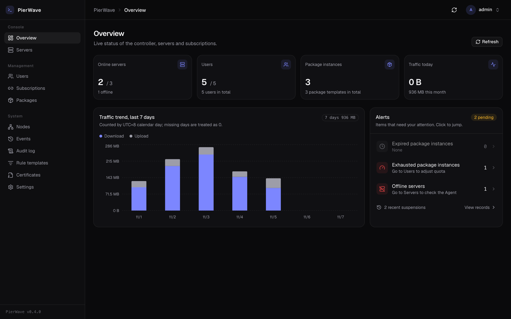
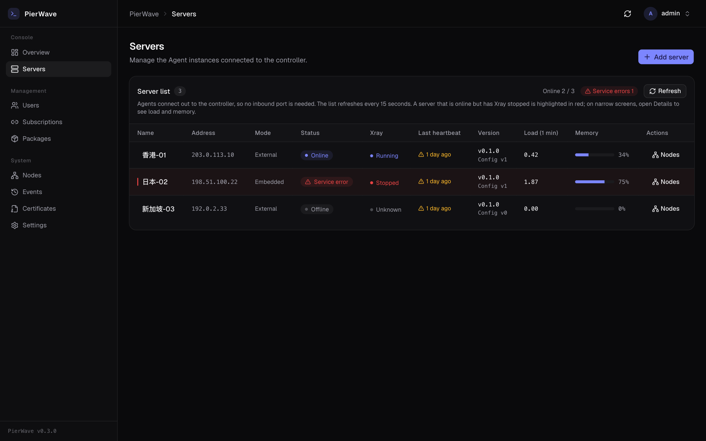
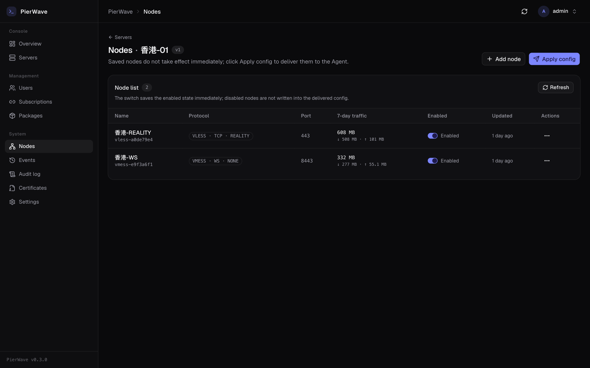
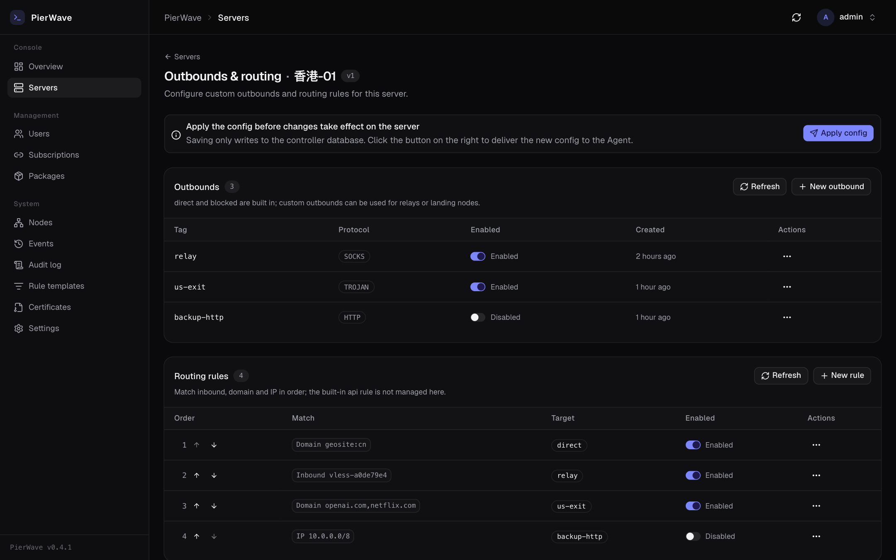
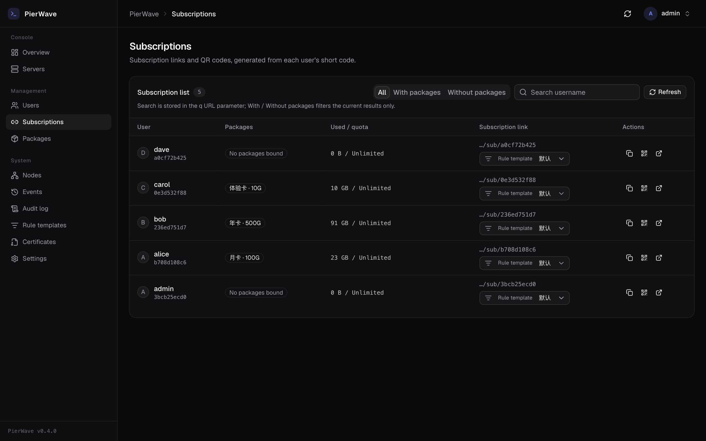
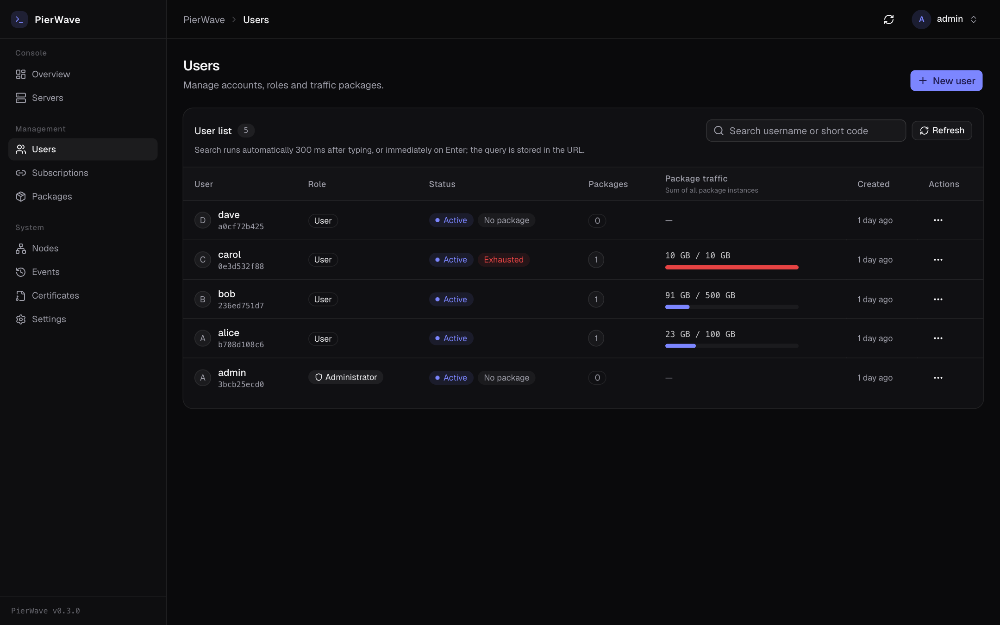
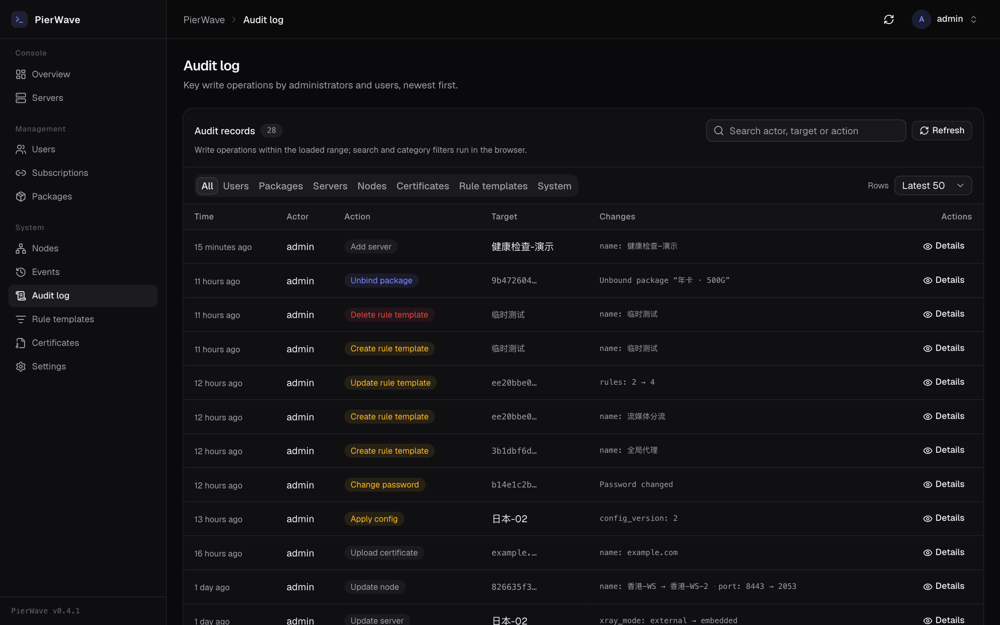
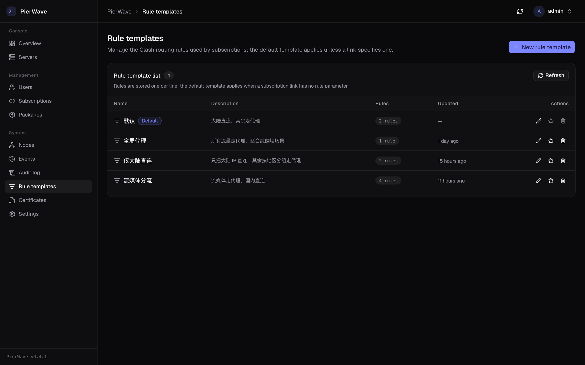
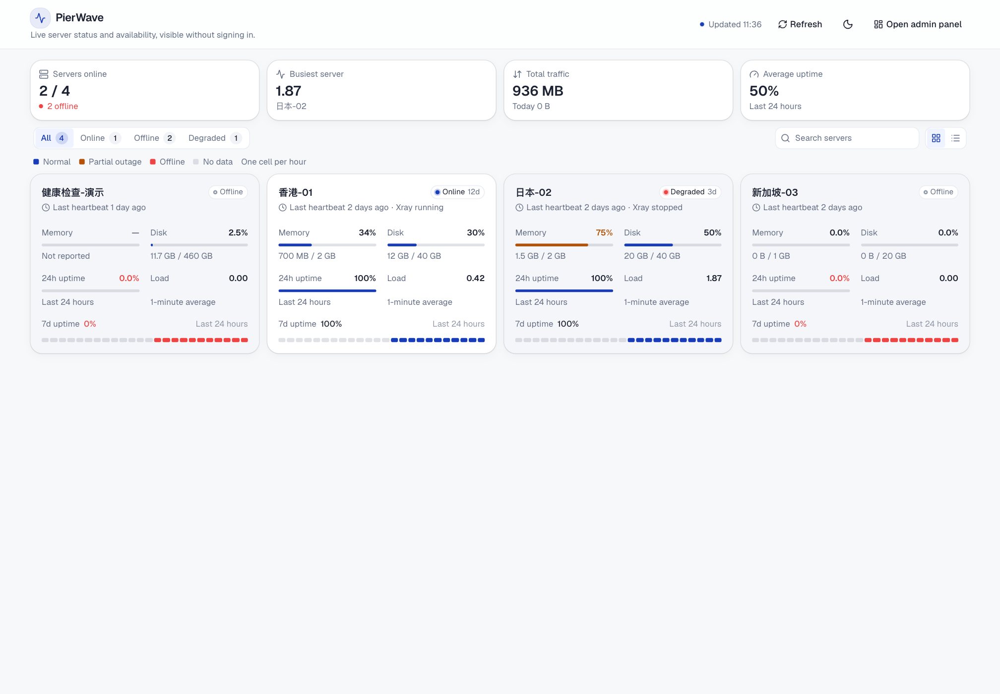

# PierWave

**English** | [简体中文](README.zh-CN.md)

A Rust control plane for [Xray](https://github.com/XTLS/Xray-core) fleets: panel, subscription
delivery, traffic metering and quota enforcement — with agents that dial **outbound** to the master,
so your servers never expose an inbound management port.



## Why

Running Xray on more than a couple of servers is rarely about installing Xray. The hard parts are:
which node runs where, how much each user consumed, and what happens when the quota is gone.
PierWave puts all of that behind one control plane:

- **Servers only dial out.** Agents connect to the master over WebSocket — no management port on
  each box, works behind NAT.
- **Desired state, not commands.** The master ships a full config; the agent validates it
  (`xray -test`), backs up, swaps atomically, and rolls back on failure.
- **Derived credentials.** Each `(user, node)` UUID is derived with HMAC — nothing to store, and the
  exact same value appears in the subscription and in the server config.
- **One billing source of truth.** Xray stats → deltas → weighted by direction × node ratio → daily
  ledger. Exhausted users are evicted from the config automatically and restored within ~30s after
  a top-up.
- **Subscriptions that work out of the box.** Clash/mihomo YAML and URI list, with the
  `Subscription-Userinfo` header clients use to show quota.

## Architecture

```
        ┌─────────── pierwave-master ───────────┐
        │  axum API · sessions · static SPA     │
        │  subscription render · metering       │
        │  enforcement reconcile                │
        └───────▲───────────────────┬───────────┘
                │ desired state /    │ WebSocket (outbound from agent)
                │ heartbeat / traffic│
        ┌───────┴────────┐   ┌──────▼─────────┐
        │ pierwave-agent │   │ pierwave-agent │
        │ reconciler     │   │ ...            │
        └───────┬────────┘   └────────────────┘
                │ local gRPC :10085
             xray-core
```

| crate | responsibility |
|---|---|
| `crates/proto` | wire protocol between master and agent (versioned, additive-only) |
| `crates/domain` | models, SQL, business rules (no axum dependency) |
| `crates/master` | HTTP API, auth, SPA hosting, agent WebSocket |
| `crates/agent` | connects to master, converges configs, reports health and traffic |
| `web` | React 19 + TypeScript + Tailwind 4 + shadcn/ui |

## Screens

| Servers | Nodes |
|---|---|
|  |  |

| Outbounds & routing | Subscriptions |
|---|---|
|  |  |

| Users | Audit log |
|---|---|
|  |  |

| Rule templates | Public status |
|---|---|
|  |  |

## Quick start

```bash
make web-install      # first run: frontend dependencies
make web-build        # builds web/dist (served by the master)
make run              # http://127.0.0.1:8787
```

The first start creates an `admin` account; the password is printed in the log
(or set `PIERWAVE_ADMIN_PASSWORD` before starting).

For frontend hot reload: `make web-dev` (:5173, `/api` is proxied to the master).

## Install

Two supported ways to run the **master**. The **agent** always runs on the target host, never in a
container: it supervises the local `xray` process, writes `/etc/xray/config.json` and restarts a
systemd unit — none of that works from inside a container.

### Option A: Docker (fastest)

```bash
git clone https://github.com/jacob-bytes/pierwave.git && cd pierwave
cp .env.example .env          # set PIERWAVE_ADMIN_PASSWORD (>= 12 chars)
docker compose up -d
docker compose logs -f        # shows the URL and the generated password
```

The panel listens on `http://<host>:8787`; the database and the agent release cache live in
`./data` (bind-mounted), so recreating the container keeps your data.
`docker compose down` stops it; deleting `./data` deletes everything.

### Option B: systemd (one script)

```bash
curl -fsSL https://raw.githubusercontent.com/jacob-bytes/pierwave/main/scripts/install.sh \
  -o /tmp/pierwave-install.sh
sudo bash /tmp/pierwave-install.sh install
```

Verified downloads (Ed25519 signature over `SHA256SUMS`), a dedicated systemd unit, a random admin
password printed once, and a health check after start. Subcommands:

```bash
sudo pierwave-install.sh status      # state, version, paths, health
sudo pierwave-install.sh upgrade     # newest release; downgrades are refused
sudo pierwave-install.sh upgrade --version v0.5.1
sudo pierwave-install.sh restart | stop | start | logs
sudo pierwave-install.sh uninstall   # keeps /var/lib/pierwave unless --purge
```

Files: binary `/usr/local/bin/pierwave-master`, config `/etc/pierwave/pierwave.env` (0600),
data `/var/lib/pierwave`, unit `pierwave-master.service`.

### Installing an agent

Create a server in the panel, copy the one-time command, run it on the target host:

```bash
curl -fsSL http://<master>/api/agent/install.sh?token=<token> | sudo bash
```

The installer picks the right architecture, downloads the agent, writes
`/etc/pierwave-agent/config.toml` (0600), installs a systemd unit and starts it.
Prebuilt Linux binaries (musl, x86_64 / aarch64) are published on the
[Releases](https://github.com/jacob-bytes/pierwave/releases) page. Drop `pierwave-agent-<target>`
into the directory `PIERWAVE_AGENT_DIST` points to and the install command works as-is.
See [docs/DEPLOY.md](docs/DEPLOY.md) for building from source instead.

## Configuration (master)

| variable | default | description |
|---|---|---|
| `PIERWAVE_ADDR` | `127.0.0.1:8787` | listen address |
| `PIERWAVE_DB` | `sqlite://data/pierwave.db?mode=rwc` | database |
| `PIERWAVE_WEB_DIR` | `web/dist` | SPA assets |
| `PIERWAVE_ADMIN_PASSWORD` | random | only used when the database is created |
| `PIERWAVE_AGENT_DIST` | unset | directory holding agent binaries |
| `PIERWAVE_ENFORCE` | on | `0` disables quota enforcement |

Login throttling, session lifetime and the panel name live in the settings page (stored in the
database, no restart needed).

## Status

Working: node/inbound management, desired-state delivery with rollback, users and package
instances (multiple cards per user with independent quotas), subscription delivery, traffic metering
and enforcement, certificate upload and deployment, audit log with a dedicated UI, configurable subscription rule templates, per-server outbounds and routing rules,
port forwarding and multi-hop relay chains (native / realm / nftables engines; realm chains support hop-to-hop TLS), self-service page for end users,
bilingual UI (English / 简体中文).

Not implemented yet: ACME issuance, per-user rate limiting, nginx certificate deployment,
multi-master/HA. Certificates must be uploaded manually; for plain `IP:port` deployments REALITY is
the recommended transport since it needs no certificate.

## Development

```bash
make check    # fmt + clippy(-D warnings) + tests + frontend build
make e2e      # end-to-end: starts master + agent, verifies delivery, metering, subscription loop
```

Conventions live in [AGENTS.md](AGENTS.md); design notes are under `docs/`
([PLAN](docs/PLAN.md) · [METERING](docs/METERING.md) · [SUBSCRIBE](docs/SUBSCRIBE.md) · [CERTS](docs/CERTS.md) · [DEPLOY](docs/DEPLOY.md)).

## License

[AGPL-3.0](LICENSE). You may self-host, modify and redistribute; if you run a modified version as a
network service, AGPL requires you to publish those modifications. Commercial licensing is
available on request.

Before contributing, read [CONTRIBUTING.md](CONTRIBUTING.md): submitting a PR means agreeing to
license your contribution under AGPL-3.0 and granting the maintainer a right to relicense.
