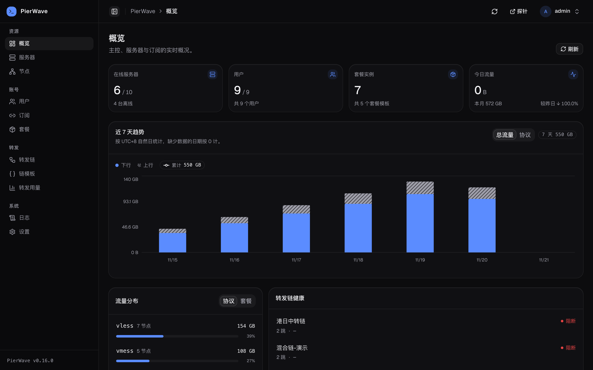
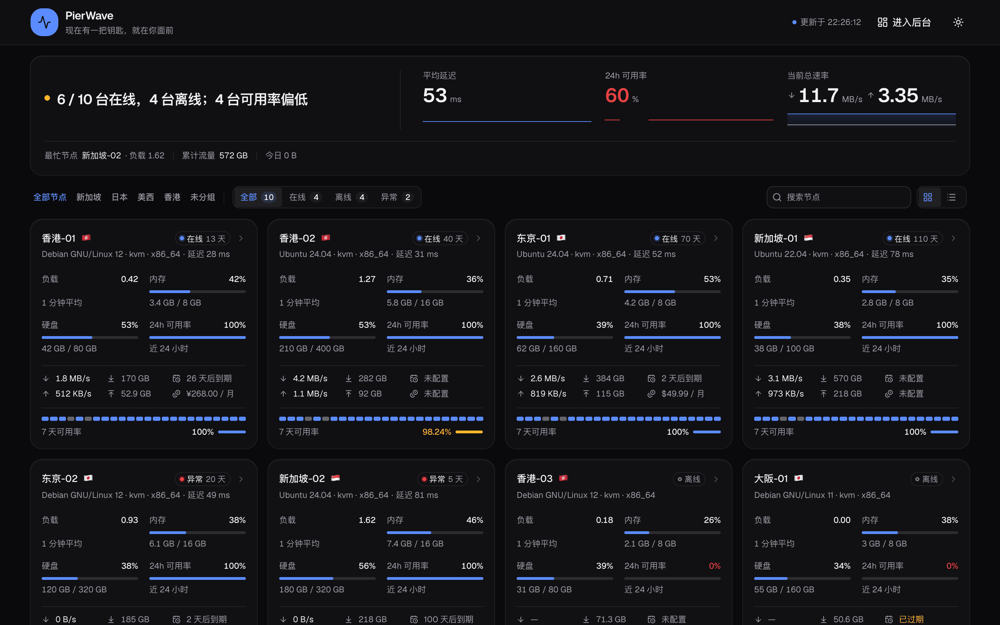
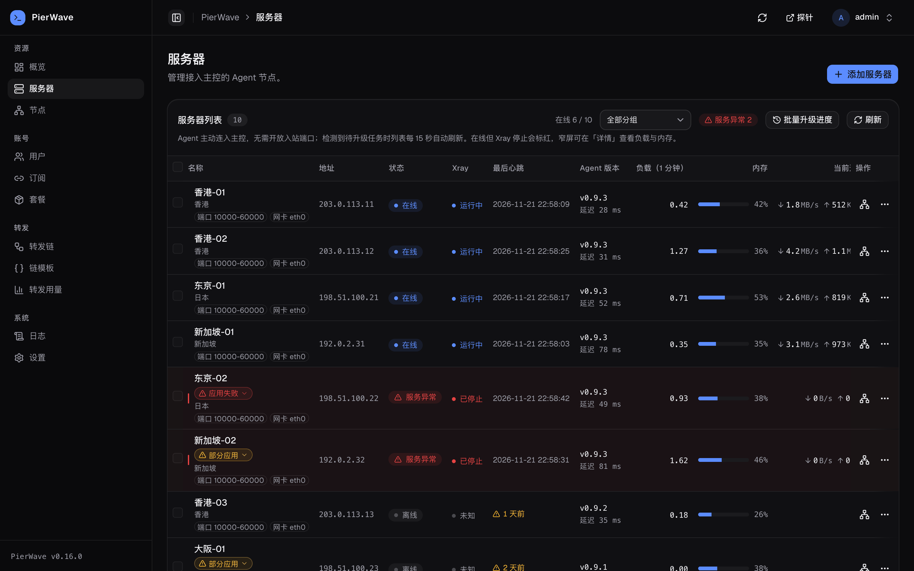
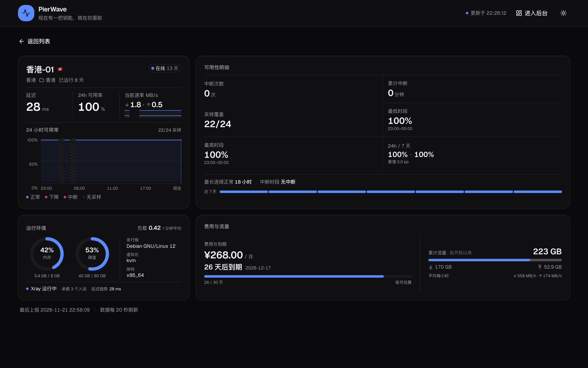
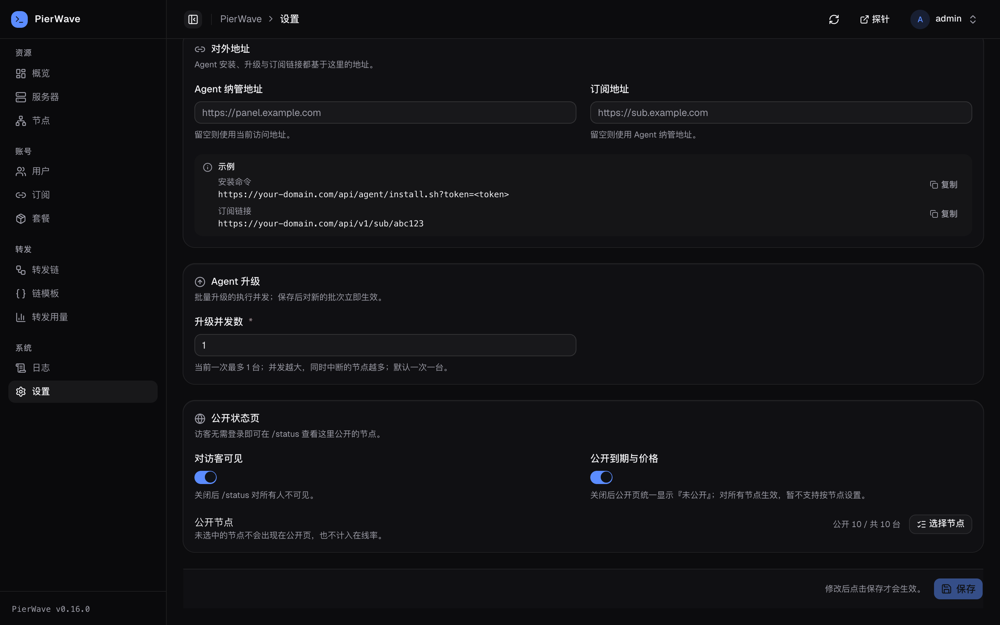
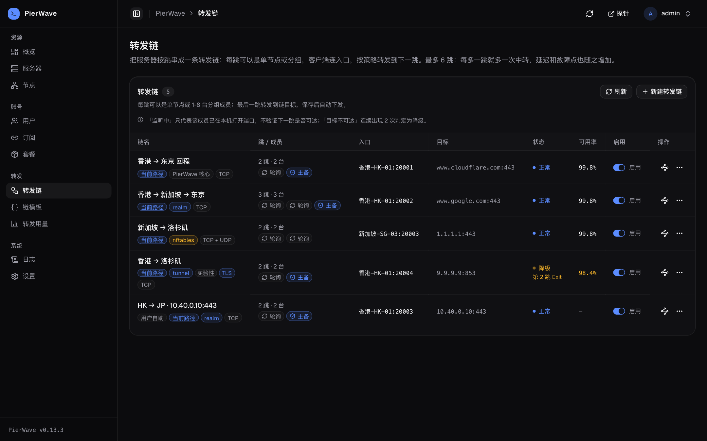
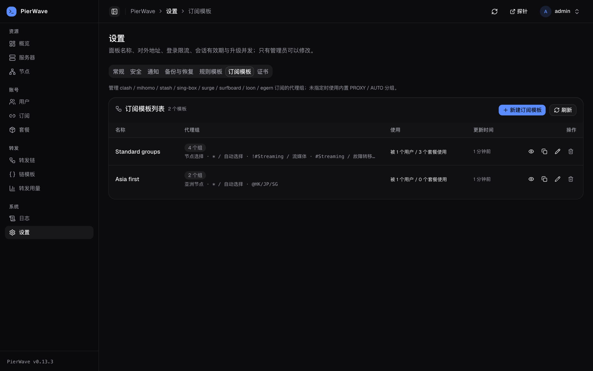
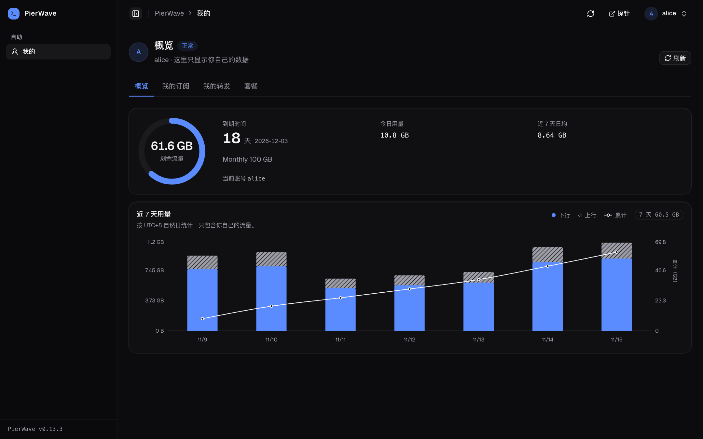
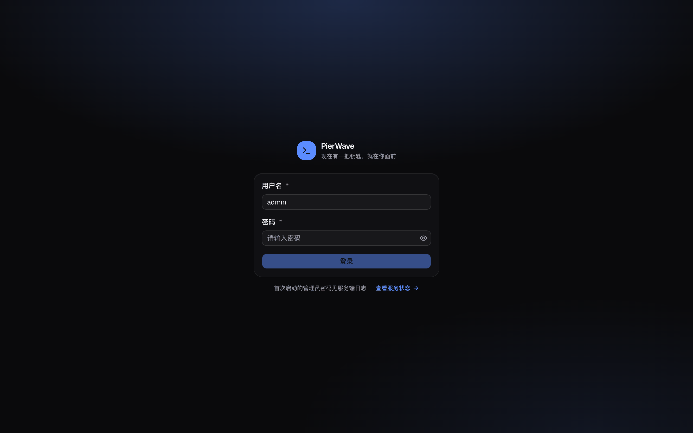

# PierWave

[English](README.md) | **简体中文**

用 Rust 写的 Xray 代理面板：主控（master）+ Agent + Web UI。Agent 反向连入主控，服务器不必开放管理端口，
配置以期望态下发并由 Agent 收敛，NAT 后的机器也能管。主控与 Agent 都是单二进制。



## 它解决什么

多机跑 Xray，麻烦的不是装 Xray，而是节点与用户怎么对应、流量怎么算、用完怎么断；PierWave 把这些收进一个控制面：

- **只有 Agent 连出来**：WebSocket 反向连接，不在每台服务器上开管理端口，也不怕 NAT。
- **下发期望态**：主控给完整配置，Agent 校验、备份、原子替换，失败回滚；没有逐条命令 RPC。
- **凭据是派生的**：每个「用户 × 节点」的 UUID 由 HMAC 派生，不存表；订阅与服务端配置同源。

## 功能

### 服务器与 Agent
- 建服务器时发一次性 token（只存哈希），安装命令只出现一次；丢失可重置令牌。
- Agent 反向 WebSocket 连入，心跳上报版本、负载、内存、磁盘、网卡与流量计数。
- 可绑定网卡、限定允许端口区间与额外端口、填写跳间内网地址；批量升级的产物走 Ed25519 签名与 SHA256 校验。

### 节点
- 协议 × 传输 × 安全层：vless / vmess / trojan / shadowsocks / socks / http，tcp / ws / grpc / http / h2 / quic / kcp / httpupgrade / xhttp，none / tls / reality。
- TLS 证书随期望态下发（私钥 0600），REALITY 公钥由私钥反推；节点可打标签、标地区、设带宽上限。
- NAT 部署可单独填对外端口：订阅与探测用 `public_port`，Agent 仍监听 `port`。

### 订阅
- 14 种客户端格式：clash / mihomo / stash / surge / egern / surfboard / loon / qx / singbox / uri / shadowrocket / v2ray，以及 singbox-full / surge-full。
- `?target=` 指定格式，否则按 UA 嗅探；响应带 `Subscription-Userinfo`，客户端直接显示流量与到期。
- 订阅模板把代理组变成声明式数据（select / url-test / fallback / load-balance，按标签、地区、协议筛选），规则模板可绑到用户或套餐。

### 用户与套餐
- 一个用户可挂多张套餐实例，各自额度、到期日、重置日；扣费按创建顺序瀑布分配。
- 方向（双向 / 仅上行 / 仅下行）× 节点倍率，换算口径只有一处实现。
- 额度用尽或到期会自动从服务器配置移除（断流），续费后对账恢复；过期实例可在概览批量续期，超额用户可批量停用。

### 转发与链
- 四种引擎：native（Agent 自建转发）、realm（受管子进程）、nftables（内核 DNAT）、tunnel（自研 TLS/Noise 帧中继）。
- 1–6 跳，每跳可单机或分组；六种选路：轮询、主备、最低延迟、IP 哈希、加权、最少连接。
- 入口与中间端口自动分配，链模板 + 用户自助建链；单跳转发同样做流量计量与日表对账。

### 可观测
- 概览汇总在线率、今日/本月流量、协议分布与趋势、Top 服务器与用户、链路健康。
- 公开探针页无需登录：24h/7d 可用率、负载/内存/磁盘、当前速率与累计流量，可整体关闭。
- 速率由心跳的网卡计数差分算出，可用率是 TCP 探测成功率的近似；告警走 Telegram / Webhook，6 类事件带冷却去抖。

### 运维
- 备份是 SQLite 单文件快照（VACUUM INTO + gzip），可定时上传 WebDAV，并按保留份数清理自己的文件。
- 版本更新检测覆盖主控与 Agent 版本分布，审计日志记录管理动作；另有只读 MCP stdio 服务与管理员 Telegram Bot（`/status`、`/servers`、`/user`、`/chain`）。

## 架构

```
        浏览器 / 订阅客户端
               │ HTTPS
       ┌───────▼─────────────────────────────┐
       │ pierwave-master                     │
       │ axum API · SPA · 订阅渲染 · 调度器   │
       └───────┬─────────────────────▲───────┘
               │ 期望态 + 文件        │ 心跳 / 流量 / 探测
               │ （Agent 反向 WS）    │
       ┌───────▼────────┐    ┌────────┴────────┐
       │ pierwave-agent │    │ pierwave-agent  │
       └───────┬────────┘    └────────┬────────┘
               │ 本地 stats API        │
           xray-core               xray-core
```

主控只生成 DesiredState：节点配置、证书文件、转发与隧道。Agent 先跑 `xray -test`，
按目标权限落盘证书，再原子替换配置，失败保留旧配置；心跳只上报事实，Agent 侧唯一的动作是「收敛到期望态」。

### Crate 划分

| Crate | 职责 |
|---|---|
| `pierwave-proto` | 主控↔Agent 线协议、跨端 DTO |
| `pierwave-common` | 主控与 Agent 共用的底层工具：私有文件权限、发布验签/校验和、可翻译错误 |
| `pierwave-domain` | 数据模型、SQL 与业务规则；re-export `pierwave-common` |
| `pierwave-master` | axum API、鉴权、SPA 静态资源 |
| `pierwave-agent` | 收敛器、进程监督、上报；只依赖 `common` + `proto`，**不依赖** `domain`；自 0.19.x 起在 [pierwave-agent](https://github.com/jacob-bytes/pierwave-agent) 按独立 `v*` 版本线发布 |
| `pierwave-mcp` | 只读 MCP stdio 服务 |

Agent 不依赖 `pierwave-domain`：它只共享 `pierwave-common`，因此不带主控的 SQL/tokio 依赖。
自 0.19.x 起它在独立仓库按自己的 `v*` 版本线发布；主仓保留 `crates/agent` 源码用于 e2e 与验证，
不再随主控发布。

## 界面

| 公开探针 | 服务器 |
|---|---|
|  |  |

| 节点详情 | 设置 |
|---|---|
|  |  |

| 转发链 | 订阅模板 |
|---|---|
|  |  |

用户端只返回当前登录用户的数据：额度、订阅链接、自助转发、套餐与登录设备。

| 用户端 | 登录页 |
|---|---|
|  |  |

## 快速开始

### Docker
```bash
git clone https://github.com/jacob-bytes/pierwave.git && cd pierwave
cp .env.example .env      # 填 PIERWAVE_ADMIN_PASSWORD
docker compose up -d
```

面板在 `http://<主机>:8787`；数据库与 Agent 发布缓存都在 `./data`（bind mount），重建容器不丢数据。
Agent 不要放进容器：它要守护宿主机的 xray 进程与 systemd 服务。

### systemd
```bash
git clone https://github.com/jacob-bytes/pierwave.git && cd pierwave
sudo bash scripts/install.sh install
sudo scripts/install.sh status
```

脚本会校验发布产物（Ed25519 签名 + SHA256）、写 systemd unit、生成管理员密码并打印一次，
启动后做健康检查。后续：

```bash
sudo scripts/install.sh upgrade
sudo scripts/install.sh uninstall --purge   # 连数据一起删，谨慎
```

文件位置：二进制 `/usr/local/bin/pierwave-master`、配置 `/etc/pierwave/pierwave.env`（0600）、数据 `/var/lib/pierwave`、unit `pierwave-master.service`。

### 安装 Agent
在面板「服务器 → 添加」复制一次性命令，到目标主机执行：

```bash
curl -fsSL https://<主控地址>/api/agent/install.sh?token=<token> | sudo bash
```

脚本按架构下载 Agent、写 `/etc/pierwave-agent/config.toml`（0600）、装 systemd 并启动。
预编译的 Linux 二进制（musl，x86_64 / aarch64）在
[pierwave-agent](https://github.com/jacob-bytes/pierwave-agent/releases) 仓库发布，主控的
安装/升级中转默认也从那里回源；把 `pierwave-agent-<target>` 放进 `PIERWAVE_AGENT_DIST`
指向的目录即可离线安装。

端口、数据库、前端目录等环境变量与反代要求见 [docs/DEPLOY.md](docs/DEPLOY.md)。

## 安全说明

服务器 token 只存哈希；每个「用户 × 节点」凭据由 HMAC 派生；链路证书或能力不满足时整链拒绝下发
（fail closed），绝不回落到明文。

## 文档

- [部署与运维](docs/DEPLOY.md)
- [备份与秘密加密](docs/BACKUP_ENCRYPTION.md)
- [施工计划](docs/PLAN.md)
- [流量计量](docs/METERING.md)
- [订阅与客户端格式](docs/SUBSCRIBE.md)
- [转发链模板与用户自助](docs/CHAIN-TEMPLATES.md)
- [实时速率与可用率](docs/TELEMETRY.md)
- [错误码](docs/ERRORS.md)
- [只读 MCP](docs/MCP.md)

## 开发

```bash
make check    # fmt + clippy(-D warnings) + test + web build + web test
make e2e      # 起真实 master + agent，验证下发、计量、订阅闭环
make size     # 查看各部分构建缓存占用
make clean    # 删除 target/ 与 web/dist，保留离线依赖缓存
```

`target/` 会随每次构建和每个交叉编译目标增长；工作区涨到几十 GB 时，先用
`make size` 看是哪里，再用 `make clean` 回收。**保留 `.cargo-home/`**——它是
离线依赖缓存，在受限网络下重建代价很高。

工程约定见 [AGENTS.md](AGENTS.md)；用户自助转发见 [docs/USER-FORWARDS.md](docs/USER-FORWARDS.md)。

## 许可证与贡献

[AGPL-3.0](LICENSE)。可以自建、修改、再分发；如果把修改版作为网络服务对外提供，需按 AGPL-3.0 公开修改。商业授权请联系维护者。
提交前请读 [CONTRIBUTING.md](CONTRIBUTING.md)：提交 PR 即表示同意以 AGPL-3.0 授权，并授予维护者再许可权。
