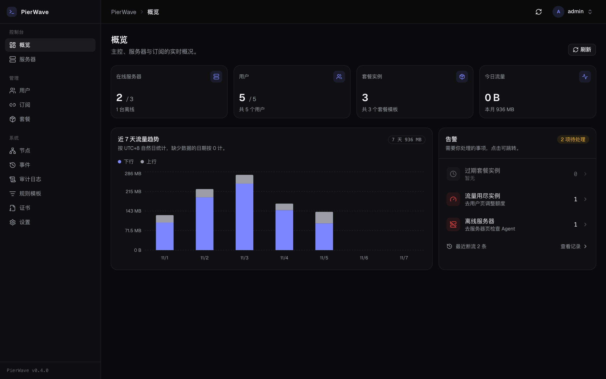
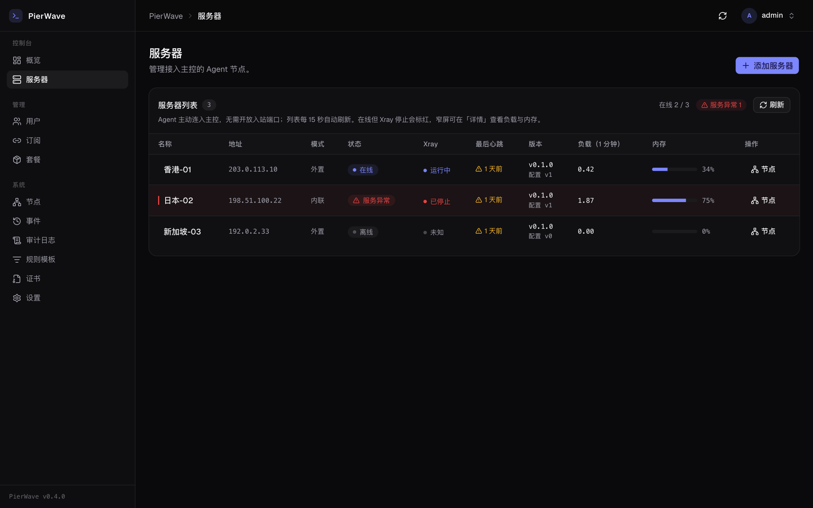
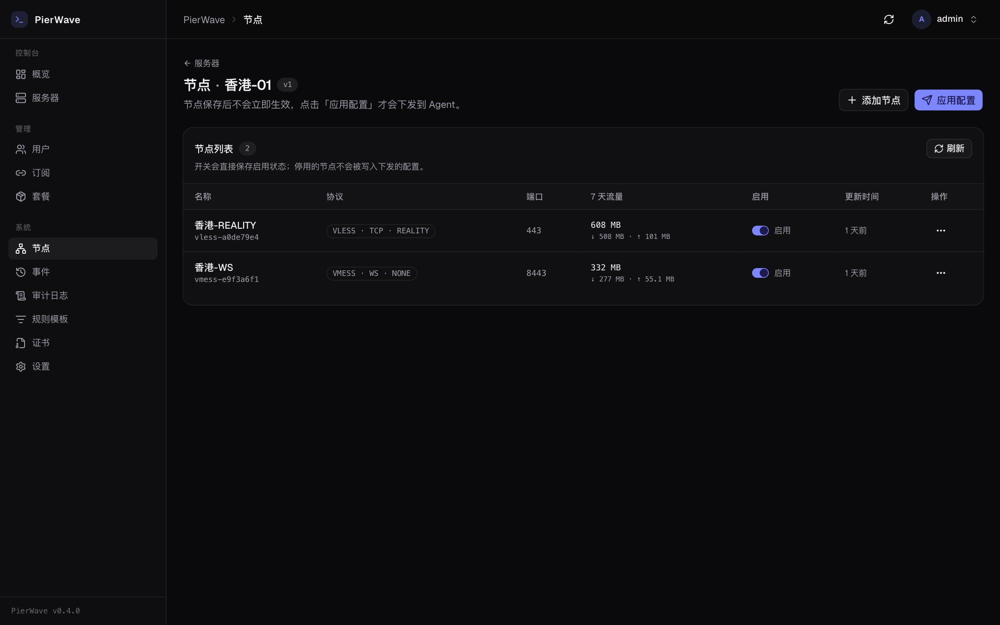
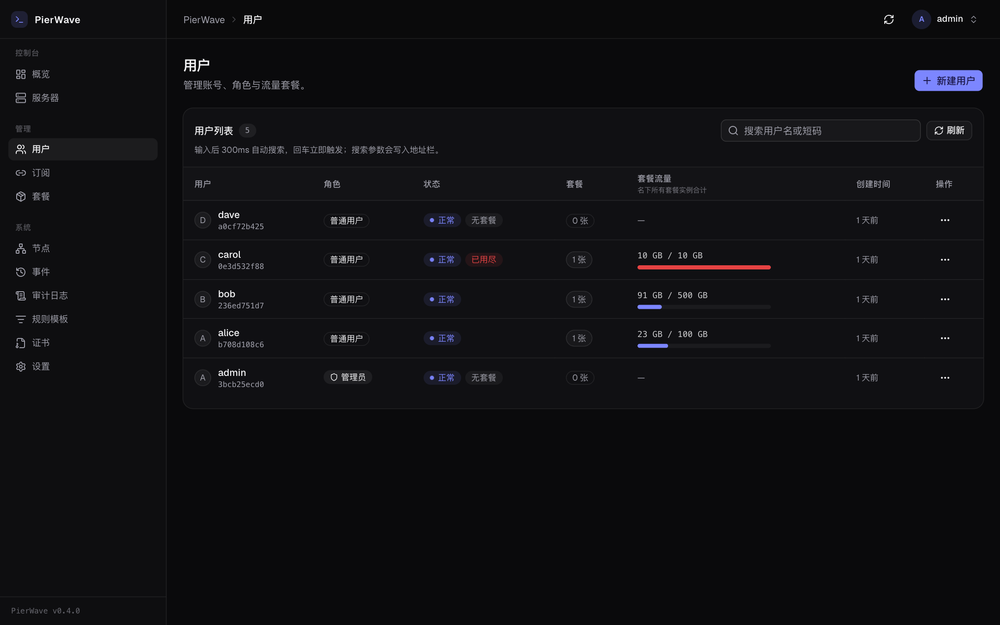
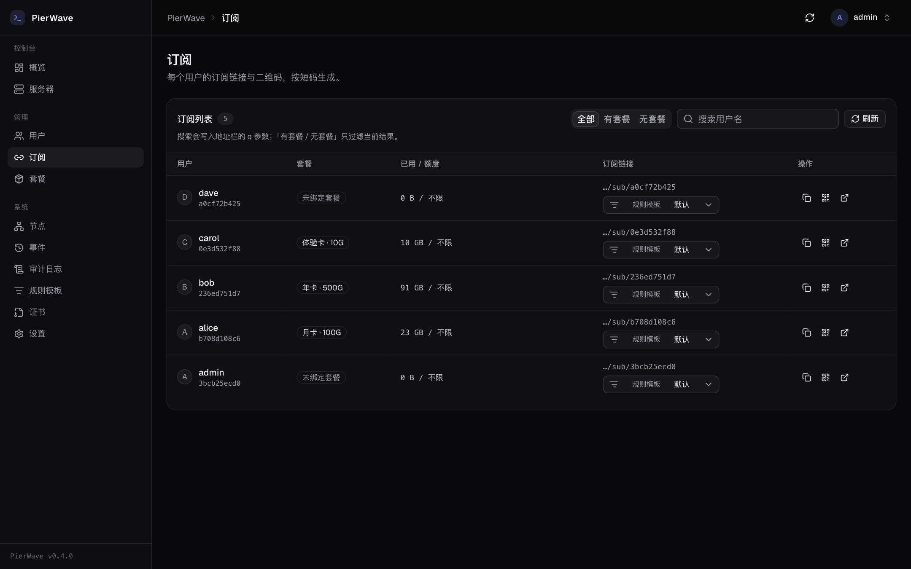
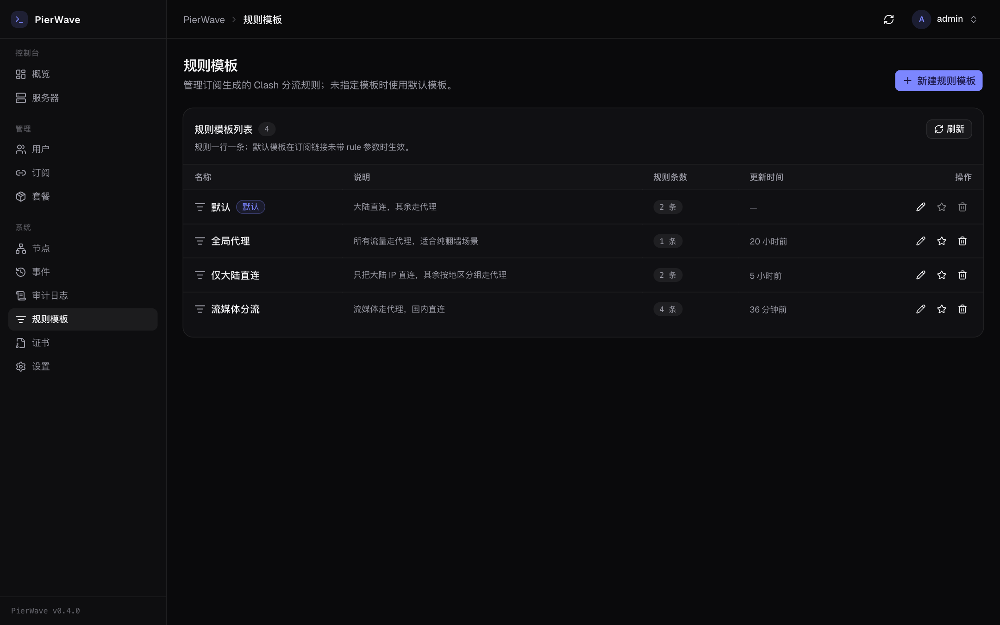
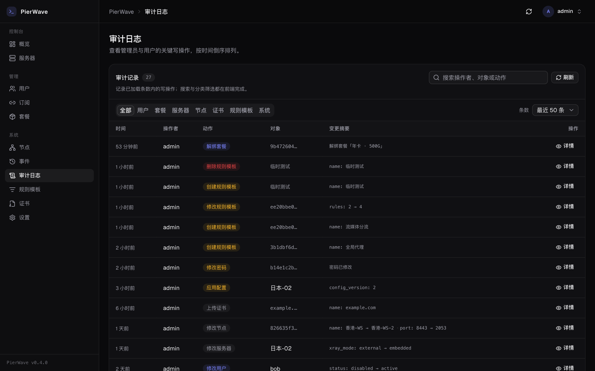
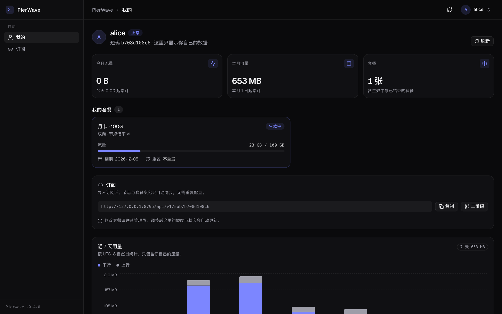

# PierWave

[English](README.md) | **简体中文**

Rust 写的 Xray 代理控制面：**主控 + Agent 分离**，Agent 反向连入，服务器不需要开放任何入站端口。
面板、订阅分发、流量计费、超额断流在一套二进制里跑完。



## 它解决什么

多台服务器跑 Xray 时，真正麻烦的不是装 Xray，而是：谁在跑哪个节点、给谁用了多少流量、用完了怎么断。
PierWave 把这些收进一个控制面：

- **服务器只管连出来** —— Agent 主动连主控（WebSocket），不用在每台机器上开管理端口，也不怕 NAT
- **配置是期望态** —— 主控下发完整配置，Agent 校验（`xray -test`）→ 备份 → 原子替换 → 失败回滚
- **凭据是派生的** —— 每个「用户 × 节点」的 UUID 由 HMAC 派生，不用存表；同一份值同时出现在订阅和服务端配置里
- **计费有唯一口径** —— Xray stats → 增量 → 方向×节点倍率加权 → 日账本；超额自动断流，续费 30 秒内恢复
- **订阅开箱可用** —— Clash/mihomo YAML 与 URI 两种输出，带 `Subscription-Userinfo` 流量头

## 架构

```
        ┌─────────── pierwave-master ───────────┐
        │  axum API · 会话鉴权 · 静态 SPA         │
        │  订阅渲染 · 计费账本 · 断流对账         │
        └───────▲───────────────────┬───────────┘
                │ 期望态 / 心跳 / 流量 │ WebSocket（反向连入）
        ┌───────┴────────┐   ┌──────▼─────────┐
        │ pierwave-agent │   │ pierwave-agent │
        │ 收敛器 + 监督   │   │ ...            │
        └───────┬────────┘   └────────────────┘
                │ 本地 gRPC :10085
             xray-core
```

| crate | 职责 |
|---|---|
| `crates/proto` | 主控 ↔ Agent 线协议，版本化、只增不改 |
| `crates/domain` | 数据模型、SQL、业务规则（不依赖 axum） |
| `crates/master` | HTTP API、鉴权、SPA 托管、Agent WS |
| `crates/agent` | 连主控、收敛配置、上报心跳与流量 |
| `web` | React 19 + TypeScript + Tailwind 4 + shadcn/ui |

## 界面

| 服务器 | 节点 |
|---|---|
|  |  |

| 用户 | 订阅 |
|---|---|
|  |  |

| 规则模板 | 审计日志 |
|---|---|
|  |  |

| 用户自助 |
|---|
|  |

## 快速开始

```bash
make web-install      # 首次：装前端依赖
make web-build        # 产出 web/dist（master 直接托管）
make run              # http://127.0.0.1:8787
```

首次启动创建管理员 `admin`，密码打印在日志里（或启动前设 `PIERWAVE_ADMIN_PASSWORD`）。
开发时热更新：`make web-dev`（:5173，`/api` 已代理）。

### 接入一台服务器

面板「服务器 → 添加」拿到一次性 token，在目标机执行：

```bash
curl -fsSL http://<主控地址>/api/agent/install.sh?token=<token> | sudo bash
```

脚本按架构下载 agent、写 `/etc/pierwave-agent/config.toml`（0600）、装 systemd 并启动。

预编译的 Linux 二进制（musl，x86_64 / aarch64）发布在
[Releases](https://github.com/jacob-bytes/pierwave/releases) 页。把 `pierwave-agent-<target>`
放进 `PIERWAVE_AGENT_DIST` 指向的目录，安装命令即可直接使用。
从源码交叉编译的步骤见 [docs/DEPLOY.md](docs/DEPLOY.md)。

## 配置（master）

| 变量 | 默认 | 说明 |
|---|---|---|
| `PIERWAVE_ADDR` | `127.0.0.1:8787` | 监听地址 |
| `PIERWAVE_DB` | `sqlite://data/pierwave.db?mode=rwc` | 数据库 |
| `PIERWAVE_WEB_DIR` | `web/dist` | SPA 产物 |
| `PIERWAVE_ADMIN_PASSWORD` | 随机 | 仅首次建库生效 |
| `PIERWAVE_AGENT_DIST` | 未设置 | agent 二进制目录 |
| `PIERWAVE_ENFORCE` | 开 | `0` 关闭超额断流 |

登录限流阈值、会话有效期、面板名称在「设置」页改，存库、不用重启。

## 状态

已可用：节点/入站管理、期望态下发与回滚、用户与套餐实例（多卡独立额度）、订阅分发、
流量计量与断流、证书上传与部署、审计日志（含界面）、可配置的订阅规则模板、用户自助页、中英文界面。

未做：ACME 自动签发、按用户限速、nginx 证书部署、多主控/高可用。
证书目前需手动上传；纯 IP:port 部署建议用 REALITY（不需要证书）。

## 开发

```bash
make check    # fmt + clippy(-D warnings) + test + web build
make e2e      # 端到端：起 master + agent，验证下发、计量、订阅闭环
```

工程约定见 [AGENTS.md](AGENTS.md)，设计文档在 `docs/`（[PLAN](docs/PLAN.md) · [METERING](docs/METERING.md) · [SUBSCRIBE](docs/SUBSCRIBE.md) · [CERTS](docs/CERTS.md) · [DEPLOY](docs/DEPLOY.md)）。

## 许可证

[AGPL-3.0](LICENSE)。

你可以自建、修改、二次分发；但如果把 PierWave（或它的修改版）作为网络服务对外提供，
必须按 AGPL-3.0 公开你的修改。商业授权请联系维护者。

贡献代码前请阅读 [`CONTRIBUTING.md`](CONTRIBUTING.md)：提交即表示同意以 AGPL-3.0 授权，
并授予维护者再许可权。
