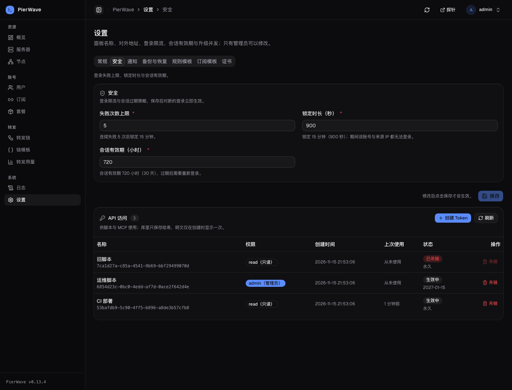
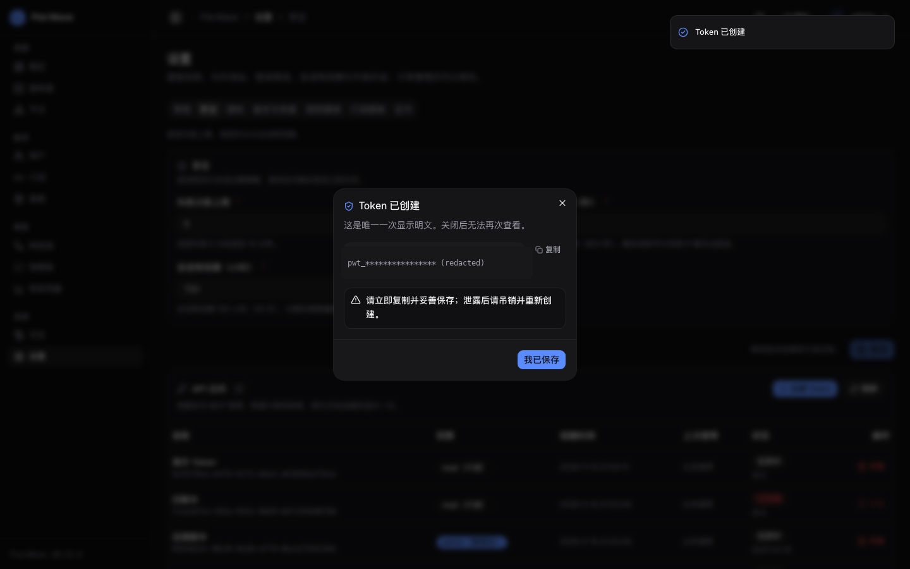

# API Token / API tokens

[简体中文](#简体中文) | [English](#english)

---

## 简体中文

API Token 用于脚本、CI 与 MCP 等非浏览器客户端。它和浏览器 Cookie 会话**并行**：
同一个 `Authorization: Bearer pwt_...` 既能访问 `/api/v1/*`，也能访问 `/mcp`。

### 创建与保管

- 明文格式：`pwt_` + 64 位十六进制（两个 UUIDv4），只在创建响应里出现一次；
- 库里只存 `SHA-256(明文)` 的十六进制，和 Agent token / 会话 token 同一种方式；
- 列表接口不会返回明文或哈希；忘记后只能吊销并重新创建。

### 接口

| 方法 | 路径 | 说明 |
|---|---|---|
| `GET` | `/api/v1/api-tokens` | 列表（名称、scope、创建/上次使用/过期/吊销时间）；仅管理员 |
| `POST` | `/api/v1/api-tokens` | `{ name, scope, expires_at? }` → `{ token, item }`，`token` 仅此一次；仅管理员 |
| `DELETE` | `/api/v1/api-tokens/{id}` | 吊销（幂等）；仅管理员 |

`scope` 只能是：

| scope | 权限 |
|---|---|
| `read`（默认） | 只能访问**非敏感** `GET`/`HEAD`/`OPTIONS`；写操作返回 `403 api_token.read_only`，敏感 GET 返回 `403 api_token.sensitive_endpoint` |
| `admin` | 等同管理员会话，可读写 |

「仅管理员」指 Cookie 管理员或 **admin scope** 的 token；read scope 连 token 列表也不能看
（返回 `403 api_token.sensitive_endpoint`）。

### read 不等于「只读安全」：敏感 GET 也被拒绝

`read` 只表示「不写」，不表示「可以看所有数据」。以下路径对 read scope 一律返回
`403 api_token.sensitive_endpoint`（admin scope 不受影响）：

| 路径前缀 | 拒绝理由 |
|---|---|
| `/api/v1/backup`、`/api/v1/backup/info`、`/api/v1/backup/remote` | 整库导出、待恢复信息、远端备份文件列表 |
| `/api/v1/certificates` | 证书库存与元数据（当前不返回 PEM/私钥，防御性拒绝） |
| `/api/v1/audit` | 管理动作、操作者与目标 |
| `/api/v1/settings` | 含明文 Telegram Bot Token、chat id 与 Webhook 地址 |
| `/api/v1/api-tokens` | token 元数据；管理本身要求 admin scope |
| `/api/v1/servers`、`/api/v1/nodes`、`/api/v1/outbounds` | 服务器地址、节点/出站配置（可能含客户端凭据、Reality 私钥、上游账号密码） |
| `/api/v1/forwards`、`/api/v1/chains`、`/api/v1/chain-templates`、`/api/v1/routing-rules` | 转发目标、链拓扑与路由编排 |
| `/api/v1/users`、`/api/v1/subscriptions` | 用户清单与订阅短码（短码本身就是订阅凭据） |

匹配规则是「等于前缀或以 `前缀/` 开头」，所以 `/api/v1/servers/{id}/nodes`
也会被拒绝，而 `/api/v1/overview`、`/api/v1/stats/*`、`/api/v1/forward-traffic`
等聚合/统计接口仍可读。名单集中定义在 `crates/master/src/auth.rs` 的
`SENSITIVE_READ_PREFIXES`；新增敏感 GET 时把前缀加进这个常量即可。

### 鉴权与限流

- 请求头：`Authorization: Bearer pwt_...`；
- 无效、已过期、已吊销 → `401 api_token.invalid`；
- 每个 token 每分钟 120 次（普通 API 与 `/mcp` 共用额度），超出 → `429 api_token.rate_limited`
  （带 `Retry-After`）；
- `last_used_at` 在内存里聚合，每 10 秒批量写回一次库，不在每个请求上写 SQLite。

### 审计

`api_token.create` 与 `api_token.revoke` 只记录名称、scope、过期时间与目标 id；
**不记录明文，也不记录哈希**。

### curl 示例

```bash
# 创建（用管理员 Cookie 或 admin scope token）
curl -s -b cookie.txt -X POST http://127.0.0.1:8787/api/v1/api-tokens \
  -H 'Content-Type: application/json' \
  -d '{"name":"CI","scope":"read"}'

# 读：脚本用 Bearer
curl -s -H "Authorization: Bearer pwt_..." http://127.0.0.1:8787/api/v1/settings

# 写：read scope 会 403 api_token.read_only
curl -s -X PATCH -H "Authorization: Bearer pwt_..." \
  -H 'Content-Type: application/json' \
  -d '{"panel_name":"x"}' http://127.0.0.1:8787/api/v1/settings
```

### 界面





MCP 的 HTTP 接入见 [MCP.md](./MCP.md#http-接入streamable-http)。

---

## English

API tokens are for scripts, CI and MCP clients. They work **alongside** browser
cookie sessions: the same `Authorization: Bearer pwt_...` header works for both
`/api/v1/*` and `/mcp`.

### Creation and storage

- Plaintext format: `pwt_` + 64 hex characters (two UUIDv4s), returned once at
  creation only;
- only `SHA-256(plaintext)` in hex is stored — the same approach as agent and
  session tokens;
- list responses never contain the plaintext or the hash. If lost, revoke and
  create a new one.

### Endpoints

| Method | Path | Behavior |
|---|---|---|
| `GET` | `/api/v1/api-tokens` | List (name, scope, created/last used/expires/revoked); administrators only |
| `POST` | `/api/v1/api-tokens` | `{ name, scope, expires_at? }` → `{ token, item }`; `token` is shown once; administrators only |
| `DELETE` | `/api/v1/api-tokens/{id}` | Revoke (idempotent); administrators only |

`scope` is one of:

| scope | Permission |
|---|---|
| `read` (default) | Only **non-sensitive** `GET`/`HEAD`/`OPTIONS`; writes return `403 api_token.read_only`, sensitive GETs return `403 api_token.sensitive_endpoint` |
| `admin` | Equivalent to an administrator session; read and write |

"Administrators only" means an administrator cookie session or an **admin-scoped**
token. A read-scoped token cannot even list tokens
(`403 api_token.sensitive_endpoint`).

### read is not "read-only safe": sensitive GETs are denied too

`read` means "cannot write", not "can read everything". The following paths return
`403 api_token.sensitive_endpoint` for read-scoped tokens (admin-scoped tokens are
unaffected):

| Path prefix | Why it is denied |
|---|---|
| `/api/v1/backup`, `/api/v1/backup/info`, `/api/v1/backup/remote` | Full DB export, pending-restore info, remote backup file list |
| `/api/v1/certificates` | Certificate inventory/metadata (no PEM/private key today; denied defensively) |
| `/api/v1/audit` | Admin actions, actors and targets |
| `/api/v1/settings` | Contains the plaintext Telegram bot token, chat ids and webhook URL |
| `/api/v1/api-tokens` | Token metadata; management itself requires admin scope |
| `/api/v1/servers`, `/api/v1/nodes`, `/api/v1/outbounds` | Server addresses and node/outbound configs (may contain client credentials, Reality keys, upstream passwords) |
| `/api/v1/forwards`, `/api/v1/chains`, `/api/v1/chain-templates`, `/api/v1/routing-rules` | Forward targets, chain topology and routing topology |
| `/api/v1/users`, `/api/v1/subscriptions` | User inventory and subscription short codes (a short code is itself a subscription credential) |

Matching is "equal to the prefix or starts with `prefix/`", so
`/api/v1/servers/{id}/nodes` is denied too, while aggregate endpoints such as
`/api/v1/overview`, `/api/v1/stats/*` and `/api/v1/forward-traffic` remain readable.
The list lives in `SENSITIVE_READ_PREFIXES` in `crates/master/src/auth.rs`; add new
sensitive GETs there.

### Auth and rate limiting

- Header: `Authorization: Bearer pwt_...`;
- invalid, expired or revoked → `401 api_token.invalid`;
- 120 requests per minute per token (shared by the regular API and `/mcp`); over
  the limit → `429 api_token.rate_limited` with `Retry-After`;
- `last_used_at` is aggregated in memory and flushed every 10 seconds, so the hot
  path never writes SQLite per request.

### Audit

`api_token.create` and `api_token.revoke` record the name, scope, expiry and
target id only. **Neither the plaintext nor the hash is audited.**

### curl examples

```bash
# Create (administrator cookie or admin-scoped token)
curl -s -b cookie.txt -X POST http://127.0.0.1:8787/api/v1/api-tokens \
  -H 'Content-Type: application/json' \
  -d '{"name":"CI","scope":"read"}'

# Read via Bearer
curl -s -H "Authorization: Bearer pwt_..." http://127.0.0.1:8787/api/v1/settings

# Write with a read-scoped token → 403 api_token.read_only
curl -s -X PATCH -H "Authorization: Bearer pwt_..." \
  -H 'Content-Type: application/json' \
  -d '{"panel_name":"x"}' http://127.0.0.1:8787/api/v1/settings
```

### UI


For the MCP HTTP transport see [MCP.md](./MCP.md#http-access-streamable-http).
