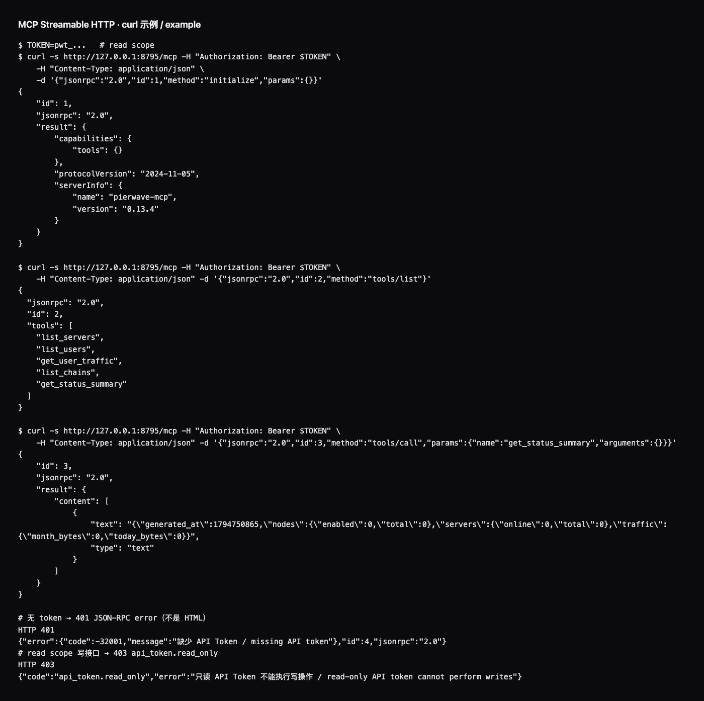

# PierWave MCP（只读服务）

[简体中文](#简体中文) | [English](#english)

---

## 简体中文

`pierwave-mcp` 是一个 **只读** 的 [MCP](https://modelcontextprotocol.io/) stdio 服务：
它通过逐行 JSON-RPC 2.0 与 MCP 客户端通信，直接以只读方式打开主控的 SQLite 数据库，
提供 5 个查询工具。stdio 模式不经过主控 HTTP API；HTTP 模式由主控的 `POST /mcp` 暴露同一套只读工具。两种模式都没有任何写入、重启或下发配置的能力。

### 构建

```bash
cargo build --release -p pierwave-mcp
# 产物：target/release/pierwave-mcp
```

本仓库的沙箱把 cargo 缓存指到了仓库内；在这一环境下请显式带上缓存目录：

```bash
CARGO_HOME=$PWD/.cargo-home cargo build --release -p pierwave-mcp
```

运行测试：

```bash
CARGO_HOME=$PWD/.cargo-home cargo test -p pierwave-mcp
```

### 运行

```bash
# 显式指定数据库
pierwave-mcp --db ./data/pierwave.db

# 或读取环境变量（主控也使用同名变量，值可以是路径或 sqlite:// URL）
PIERWAVE_DB=./data/pierwave.db pierwave-mcp

# 都没有时回落到 data/pierwave.db
pierwave-mcp
```

参数：

| 参数 | 说明 |
|---|---|
| `--db <path>` | 主控 SQLite 文件路径；也接受 `sqlite://...?mode=rwc` 形式（查询串会被忽略，强制只读） |
| `-h`, `--help` | 显示双语帮助 |
| `-V`, `--version` | 显示版本 |

启动时会检查文件存在，并以 `SQLITE_OPEN_READONLY`（等价于 `?mode=ro`）打开；文件不存在
会直接失败并给出中英双语提示。stdout 只输出 JSON-RPC，日志全部走 stderr。

### 配置到 MCP 客户端

Claude Desktop（`claude_desktop_config.json`）或 Cursor（`~/.cursor/mcp.json`）示例：

```json
{
  "mcpServers": {
    "pierwave": {
      "command": "/absolute/path/to/pierwave-mcp",
      "args": ["--db", "/absolute/path/to/data/pierwave.db"]
    }
  }
}
```

用环境变量传路径：

```json
{
  "mcpServers": {
    "pierwave": {
      "command": "/absolute/path/to/pierwave-mcp",
      "env": {
        "PIERWAVE_DB": "/absolute/path/to/data/pierwave.db"
      }
    }
  }
}
```

任何支持 stdio MCP 的客户端都可以直接启动该命令。传输格式是**一行一个 JSON 对象**，
每个请求的响应也是一行。

单行上限 **1 MiB**（含行尾换行符）。超限时服务端丢弃该行、返回一条
`error.code = -32700`、`id = null` 的 JSON-RPC 错误，然后**继续服务**（不退出）：
一条超大的通知不该杀死长期运行的 MCP 进程，客户端收到错误后可自行重试。
错误详情（SQL、表名、列名等）只写 stderr，不会出现在协议响应里。

### HTTP 接入（Streamable HTTP）

不能启动本地进程的 MCP 客户端可以直接连主控的 `POST /mcp`。它和 stdio 模式
共用同一套工具实现与结果形状，只是把传输换成了 HTTP。

- **认证**：`Authorization: Bearer pwt_...`。token 在「设置 → 安全 → API 访问」创建，
  明文只显示一次；库里只存 SHA-256 哈希。
- **scope：必须是 `admin`**。这 5 个工具虽然只读，但返回服务器地址、用户清单与链拓扑，
  和 REST 的敏感 GET 是同一份数据。**read token 只能走 REST 的非敏感 GET，不能用于 MCP**：
  用 read scope 调用 `/mcp`（含 `initialize` / `tools/list` / `tools/call`）一律返回 `403`
  JSON-RPC 错误，`error.data.code = "api_token.mcp_requires_admin"`。缺失、无效、过期或
  已吊销返回 `401`；scope 被改成未知值同样按「不是 admin」拒绝。
- **传输**：一次 POST 一条 JSON-RPC 消息。请求返回 `application/json`；
  通知（没有 `id`）返回 `202` + 空 body。不提供服务端 SSE 流。
- **错误形状**：认证、限流、解析错误全部是 JSON-RPC `error` 对象，不会出现 HTML 错误页。
  实现自定义错误码：`-32001` 未认证、`-32003` scope 不足、`-32004` 限流、`-32005` 方法不允许。
  需要区分的业务错误会额外带 `error.data.code`（例如 `api_token.mcp_requires_admin`）。
- **限流**：每个 token 每分钟 120 次，与普通 API 共用额度；超出返回 `429`，
  带 `Retry-After` 头，`error.code = -32004`。

```bash
TOKEN=pwt_xxxxxxxxxxxxxxxxxxxxxxxxxxxxxxxxxxxxxxxxxxxxxxxxxxxxxxxxxxxxxxxx

# initialize
curl -s http://127.0.0.1:8787/mcp \
  -H "Authorization: Bearer $TOKEN" \
  -H "Content-Type: application/json" \
  -d '{"jsonrpc":"2.0","id":1,"method":"initialize","params":{}}'

# tools/list
curl -s http://127.0.0.1:8787/mcp \
  -H "Authorization: Bearer $TOKEN" \
  -H "Content-Type: application/json" \
  -d '{"jsonrpc":"2.0","id":2,"method":"tools/list"}'

# tools/call
curl -s http://127.0.0.1:8787/mcp \
  -H "Authorization: Bearer $TOKEN" \
  -H "Content-Type: application/json" \
  -d '{"jsonrpc":"2.0","id":3,"method":"tools/call","params":{"name":"list_servers","arguments":{}}}'
```



#### HTTP 的工具复用方式与取舍

HTTP 入口**没有**另写一套查询：

1. `crates/mcp/src/tools.rs` 继续拥有工具目录、参数校验与派发；
2. 主控把现有的 `SqlitePool` 包成 `pierwave_mcp::Database`（`Database::from_pool`），
   再调用同一个 `Server::handle_message`；
3. master 里没有任何 SQL，工具 SQL 仍然只出现在 `crates/mcp/src/db.rs`（全部 `SELECT`）。

代价是 master 依赖 `pierwave-mcp` 这个轻量 crate，且共享的是同一个连接池；
收益是 stdio 与 HTTP 的工具 schema、参数错误、返回字段**逐字节一致**，
不会出现两份会漂移的查询实现。`Database::from_pool` 只通过工具派发使用，
工具代码的只读性由 `db.rs` 的写关键字扫描测试兜底。

### 协议

实现 MCP 2024-11-05 的基础方法：

| 方法 | 说明 |
|---|---|
| `initialize` | 返回 `protocolVersion: "2024-11-05"`、`capabilities.tools`、`serverInfo` |
| `tools/list` | 返回 5 个工具及各自的 JSON Schema `inputSchema` |
| `tools/call` | 执行只读工具，结果放在 `content: [{ "type": "text", "text": "<JSON>" }]` |
| `notifications/initialized` 等通知 | 没有 `id` 的通知直接忽略，不产生响应 |

`initialize` 的真实响应（为便于阅读已格式化，实际是一行）：

```json
{
  "id": 1,
  "jsonrpc": "2.0",
  "result": {
    "capabilities": {
      "tools": {}
    },
    "protocolVersion": "2024-11-05",
    "serverInfo": {
      "name": "pierwave-mcp",
      "version": "0.5.10"
    }
  }
}
```

`tools/list` 返回的工具名固定为：

```text
list_servers
list_users
get_user_traffic
list_chains
get_status_summary
```

每个工具都有 `inputSchema`；无参工具也返回 `{"type":"object","properties":{}}`。

#### 错误码

| code | 场景 |
|---|---|
| `-32700` | 非法 JSON（Parse error），或 stdio 单行超过 1 MiB |
| `-32600` | 非法请求对象 / 缺少 `jsonrpc` 或 `method` |
| `-32601` | 未知方法（Method not found） |
| `-32602` | 未知工具、缺少/非法参数、未知用户名 |
| `-32603` | 数据库查询等内部错误 |

未知工具**不会**返回空结果，而是返回 `-32602`，并在 `message` 中列出可用工具。

### 工具

以下示例中的字节数均为整数；时间戳为 UTC Unix 秒；日期为 UTC+8 自然日。

三个列表工具（`list_servers` / `list_users` / `list_chains`）单次最多返回
**500 行**主记录（`list_users` 的一行是一个套餐实例）。`list_chains` 的组、
成员、健康状态查询各自也有 500 行上限，避免一条链把整份拓扑放大到不可控。
结果顶层带 `truncated` 布尔值：为 `true` 表示上述任一查询发生了截断，
调用方不能把它当成完整清单。`get_user_traffic` 的 `days` 上限 90 天，不受此限制。

#### `truncated`：客户端必须检查 / Clients must check `truncated`

三个列表工具的结果顶层**总是**带 `truncated` 字段：

```json
{ "servers": [ /* 最多 500 行 */ ], "truncated": true }
```

- `false`：本次结果在 500 行上限内，可以当成完整清单处理；
- `true`：至少一条底层查询被截断。返回的行可能不全，由这些行算出的分组数量 /
  成员数量 / 健康状态计数同样可能偏小；
- 这些工具**没有**分页、`offset` 或 `cursor` 参数：重试同一个请求不会拿到剩下的
  行。客户端应把结果标记为「不完整」并告知用户，不要把它当成全量清单继续做统计
  或破坏性操作；
- `get_user_traffic` 没有这个字段：它用 `days`（≤ 90）限制范围，不做行截断。

English: the three list tools always include a top-level `truncated` boolean.
`false` means the result stayed under the 500-row cap and can be treated as
complete. `true` means at least one underlying query was cut: rows may be
missing, and counts derived from those rows (groups, members, health) may be
low. There is no pagination / `offset` / `cursor` argument, so retrying the same
call will not fetch the rest — mark the result as incomplete and tell the user
instead of treating it as a full inventory. `get_user_traffic` has no such field
because it is bounded by `days` (max 90), not row truncation.

#### 1. `list_servers`

输入：无参数。

```json
{"name":"list_servers","arguments":{}}
```

输出字段：`id`、`name`、`address`、`online`、`xray_running`、`load1`、
`mem`（`{used,total}`）、`disk`（`{used,total}`）、`mem_used`、`mem_total`、
`disk_used`、`disk_total`、`latency_ms`、`last_seen`。
没有心跳数据的字段为 `null`。

```json
{
  "servers": [
    {
      "id": "srv-hk",
      "name": "香港-01",
      "address": "hk1.example.com",
      "online": true,
      "xray_running": true,
      "load1": 0.42,
      "mem": { "used": 1610612736, "total": 4294967296 },
      "disk": { "used": 21474836480, "total": 107374182400 },
      "mem_used": 1610612736,
      "mem_total": 4294967296,
      "disk_used": 21474836480,
      "disk_total": 107374182400,
      "latency_ms": 18,
      "last_seen": 1794138184
    }
  ]
}
```

#### 2. `list_users`

输入：无参数。

```json
{"name":"list_users","arguments":{}}
```

输出字段：`user_id`、`username`、`role`、`package`、`used_bytes`、`limit_bytes`、
`expires_at`、`status`。

- 一个套餐实例一行；同一用户有多张卡时会出现多行（`username` 相同、`package` 不同）。
- 没有任何套餐实例的用户也会有一行，`package` / `limit_bytes` / `expires_at` 为 `null`，
  `used_bytes` 取用户账户总量。
- `status` 的优先级为 `disabled` > `expired` > `exhausted` > `active`；
  `limit_bytes = 0` 表示显式不限，不会判成 `exhausted`。

```json
{
  "users": [
    {
      "user_id": "user-alice",
      "username": "alice",
      "role": "user",
      "package": "基础套餐",
      "used_bytes": 3221225472,
      "limit_bytes": 107374182400,
      "expires_at": 1795866184,
      "status": "active"
    },
    {
      "user_id": "user-bob",
      "username": "bob",
      "role": "user",
      "package": "基础套餐",
      "used_bytes": 1073741824,
      "limit_bytes": 107374182400,
      "expires_at": 1794570184,
      "status": "active"
    }
  ]
}
```

#### 3. `get_user_traffic`

输入：

```json
{"username":"alice","days":7}
```

- `username` 必填，精确匹配。
- `days` 可选，默认 7，范围 1–90。
- 返回最近 `days` 个 UTC+8 自然日；没有数据的日期补 0，日期升序。
- 数据来自 `traffic_daily` 的 `subject = user_id`，字段为 `uplink` / `downlink` / `weighted`。

```json
{
  "username": "alice",
  "days": 3,
  "daily": [
    { "date": "2026-11-06", "uplink": 104857600, "downlink": 314572800, "weighted": 419430400 },
    { "date": "2026-11-07", "uplink": 209715200, "downlink": 629145600, "weighted": 838860800 },
    { "date": "2026-11-08", "uplink": 52428800, "downlink": 157286400, "weighted": 209715200 }
  ]
}
```

#### 4. `list_chains`

输入：无参数。

```json
{"name":"list_chains","arguments":{}}
```

输出：

- 链级：`id`、`name`、`enabled`、`target_host`、`target_port`、`group_count`、
  `member_count`、`degraded`、`groups`。
- 组级：`id`、`seq`、`name`、`strategy`、`member_count`、`degraded`、`members`。
- 成员级：`server_id`、`server_name`、`listen_port`、`priority`、`weight`、
  `forward_id`、`listening`、`target_ok`、`degraded`、`error`、`updated_at`。
- `listening` / `target_ok` 为 `null` 表示还没有对应的心跳状态；`degraded` 表示该成员
  连续 2 次上报 `target_ok = false`。任意成员降级会让所在组和整条链降级。
- `forward_id` 与主控推导的一致：单成员组为 `chain-<链id>-<组序号>`，
  多成员组为 `chain-<链id>-<组序号>-<server_id>`。

```json
{
  "chains": [
    {
      "id": "chain-main",
      "name": "香港 → 东京 → 目标",
      "enabled": true,
      "target_host": "target.example.com",
      "target_port": 443,
      "group_count": 2,
      "member_count": 3,
      "degraded": true,
      "groups": [
        {
          "id": "grp-entry",
          "seq": 0,
          "name": "入口",
          "strategy": "failover",
          "member_count": 2,
          "degraded": true,
          "members": [
            {
              "server_id": "srv-hk",
              "server_name": "香港-01",
              "listen_port": 9001,
              "priority": 0,
              "weight": 1,
              "forward_id": "chain-chain-main-0-srv-hk",
              "listening": true,
              "target_ok": true,
              "degraded": false,
              "error": "",
              "updated_at": 1794138184
            },
            {
              "server_id": "srv-jp",
              "server_name": "东京-01",
              "listen_port": 9002,
              "priority": 1,
              "weight": 1,
              "forward_id": "chain-chain-main-0-srv-jp",
              "listening": true,
              "target_ok": false,
              "degraded": true,
              "error": "connect timeout",
              "updated_at": 1794138184
            }
          ]
        }
      ]
    }
  ]
}
```

（示例省略了第二个组；真实输出会完整返回所有组。）

#### 5. `get_status_summary`

输入：无参数。

```json
{"name":"get_status_summary","arguments":{}}
```

输出：服务器总数/在线数、节点总数/启用数、今日与本月加权流量。

```json
{
  "generated_at": 1794138188,
  "servers": { "total": 3, "online": 2 },
  "nodes": { "total": 3, "enabled": 2 },
  "traffic": { "month_bytes": 6234832896, "today_bytes": 367001600 }
}
```

### 只读是怎么保证的

1. **打开方式**：`SqliteConnectOptions::read_only(true)`（等价于 URL 的 `?mode=ro`，
   设置 `SQLITE_OPEN_READONLY`），同时 `create_if_missing(false)`；文件不存在直接报错，
   不会创建一个空库。
2. **连接级保护**：连接建立后执行 `PRAGMA query_only = ON`，即使未来有人改错打开参数，
   这条连接也会拒绝写入。
3. **代码约束**：本 crate 的所有 SQL 都集中在 `crates/mcp/src/db.rs`，并且只有 `SELECT`；
   测试会扫描该文件，出现 `INSERT` / `UPDATE` / `DELETE` / `DROP` / `ALTER` / `CREATE`
   即失败。
4. **测试证明**：`read_only_connection_rejects_writes` 用真实临时数据库文件打开只读连接后
   执行 `INSERT`，断言 SQLite 返回只读错误；`missing_database_has_clear_error` 覆盖文件不存在。

### 为什么直接读 SQLite，而不是走主控 HTTP

- **不需要认证与管理员会话**：MCP 客户端是本地进程；走 HTTP 就要求它持有管理员 Cookie/Token，
  等于把写接口的凭据交给了客户端。只读 SQLite 天然没有这个风险。
- **不扩大主控的 API 面**：这 5 个查询不需要新增 HTTP 路由，也不需要改主控代码；主控保持
  单一职责，MCP 只是数据库的只读观察者。
- **拿到的是同一份事实**：面板、计费和 Agent 上报最终都落在 SQLite；直接查询避免
  「HTTP 视图字段不全 / 需要为 MCP 扩展 DTO」的二次维护。
- **故障时仍可诊断**：主控进程不在时，数据库文件（以及 WAL）仍可只读打开，便于排障。
- **代价**：查询直接绑定当前 schema。迁移只追加的约定降低了风险；schema 变化时需要同步
  更新 `crates/mcp/src/db.rs` 与测试。

### 限制与安全

- stdio 模式没有鉴权：只应在可信的本机/本用户环境运行；不要把数据库文件暴露到公网。
  HTTP 模式（`POST /mcp`）必须带 **admin scope** 的 API Token，且只读；仍建议放在反向代理/TLS 后面。
- 需要数据库文件的读权限；如果主控使用 WAL 模式，还需要能读取同目录的 `-wal` / `-shm`。
- 不支持 `:memory:`；MCP 必须连接文件型数据库。
- 只读工具不会触发断流、下发、重启或任何副作用；它不能代替主控的管理操作。

---

## English

`pierwave-mcp` is a **read-only** [MCP](https://modelcontextprotocol.io/) stdio
server. It speaks line-delimited JSON-RPC 2.0, opens the master's SQLite database
in read-only mode, and exposes five query tools. The stdio mode never calls the
master HTTP API; the HTTP mode exposes the same read-only tools at `POST /mcp` on
the master. Neither mode can write, restart anything, or push configuration.

### Build

```bash
cargo build --release -p pierwave-mcp
# binary: target/release/pierwave-mcp
```

This repository redirects the cargo cache into the workspace. In that sandbox, pass
the cache directory explicitly:

```bash
CARGO_HOME=$PWD/.cargo-home cargo build --release -p pierwave-mcp
```

Run the tests:

```bash
CARGO_HOME=$PWD/.cargo-home cargo test -p pierwave-mcp
```

### Run

```bash
# Explicit database path
pierwave-mcp --db ./data/pierwave.db

# Or the same environment variable the master uses (plain path or sqlite:// URL)
PIERWAVE_DB=./data/pierwave.db pierwave-mcp

# Falls back to data/pierwave.db
pierwave-mcp
```

| Option | Description |
|---|---|
| `--db <path>` | Master SQLite file. Accepts `sqlite://...?mode=rwc` too; the query string is ignored and the file is always opened read-only |
| `-h`, `--help` | Bilingual help |
| `-V`, `--version` | Version |

Startup checks that the file exists and opens it with `SQLITE_OPEN_READONLY`
(the typed equivalent of `?mode=ro`). A missing file is a startup error with a
bilingual message. stdout carries JSON-RPC only; diagnostics go to stderr.

### Client configuration

Claude Desktop (`claude_desktop_config.json`) or Cursor (`~/.cursor/mcp.json`):

```json
{
  "mcpServers": {
    "pierwave": {
      "command": "/absolute/path/to/pierwave-mcp",
      "args": ["--db", "/absolute/path/to/data/pierwave.db"]
    }
  }
}
```

Passing the path through the environment:

```json
{
  "mcpServers": {
    "pierwave": {
      "command": "/absolute/path/to/pierwave-mcp",
      "env": {
        "PIERWAVE_DB": "/absolute/path/to/data/pierwave.db"
      }
    }
  }
}
```

Any MCP client that supports stdio can launch the command directly. The transport
is one JSON object per line; each response is one line as well.

Each line is capped at **1 MiB** (including the trailing newline). An oversized
line is discarded: the server returns a JSON-RPC error with `error.code = -32700`
and `id = null`, then **keeps serving** instead of exiting. One oversized
notification must not kill a long-running MCP process, and the client can retry
after seeing the error. Error details (SQL, table/column names) go to stderr only
and never appear in protocol responses.

### HTTP access (Streamable HTTP)

MCP clients that cannot launch a local process can talk to the master at
`POST /mcp`. It shares the exact same tool implementation and result shape as the
stdio mode; only the transport changes.

- **Auth**: `Authorization: Bearer pwt_...`. Create the token under
  Settings → Security → API access; the plaintext is shown once and only a
  SHA-256 hash is stored.
- **Scope: `admin` is required.** The five tools are read-only, but they return
  server addresses, the user list and chain topology — the same data as the
  sensitive REST GETs. **A read-scoped token can only use non-sensitive REST
  GETs and must not use MCP**: calling `/mcp` (`initialize`, `tools/list` or
  `tools/call`) with a read token returns a `403` JSON-RPC error with
  `error.data.code = "api_token.mcp_requires_admin"`. Missing, invalid, expired
  or revoked tokens return `401`; a token whose scope was manually changed to an
  unknown value is rejected as "not admin" too.
- **Transport**: one JSON-RPC message per POST. Requests return `application/json`;
  notifications (no `id`) return `202` with an empty body. No server-side SSE stream.
- **Error shape**: auth, rate-limit and parse failures are JSON-RPC `error`
  objects — never an HTML error page. Implementation-defined codes: `-32001`
  unauthorized, `-32003` insufficient scope, `-32004` rate limited, `-32005`
  method not allowed. Business errors that need to be distinguished also carry
  `error.data.code` (for example `api_token.mcp_requires_admin`).
- **Rate limit**: 120 requests per minute per token, shared with the regular API.
  Over the limit returns `429` with `Retry-After` and `error.code = -32004`.

```bash
TOKEN=pwt_xxxxxxxxxxxxxxxxxxxxxxxxxxxxxxxxxxxxxxxxxxxxxxxxxxxxxxxxxxxxxxxx

# initialize
curl -s http://127.0.0.1:8787/mcp \
  -H "Authorization: Bearer $TOKEN" \
  -H "Content-Type: application/json" \
  -d '{"jsonrpc":"2.0","id":1,"method":"initialize","params":{}}'

# tools/list
curl -s http://127.0.0.1:8787/mcp \
  -H "Authorization: Bearer $TOKEN" \
  -H "Content-Type: application/json" \
  -d '{"jsonrpc":"2.0","id":2,"method":"tools/list"}'

# tools/call
curl -s http://127.0.0.1:8787/mcp \
  -H "Authorization: Bearer $TOKEN" \
  -H "Content-Type: application/json" \
  -d '{"jsonrpc":"2.0","id":3,"method":"tools/call","params":{"name":"list_servers","arguments":{}}}'
```


#### Why the HTTP transport reuses the stdio tools

The HTTP entry point does **not** add a second query layer:

1. `crates/mcp/src/tools.rs` keeps owning the tool catalog, argument validation
   and dispatch;
2. the master wraps its existing `SqlitePool` as `pierwave_mcp::Database`
   (`Database::from_pool`) and calls the same `Server::handle_message`;
3. there is no SQL in the master. Tool SQL stays in `crates/mcp/src/db.rs`
   (all `SELECT`).

The cost is that the master depends on the small `pierwave-mcp` crate and shares
its connection pool; the benefit is that stdio and HTTP have byte-identical tool
schemas, argument errors and result fields — no second implementation to drift.
`Database::from_pool` is only used through tool dispatch, and the read-only rule
is guarded by the write-keyword scan test for `db.rs`.

### Protocol

Implements the MCP 2024-11-05 basics:

| Method | Behavior |
|---|---|
| `initialize` | Returns `protocolVersion: "2024-11-05"`, `capabilities.tools` and `serverInfo` |
| `tools/list` | Returns the five tools, each with a JSON Schema `inputSchema` |
| `tools/call` | Runs a read-only tool and returns `content: [{ "type": "text", "text": "<JSON>" }]` |
| `notifications/initialized` and other notifications | Ignored (no `id` means no response) |

Real `initialize` response (pretty-printed here; the wire format is one line):

```json
{
  "id": 1,
  "jsonrpc": "2.0",
  "result": {
    "capabilities": {
      "tools": {}
    },
    "protocolVersion": "2024-11-05",
    "serverInfo": {
      "name": "pierwave-mcp",
      "version": "0.5.10"
    }
  }
}
```

`tools/list` always exposes:

```text
list_servers
list_users
get_user_traffic
list_chains
get_status_summary
```

Every tool has an `inputSchema`; no-argument tools return
`{"type":"object","properties":{}}`.

#### Error codes

| code | Meaning |
|---|---|
| `-32700` | Invalid JSON (parse error), or a stdio line over 1 MiB |
| `-32600` | Invalid request object / missing `jsonrpc` or `method` |
| `-32601` | Unknown method |
| `-32602` | Unknown tool, missing/invalid arguments, unknown username |
| `-32603` | Internal error (database/query failure) |

An unknown tool is **not** an empty result: it returns `-32602` and the message
lists the available tools.

### Tools

Byte counts are integers; timestamps are UTC Unix seconds; dates are UTC+8
calendar days.

The three list tools (`list_servers` / `list_users` / `list_chains`) return at
most **500 primary rows** per call (`list_users` rows are package instances).
`list_chains` also caps its groups, members and health rows at 500 each, so a
single chain cannot blow up the whole topology response. Their top-level
`truncated` boolean is `true` when any of those queries was cut, so callers must
not treat such a result as the complete list. `get_user_traffic` is bounded by
its `days` parameter (max 90) instead.

#### `truncated`: clients must check it

Every list result carries a top-level `truncated` field:

```json
{ "servers": [ /* at most 500 rows */ ], "truncated": true }
```

`false` means the response stayed under the cap and is complete. `true` means at
least one underlying query was cut, so rows and any counts derived from them may
be incomplete. There is no pagination, `offset` or `cursor` argument — retrying
the same call does not fetch the remainder. Treat the result as partial, surface
that to the user, and never base destructive actions on it. `get_user_traffic`
does not have this field: it is bounded by `days` (max 90), not by row count.

#### 1. `list_servers`

Input: no arguments.

```json
{"name":"list_servers","arguments":{}}
```

Output fields: `id`, `name`, `address`, `online`, `xray_running`, `load1`,
`mem` (`{used,total}`), `disk` (`{used,total}`), `mem_used`, `mem_total`,
`disk_used`, `disk_total`, `latency_ms`, `last_seen`.
Fields without heartbeat data are `null`.

```json
{
  "servers": [
    {
      "id": "srv-hk",
      "name": "香港-01",
      "address": "hk1.example.com",
      "online": true,
      "xray_running": true,
      "load1": 0.42,
      "mem": { "used": 1610612736, "total": 4294967296 },
      "disk": { "used": 21474836480, "total": 107374182400 },
      "mem_used": 1610612736,
      "mem_total": 4294967296,
      "disk_used": 21474836480,
      "disk_total": 107374182400,
      "latency_ms": 18,
      "last_seen": 1794138184
    }
  ]
}
```

#### 2. `list_users`

Input: no arguments.

```json
{"name":"list_users","arguments":{}}
```

Output fields: `user_id`, `username`, `role`, `package`, `used_bytes`,
`limit_bytes`, `expires_at`, `status`.

- One row per package instance. A user with multiple cards appears multiple times
  (same `username`, different `package`).
- A user with no package instances still appears once; `package` / `limit_bytes` /
  `expires_at` are `null`, and `used_bytes` is the account total.
- `status` precedence: `disabled` > `expired` > `exhausted` > `active`.
  `limit_bytes = 0` means explicitly unlimited and is never `exhausted`.

```json
{
  "users": [
    {
      "user_id": "user-alice",
      "username": "alice",
      "role": "user",
      "package": "基础套餐",
      "used_bytes": 3221225472,
      "limit_bytes": 107374182400,
      "expires_at": 1795866184,
      "status": "active"
    },
    {
      "user_id": "user-bob",
      "username": "bob",
      "role": "user",
      "package": "基础套餐",
      "used_bytes": 1073741824,
      "limit_bytes": 107374182400,
      "expires_at": 1794570184,
      "status": "active"
    }
  ]
}
```

#### 3. `get_user_traffic`

Input:

```json
{"username":"alice","days":7}
```

- `username` is required and matched exactly.
- `days` is optional, defaults to 7, range 1–90.
- Returns the last `days` UTC+8 calendar days, ascending; missing days are zero.
- Data comes from `traffic_daily` where `subject = user_id`; fields are
  `uplink` / `downlink` / `weighted`.

```json
{
  "username": "alice",
  "days": 3,
  "daily": [
    { "date": "2026-11-06", "uplink": 104857600, "downlink": 314572800, "weighted": 419430400 },
    { "date": "2026-11-07", "uplink": 209715200, "downlink": 629145600, "weighted": 838860800 },
    { "date": "2026-11-08", "uplink": 52428800, "downlink": 157286400, "weighted": 209715200 }
  ]
}
```

#### 4. `list_chains`

Input: no arguments.

```json
{"name":"list_chains","arguments":{}}
```

Output:

- Chain: `id`, `name`, `enabled`, `target_host`, `target_port`, `group_count`,
  `member_count`, `degraded`, `groups`.
- Group: `id`, `seq`, `name`, `strategy`, `member_count`, `degraded`, `members`.
- Member: `server_id`, `server_name`, `listen_port`, `priority`, `weight`,
  `forward_id`, `listening`, `target_ok`, `degraded`, `error`, `updated_at`.
- `listening` / `target_ok` are `null` when no matching heartbeat exists yet.
  `degraded` means the member reported `target_ok = false` twice in a row. Any
  degraded member marks its group and the whole chain degraded.
- `forward_id` matches the master's derivation: `chain-<chain_id>-<seq>` for a
  single-member group, `chain-<chain_id>-<seq>-<server_id>` for multi-member groups.

```json
{
  "chains": [
    {
      "id": "chain-main",
      "name": "香港 → 东京 → 目标",
      "enabled": true,
      "target_host": "target.example.com",
      "target_port": 443,
      "group_count": 2,
      "member_count": 3,
      "degraded": true,
      "groups": [
        {
          "id": "grp-entry",
          "seq": 0,
          "name": "入口",
          "strategy": "failover",
          "member_count": 2,
          "degraded": true,
          "members": [
            {
              "server_id": "srv-hk",
              "server_name": "香港-01",
              "listen_port": 9001,
              "priority": 0,
              "weight": 1,
              "forward_id": "chain-chain-main-0-srv-hk",
              "listening": true,
              "target_ok": true,
              "degraded": false,
              "error": "",
              "updated_at": 1794138184
            },
            {
              "server_id": "srv-jp",
              "server_name": "东京-01",
              "listen_port": 9002,
              "priority": 1,
              "weight": 1,
              "forward_id": "chain-chain-main-0-srv-jp",
              "listening": true,
              "target_ok": false,
              "degraded": true,
              "error": "connect timeout",
              "updated_at": 1794138184
            }
          ]
        }
      ]
    }
  ]
}
```

(The example omits the second group; the real response contains every group.)

#### 5. `get_status_summary`

Input: no arguments.

```json
{"name":"get_status_summary","arguments":{}}
```

Output: server total/online, node total/enabled, and today's/month's weighted traffic.

```json
{
  "generated_at": 1794138188,
  "servers": { "total": 3, "online": 2 },
  "nodes": { "total": 3, "enabled": 2 },
  "traffic": { "month_bytes": 6234832896, "today_bytes": 367001600 }
}
```

### How read-only is enforced

1. **Open flags**: `SqliteConnectOptions::read_only(true)` (the typed equivalent of
   `?mode=ro`, i.e. `SQLITE_OPEN_READONLY`) with `create_if_missing(false)`. A
   missing file fails instead of creating an empty database.
2. **Connection guard**: after connecting, `PRAGMA query_only = ON` makes the
   connection reject writes even if the open options are changed later.
3. **Code rule**: all SQL in this crate lives in `crates/mcp/src/db.rs` and is
   `SELECT`-only. A test scans that file and fails on `INSERT` / `UPDATE` /
   `DELETE` / `DROP` / `ALTER` / `CREATE`.
4. **Test proof**: `read_only_connection_rejects_writes` opens a real temporary
   database file read-only and asserts that `INSERT` fails; the missing-file path
   is covered as well.

### Why read SQLite directly instead of the master HTTP API

- **No admin credentials in the client**: the MCP client is a local process. Going
  through HTTP would require it to hold an admin cookie/token, effectively handing a
  write-capable surface to the client. Read-only SQLite avoids that.
- **No growth of the master API surface**: these five queries need no new HTTP
  routes and no master code changes; the master stays focused, and MCP is just a
  read-only observer.
- **Same source of truth**: panel, metering and agent reports all land in SQLite.
  Querying it avoids a second DTO/view layer maintained only for MCP.
- **Diagnostics when the master is down**: the database file (and WAL) can still be
  opened read-only for troubleshooting.
- **Trade-off**: queries are tied to the current schema. The append-only migration
  rule limits the risk; schema changes must update `crates/mcp/src/db.rs` and its tests.

### Limitations and safety

- The stdio mode has no authentication: run it only on a trusted local host/user
  and never expose the DB file to the public internet. The HTTP mode (`POST /mcp`)
  requires an **admin-scoped** API token and is read-only; putting it behind a
  reverse proxy/TLS is still recommended.
- The process needs read access to the database file. With WAL mode it also needs to
  read the adjacent `-wal` / `-shm` files.
- `:memory:` is not supported; MCP needs a file-backed database.
- Read-only tools have no side effects: they never trigger enforcement, applies,
  restarts or any other master action, and cannot replace admin operations.
