# 实时网速与转发链可用率 / Link rate & relay availability

本文说明「当前网速」与「转发链可用率 / 丢包」的数据来源、计算口径和展示边界。
两套都是**只读观测数据**：不写 `traffic_daily` / `forward_traffic_daily`，不参与计费。

This document describes where the "current link rate" and "relay chain availability /
packet loss" numbers come from, how they are computed, and what they do and do not
mean. Both are **read-only observability data**: they never write `traffic_daily` or
`forward_traffic_daily` and **never affect billing**.

## 1. 网速：采集与计算 / Link rate: collection and calculation

- Agent（Linux）读 `/proc/net/dev`，汇总所有**非 `lo`** 网卡的累计收发字节；
  macOS 没有该文件，返回 `None`，心跳照常上报 → 主控显示 `—`。
- Agent 心跳带上 `net_rx_bytes` / `net_tx_bytes` / `net_at`（同一次采集）。
- 主控保存上一份基线，用「字节差 / 时间差」算速率（字节/秒），写入
  `servers.net_rx_bps` / `net_tx_bps`，并每 5 分钟抄进 `server_samples.rx_bps` /
  `tx_bps`（趋势用）。
- 以下情况**丢弃本次差值**，速率置为 NULL（前端 `—`），绝不写负数或异常峰值：
  - 任一计数器比上一次小（内核重启 / 网卡重置，计数回绕）；
  - 时间差 `<= 0`（同一秒的心跳、系统时钟回拨）；
  - 算出的速率超过 1 Tbps（只可能是脏数据）。
- 第一次上报只建立基线，没有速率；旧 Agent（协议 < 26）没有这三个字段，
  主控保持 NULL。
- 速率是**瞬时值**，不是计费流量：计费继续用 Xray 计数器与转发规则的累计计数器。

English: On Linux the agent reads `/proc/net/dev` and sums the cumulative rx/tx bytes of
all non-`lo` interfaces. macOS has no such file, so the fields stay `None` and the UI
shows `—`. The master keeps the previous baseline and computes bytes delta / elapsed
seconds into `servers.net_rx_bps` / `net_tx_bps`, copied into `server_samples` every five
minutes for trends. A delta is **discarded** (rate set to NULL, never negative or an
absurd spike) when any counter moved backwards (kernel restart / NIC reset), when the
elapsed time is `<= 0`, or when the resulting rate exceeds 1 Tbps. The first heartbeat
only establishes a baseline; agents older than protocol 26 do not report these fields and
the master keeps NULL. The value is instantaneous and **display-only**; billing still
uses the Xray and per-forward cumulative counters.

### 1.1 公开探针页：速率 + 累计流量 / Public status page: rate + totals

- 公开接口 `GET /api/v1/public/status` 每台服务器返回四个只读字段：
  - `net_rx_bps` / `net_tx_bps`：与管理端同源的当前速率（字节/秒）。
  - `net_rx_bytes` / `net_tx_bytes`：**复用** `servers.net_rx_bytes` /
    `net_tx_bytes` 基线列，也就是 Agent 最近一次心跳的累计收发字节
    （自开机以来、非 `lo` 网卡）。没有另建聚合表：这两列本来就是
    「最近一份累计计数」，速率差分也靠它。
- **口径边界**：累计值是「自开机以来」，不是生命周期总量——服务器重启后
  Agent 的网卡计数归零。卡片 tooltip 写明这一点；不要把它当计费流量或「总流量」。
  没有心跳数据时四个字段都是 `null`，前端显示 `—`，绝不写 0。
- 离线服务器的速率不展示（`servers.net_rx_bps` 是掉线前最后一次算出的值，
  画在「离线」卡上会被读成实时读数）；累计值仍展示，因为那是历史计数。
- 公开页**不显示**价格 / 续费 / 到期：主控没有这些字段，也不在公开白名单里。

English: the public status endpoint exposes `net_rx_bps` / `net_tx_bps` (same
current rate as the admin API) and `net_rx_bytes` / `net_tx_bytes` **reused from the
existing `servers` baseline columns** — the latest cumulative heartbeat counters since
boot (non-`lo` only). No extra aggregation table is added: those columns already hold
the latest cumulative counters used for the rate delta. The total is "since boot", not
lifetime (a reboot resets the agent counters), and the card tooltip says so. Missing
data is `null` (UI `—`), never 0. Offline servers hide the rate (the last value would be
mistaken for a live reading) but keep the cumulative totals. The public page shows no
price / renewal / expiry fields at all.

### 1.2 Top 服务器 sparkline / Top-server sparkline

- `GET /api/v1/overview` 的 `top[]` 每行新增 `server_id` 与 `rates[]`：
  `server_samples` 中最近 **12** 个 5 分钟采样（约 1 小时），按 `ts` 升序。
- `rx_bps` / `tx_bps` 任一侧为 NULL 的点保留为**缺口**；两侧都为 NULL 的采样点
  不返回（没有速率信息的点对趋势没有意义，也不能画成 0）。
- 没有采样时 `rates` 是空数组；前端有效点 **< 3** 时不画线、显示 `—`。
- 图表只用线型：实线 = 下行（主色），虚线 = 上行（次要文字色）；无坐标轴、
  无 tooltip、无图例，数值仍由同一行的流量 / 负载文字承担。

English: each `top[]` row in `GET /api/v1/overview` now carries `server_id` and
`rates[]`: the last **12** five-minute `server_samples` points (about one hour) in
ascending `ts` order. A NULL on one side is kept as a gap; points with both sides NULL
are omitted (never drawn as zero). No samples yields an empty array, and the frontend
draws nothing (`—`) with fewer than 3 valid points. The mini chart is line-only: solid
= downlink (primary), dashed = uplink (muted foreground), no axes, no tooltip, no
legend — the row's numbers still carry the values.

## 2. 可用率 / 丢包：探测口径 / Availability & loss: probe semantics

- Agent 每 30 秒对转发规则的目标做一次 TCP 握手探测（多成员组逐目标探测）。
- `ForwardStatus` 从协议 26 起带 `probe_attempts` / `probe_failures`（自监听启动以来的
  **累计**次数，`Option`；不做探测的规则为 `None`，绝不写 0）。
- 主控把相邻两次心跳的累计值差成增量，落到 `forward_probe_samples` 的 **5 分钟桶**
  （`attempts` / `failures` 是增量，不是累计）；计数回绕时只换基线、不记负数。
- 24h 可用率 = `1 - SUM(failures) / SUM(attempts)`，按探测次数加权（不是成员可用率的
  算术平均）。保留 7 天，写入时顺带清理。
- **丢包为探测失败率近似**：它衡量的是「目标 TCP 握手失败的比例」，不是用户业务报文
  的真实丢包率。TCP 探测成功也不代表 UDP 可达；UDP-only 规则不做 TCP 探测，因此没有
  可用率（显示 `—`）。
- 样本不足（24h 内少于 20 次探测，约 10 分钟观测）时接口与列表给 `null`，前端显示
  `—`。`0%` 只表示「有数据且全部失败」。
- 趋势接口 `GET /api/v1/chains/{id}/availability?hours=1..168` 按 5 分钟桶返回
  `points[]`（`attempts` / `failures` / `loss` / `availability`），不套 24h 样本门槛，
  没有探测的桶不出现（不补 0）。
- 链详情（拓扑弹窗）的**成员行**直接消费接口已有的 `groups[].members[].availability_24h`，
  显示成员级徽标：`99.2%` / `100%` / `—`。低于链级阈值（默认 99%）只用 `--warning`
  文字色，没有数据用 `--muted-foreground`；不新增色相。**链列表保持链级加权可用率**，
  两者口径不同，不要互相替代。

English: Every 30 seconds the agent performs a TCP handshake probe against each forward
target. Since protocol 26 `ForwardStatus` carries cumulative `probe_attempts` /
`probe_failures` (optional; rules that do not probe report `None`, never 0). The master
diffs consecutive heartbeats into 5-minute buckets in `forward_probe_samples` (increments,
not totals); a counter wrap only rebases the baseline. 24h availability is
`1 - SUM(failures) / SUM(attempts)`, weighted by attempts (not an average of member
percentages), and data is kept for 7 days. **Packet loss is approximated by the probe
failure rate** — it measures failed TCP handshakes, not loss on user traffic; UDP-only
rules are never probed and therefore have no availability. Fewer than 20 probes in the
window yields `null` (UI `—`); `0%` means "measured and everything failed". The trend
endpoint returns per-5-minute points without the 24h minimum, and buckets without probes
are omitted rather than filled with 0. The chain-detail topology dialog shows a
**per-member** availability badge from the existing `groups[].members[].availability_24h`
(`99.2%`, `100%`, or `—`): below the chain-level threshold (99% by default) it uses the
`--warning` text color, missing data stays muted, and no new hue is introduced. The chain
list keeps the chain-level weighted availability — the two are different scopes and do not
replace each other.

## 3. 降级告警 / Degradation alerts

- 事件类型复用 `chain_degraded`，**不新增事件类型**：既是「目标连续不可达」的告警，
  也是「可用率低于阈值」的告警。
- 可用率告警看**最近 15 分钟**的探测（比 24h 更灵敏；24h 断 10 分钟仍可能高于 99%）。
- 默认「连续 3 次心跳观测低于 99%」触发一次；同一轮故障只发一次，恢复到阈值以上后
  重新武装。状态存 `chain_degradation`，主控重启不会清零。
- 可配置（环境变量，非法值回落默认）：
  - `PIERWAVE_CHAIN_AVAILABILITY_THRESHOLD`：阈值百分比，0–100，默认 `99`；
  - `PIERWAVE_CHAIN_DEGRADED_STREAK`：连续次数，1–100，默认 `3`。
- 样本不足不告警：没有数据不等于故障。

English: The alert reuses the existing `chain_degraded` event (no new event type). It
evaluates the **last 15 minutes** of probes, not the 24h display window. By default a
chain alerts once after 3 consecutive heartbeat observations below 99%; the same outage
alerts only once and re-arms after recovery. State is persisted in `chain_degradation`, so
a master restart does not reset the streak. Both the threshold and the streak can be
overridden with `PIERWAVE_CHAIN_AVAILABILITY_THRESHOLD` (percent, default 99) and
`PIERWAVE_CHAIN_DEGRADED_STREAK` (default 3); invalid values fall back to the defaults.
Insufficient samples never raise an alert.

## 4. 协议与迁移 / Protocol & migration

- `PROTOCOL_VERSION` 26：`Heartbeat.net_rx_bytes / net_tx_bytes / net_at`、
  `ForwardStatus.probe_attempts / probe_failures`，全部 `Option` + `#[serde(default)]`，
  旧 Agent 缺省 `None`，旧主控忽略新字段。
- 迁移 `0053_telemetry.sql` 只追加：`servers` 的基线 / 速率列、`server_samples` 的
  `rx_bps` / `tx_bps`、`forward_probe_counters`、`forward_probe_samples`、
  `chain_degradation`。
- 旧 Agent 不报数据时，主控全程保持 NULL，前端显示 `—`；**任何地方都不会把未知写成 0**。
- `PROTOCOL_VERSION` 27（链选路）：`ForwardStrategy` 新增 `weighted` / `least_conn`，
  `ForwardTarget` 新增 `weight`（缺省 1）。`weight` 对旧 Agent 是未知字段（serde 忽略）；
  新枚举变体旧 Agent 不认识，保存与下发两条路径都要求整链协议 ≥ 27（见 `docs/ERRORS.md`）。

English: `PROTOCOL_VERSION` is 26 for the telemetry fields above; 27 adds the weighted /
least-connections chain strategies and `ForwardTarget.weight` (default 1). Old agents ignore
the unknown `weight` field, but not the new enum variants, so both the write and dispatch
paths require protocol >= 27 for the whole chain (see `docs/ERRORS.md`).

English: `PROTOCOL_VERSION` is 26. `Heartbeat` gains `net_rx_bytes`, `net_tx_bytes`,
`net_at`; `ForwardStatus` gains `probe_attempts` and `probe_failures`. All are optional and
`#[serde(default)]`-ed so old agents deserialize to `None` and old masters ignore them.
Migration `0053_telemetry.sql` only appends columns and tables. When an old agent reports
nothing the master keeps NULL and the UI shows `—`; unknown data is never rendered as 0.

## 5. 测试 / Tests

- `crates/proto`：旧心跳 / 旧 ForwardStatus 缺省为 None，新字段往返。
- `crates/domain/src/telemetry.rs`：速率差值、时间差为 0、计数回绕、异常峰值、旧数据
  无基线；可用率 100% / 0% / 样本不足 / 探测失败率；告警连续次数与恢复。
- `crates/domain/src/repo.rs`：两次心跳算速率、首次上报只建基线、探测增量、回绕、旧
  Agent 不产生样本。
- `crates/master`：服务器列表速率 HTTP JSON（数值 / null）、公开页速率与累计字节
  HTTP JSON（有 / 无数据）、概览 `top[].rates`（点、时间排序、空数组）、链列表可用率
  与趋势接口、告警只发一次。
- `web/src/lib/{netRate,chainProbe,sparkline}.test.mjs`：速率 / 累计流量格式化、
  sparkline 点归一化（少于 3 点、null 缺口、共享 y 轴）、成员可用率徽标状态
  （`99.2%` / `—` / 阈值 warning），以及 `—` 与 `0` 的区别。

English: protocol compatibility tests, pure telemetry math (delta, zero elapsed, wrap,
implausible peak, missing baseline, 100%/0%/insufficient/rates, alert streak & re-arm),
repository tests for baseline/delta/wrap plus the overview rate series (point count,
ascending time, empty list), master HTTP tests for the server list JSON, the public rate /
cumulative JSON and the chain availability endpoints, and frontend pure-logic tests for
rate / total formatting, sparkline normalization (fewer than 3 points, null gaps, shared
y scale) and member availability badge states, including the `—` vs `0` distinction.

## 6. 截图 / Screenshots

所有截图取自演示数据（4 台服务器 / 3 条链），亮色与深色 × 桌面 1440 × 移动 390。

### 服务器列表的「当前速率」/ Current rate on the server list

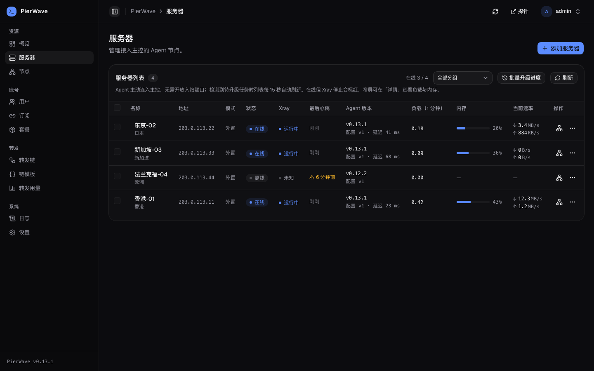

桌面端是「当前速率」列（↓ 接收 / ↑ 发送），窄屏在卡片里以「当前速率」字段展示；
离线或旧 Agent 没有数据时显示 `—`。The desktop table has a "Current rate" column
(receive ↓ / send ↑); mobile cards show the same value as a field. Offline servers and
old agents without data render `—`.

### 转发链列表的「可用率」/ Availability on the chain list

可用率低于阈值（默认 99%）显示为 warning 色；样本不足显示 `—`。Availability below the
threshold (99% by default) uses the warning color; insufficient samples show `—`.

### 链详情的可用率 / 丢包趋势 / Availability & loss trend in chain details

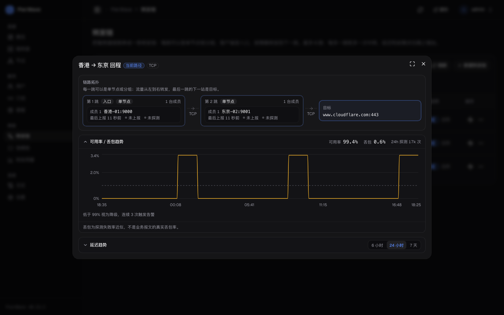
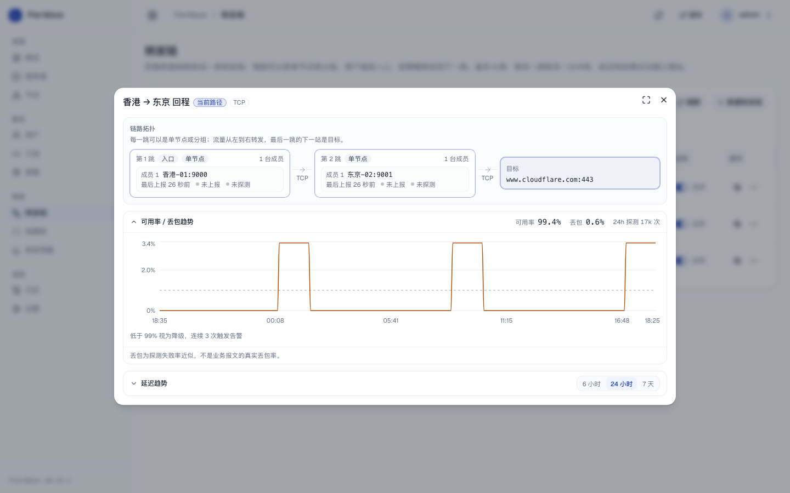

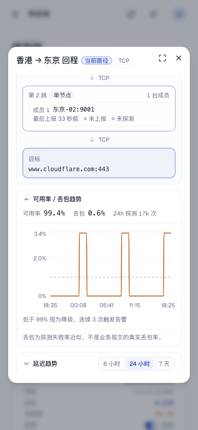

趋势图按 5 分钟桶展示探测失败率（虚线是阈值）；面板底部固定标注「丢包为探测失败率近似」。
The chart shows the probe failure rate per 5-minute bucket (dashed line = threshold); the
panel always states that packet loss is a probe failure approximation.

### 公开探针页卡片 / Public status cards

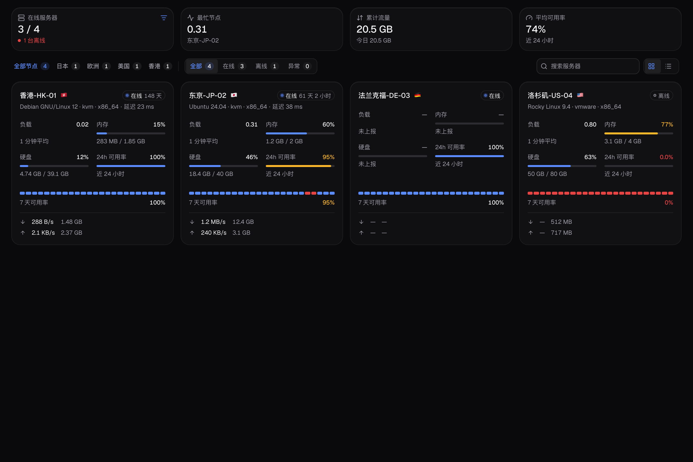
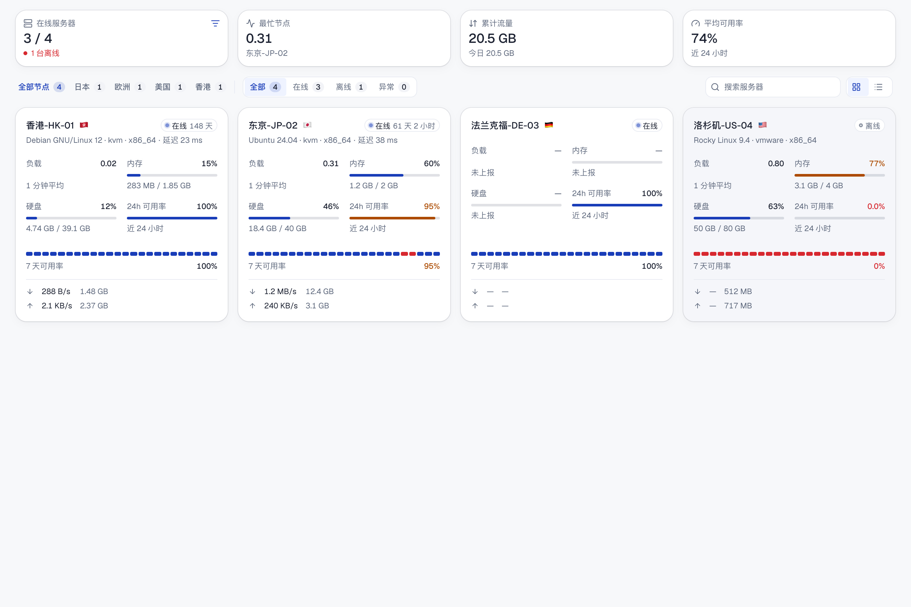
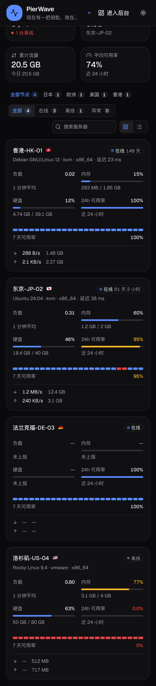

本轮截图取自 4 台服务器 / 1 条链的演示数据。卡片按参考项目的信息层次重排：
名称 + 国旗 + 在线时长 pill → `OS · 虚拟化 · 架构` → 负载 / 内存 / 硬盘 / 24h 可用率 →
24 格可用率 + 7 天可用率 → 分隔线下的「↓ 当前速率 + 累计流量 / ↑ 当前速率 + 累计流量」。
没有数据的指标一律 `—`；离线卡片保留累计值但不显示掉线前的旧速率。
These screenshots use demo data with 4 servers and 1 chain. The card follows the
reference information hierarchy: name + flag + uptime pill, `OS · virt · arch`, load /
memory / disk / 24h availability, the 24-cell availability strip + 7-day availability,
then the divider line with down/up current rate and cumulative traffic. Missing data is
always `—`; offline cards keep cumulative totals but never show the pre-disconnect rate.

### 概览 Top 服务器 sparkline / Top-server sparkline

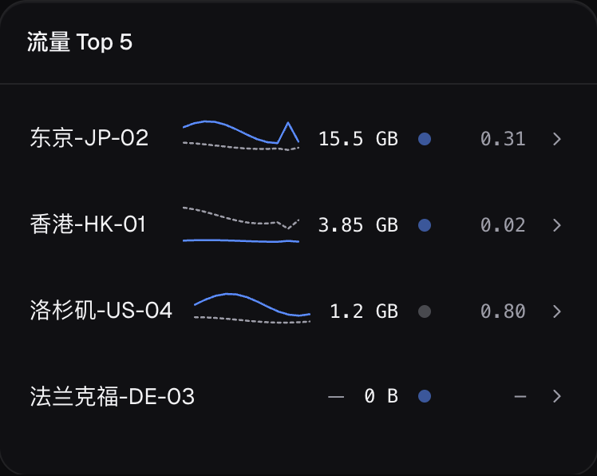
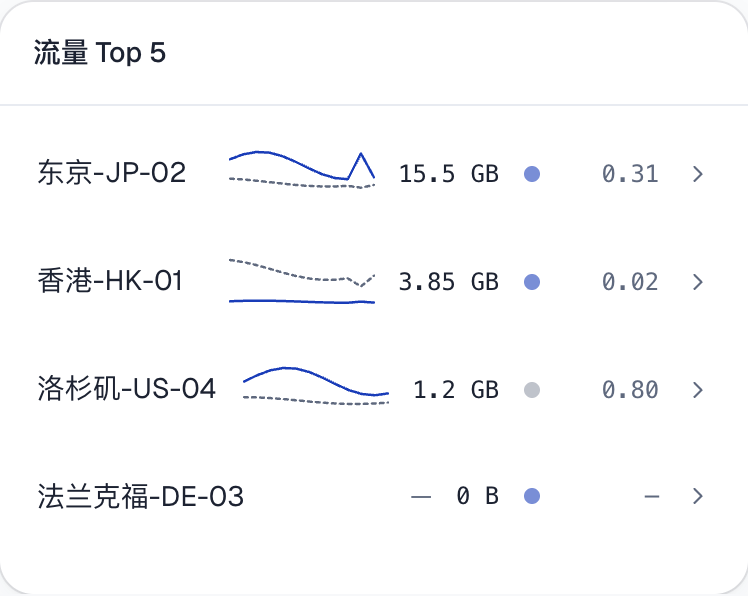
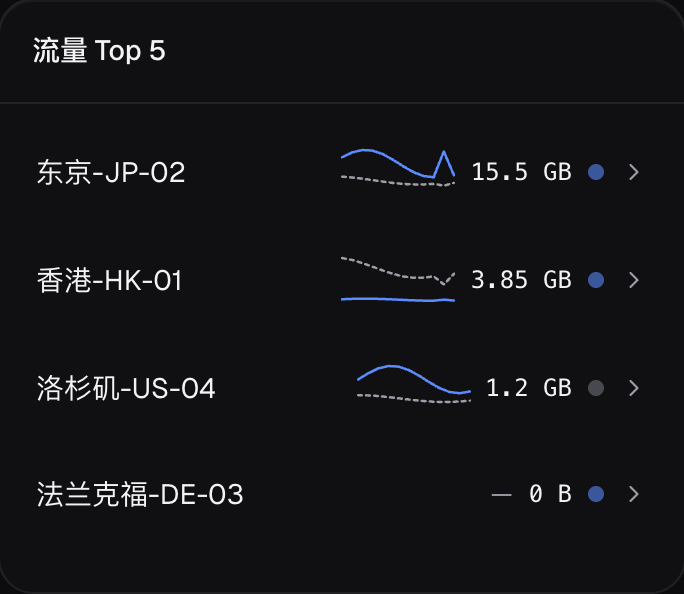
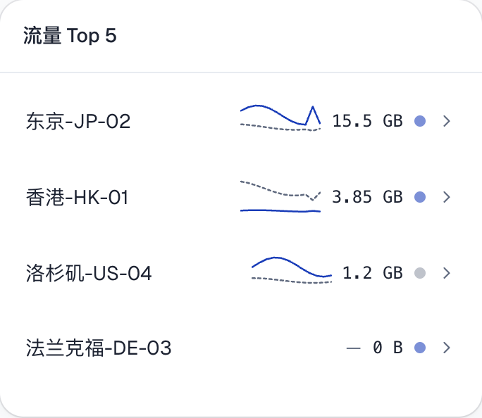

实线 = 下行、虚线 = 上行，共用同一 y 轴；无坐标轴 / tooltip。采样不足 3 个有效点的
服务器显示 `—`（示例中是法兰克福那台旧 Agent）。Solid = downlink, dashed = uplink on a
shared y scale, with no axes or tooltip. Servers with fewer than 3 valid samples show `—`
(the Frankfurt old-agent row in the example).

### 链详情成员可用率 / Per-member availability in chain details

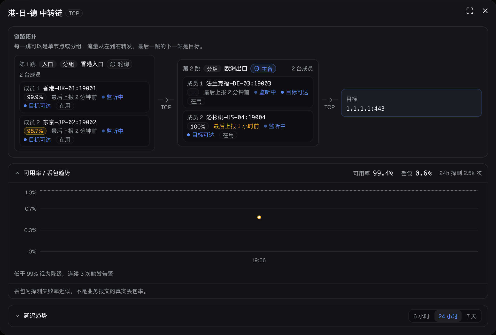

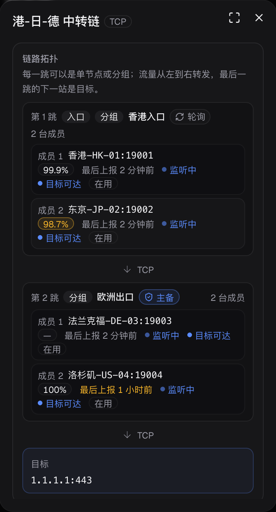
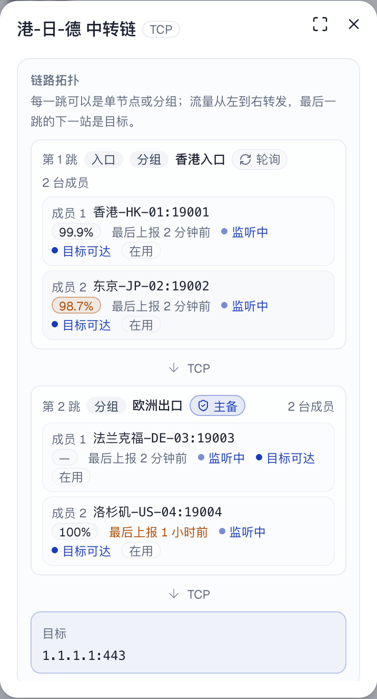

成员行显示 24h 可用率徽标：低于链级阈值（示例中 98.7% < 99%）用 warning 文字色，
没有样本显示 `—`；链列表的可用率仍是链级加权值。Each member row shows its 24h
availability badge: below the chain threshold (98.7% < 99% in the example) uses the warning
color, missing samples render `—`, and the chain list keeps its chain-level weighted value.
