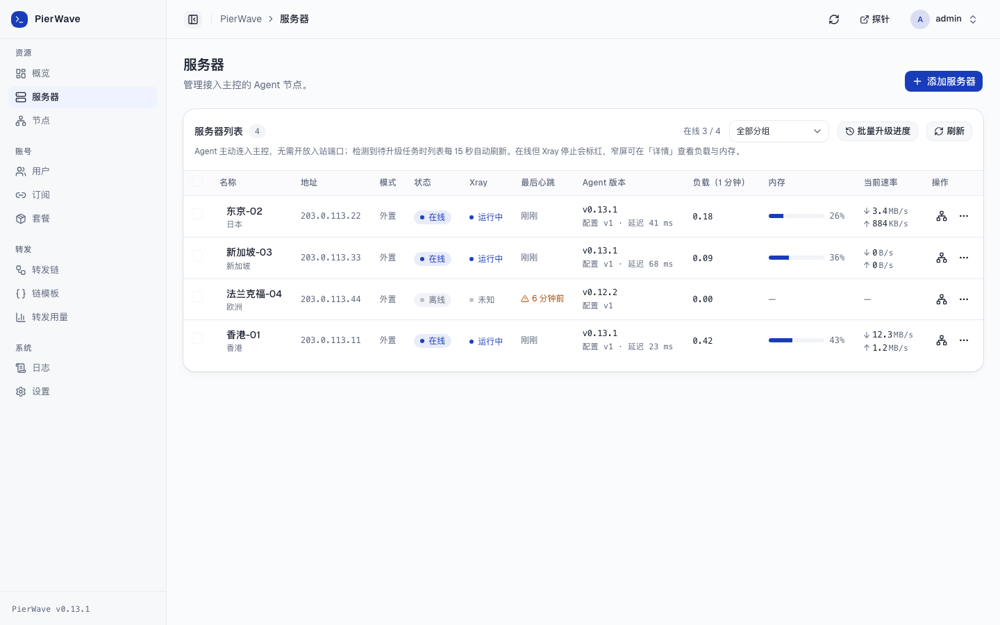
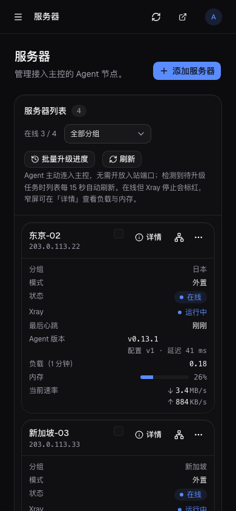
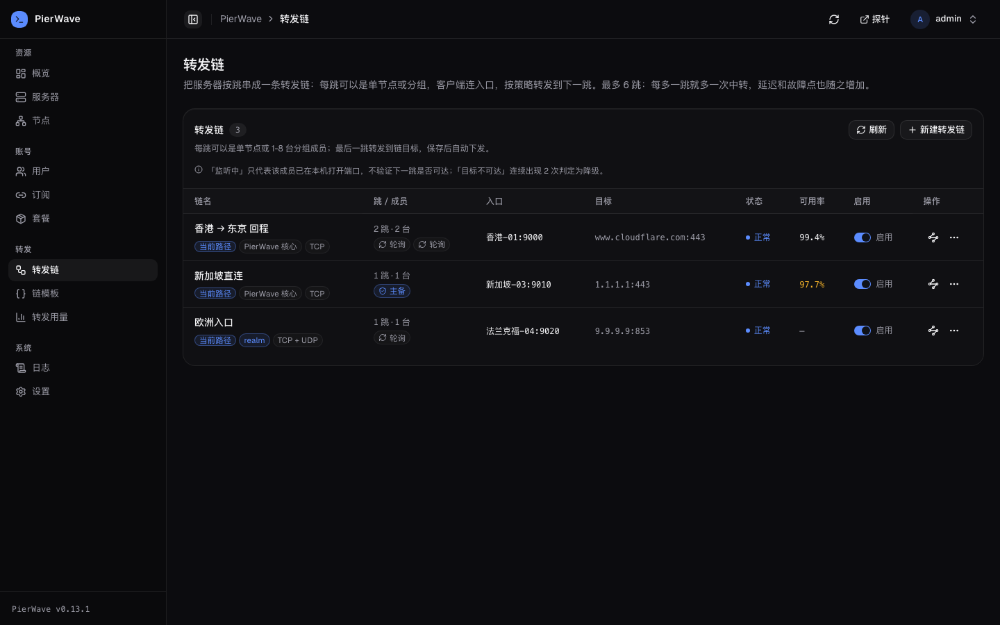
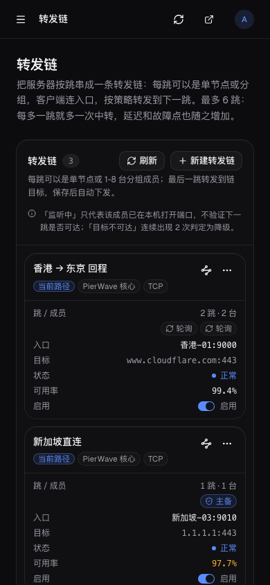
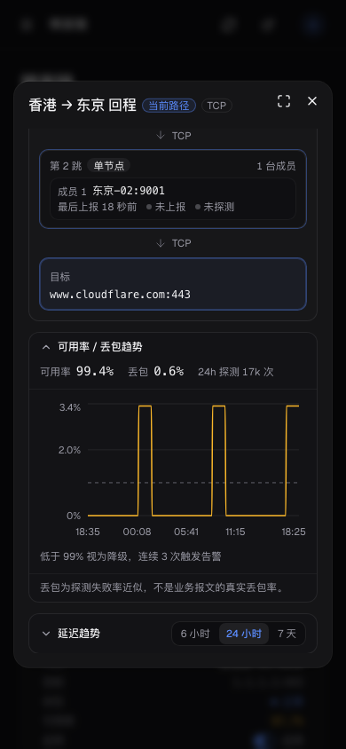

# 实时网速与转发链可用率 / Link rate & relay availability

本文说明「当前网速」与「转发链可用率 / 丢包」的数据来源、计算口径和展示边界。
两套都是**只读观测数据**：不写 `traffic_daily` / `forward_traffic_daily`，不参与计费。

This document describes where the "current link rate" and "relay chain availability /
packet loss" numbers come from, how they are computed, and what they do and do not
mean. Both are **read-only observability data**: they never write `traffic_daily` or
`forward_traffic_daily` and **never affect billing**.

## 1. 网速：采集与计算 / Link rate: collection and calculation

- Agent（Linux）读 `/proc/net/dev`，汇总所有**非 `lo`** 网卡的累计收发字节；
  macOS 没有该文件，返回 `None`，心跳照常上报 → 主控显示 `—`。
- Agent 心跳带上 `net_rx_bytes` / `net_tx_bytes` / `net_at`（同一次采集）。
- 主控保存上一份基线，用「字节差 / 时间差」算速率（字节/秒），写入
  `servers.net_rx_bps` / `net_tx_bps`，并每 5 分钟抄进 `server_samples.rx_bps` /
  `tx_bps`（趋势用）。
- 以下情况**丢弃本次差值**，速率置为 NULL（前端 `—`），绝不写负数或异常峰值：
  - 任一计数器比上一次小（内核重启 / 网卡重置，计数回绕）；
  - 时间差 `<= 0`（同一秒的心跳、系统时钟回拨）；
  - 算出的速率超过 1 Tbps（只可能是脏数据）。
- 第一次上报只建立基线，没有速率；旧 Agent（协议 < 26）没有这三个字段，
  主控保持 NULL。
- 速率是**瞬时值**，不是计费流量：计费继续用 Xray 计数器与转发规则的累计计数器。

English: On Linux the agent reads `/proc/net/dev` and sums the cumulative rx/tx bytes of
all non-`lo` interfaces. macOS has no such file, so the fields stay `None` and the UI
shows `—`. The master keeps the previous baseline and computes bytes delta / elapsed
seconds into `servers.net_rx_bps` / `net_tx_bps`, copied into `server_samples` every five
minutes for trends. A delta is **discarded** (rate set to NULL, never negative or an
absurd spike) when any counter moved backwards (kernel restart / NIC reset), when the
elapsed time is `<= 0`, or when the resulting rate exceeds 1 Tbps. The first heartbeat
only establishes a baseline; agents older than protocol 26 do not report these fields and
the master keeps NULL. The value is instantaneous and **display-only**; billing still
uses the Xray and per-forward cumulative counters.

## 2. 可用率 / 丢包：探测口径 / Availability & loss: probe semantics

- Agent 每 30 秒对转发规则的目标做一次 TCP 握手探测（多成员组逐目标探测）。
- `ForwardStatus` 从协议 26 起带 `probe_attempts` / `probe_failures`（自监听启动以来的
  **累计**次数，`Option`；不做探测的规则为 `None`，绝不写 0）。
- 主控把相邻两次心跳的累计值差成增量，落到 `forward_probe_samples` 的 **5 分钟桶**
  （`attempts` / `failures` 是增量，不是累计）；计数回绕时只换基线、不记负数。
- 24h 可用率 = `1 - SUM(failures) / SUM(attempts)`，按探测次数加权（不是成员可用率的
  算术平均）。保留 7 天，写入时顺带清理。
- **丢包为探测失败率近似**：它衡量的是「目标 TCP 握手失败的比例」，不是用户业务报文
  的真实丢包率。TCP 探测成功也不代表 UDP 可达；UDP-only 规则不做 TCP 探测，因此没有
  可用率（显示 `—`）。
- 样本不足（24h 内少于 20 次探测，约 10 分钟观测）时接口与列表给 `null`，前端显示
  `—`。`0%` 只表示「有数据且全部失败」。
- 趋势接口 `GET /api/v1/chains/{id}/availability?hours=1..168` 按 5 分钟桶返回
  `points[]`（`attempts` / `failures` / `loss` / `availability`），不套 24h 样本门槛，
  没有探测的桶不出现（不补 0）。

English: Every 30 seconds the agent performs a TCP handshake probe against each forward
target. Since protocol 26 `ForwardStatus` carries cumulative `probe_attempts` /
`probe_failures` (optional; rules that do not probe report `None`, never 0). The master
diffs consecutive heartbeats into 5-minute buckets in `forward_probe_samples` (increments,
not totals); a counter wrap only rebases the baseline. 24h availability is
`1 - SUM(failures) / SUM(attempts)`, weighted by attempts (not an average of member
percentages), and data is kept for 7 days. **Packet loss is approximated by the probe
failure rate** — it measures failed TCP handshakes, not loss on user traffic; UDP-only
rules are never probed and therefore have no availability. Fewer than 20 probes in the
window yields `null` (UI `—`); `0%` means "measured and everything failed". The trend
endpoint returns per-5-minute points without the 24h minimum, and buckets without probes
are omitted rather than filled with 0.

## 3. 降级告警 / Degradation alerts

- 事件类型复用 `chain_degraded`，**不新增事件类型**：既是「目标连续不可达」的告警，
  也是「可用率低于阈值」的告警。
- 可用率告警看**最近 15 分钟**的探测（比 24h 更灵敏；24h 断 10 分钟仍可能高于 99%）。
- 默认「连续 3 次心跳观测低于 99%」触发一次；同一轮故障只发一次，恢复到阈值以上后
  重新武装。状态存 `chain_degradation`，主控重启不会清零。
- 可配置（环境变量，非法值回落默认）：
  - `PIERWAVE_CHAIN_AVAILABILITY_THRESHOLD`：阈值百分比，0–100，默认 `99`；
  - `PIERWAVE_CHAIN_DEGRADED_STREAK`：连续次数，1–100，默认 `3`。
- 样本不足不告警：没有数据不等于故障。

English: The alert reuses the existing `chain_degraded` event (no new event type). It
evaluates the **last 15 minutes** of probes, not the 24h display window. By default a
chain alerts once after 3 consecutive heartbeat observations below 99%; the same outage
alerts only once and re-arms after recovery. State is persisted in `chain_degradation`, so
a master restart does not reset the streak. Both the threshold and the streak can be
overridden with `PIERWAVE_CHAIN_AVAILABILITY_THRESHOLD` (percent, default 99) and
`PIERWAVE_CHAIN_DEGRADED_STREAK` (default 3); invalid values fall back to the defaults.
Insufficient samples never raise an alert.

## 4. 协议与迁移 / Protocol & migration

- `PROTOCOL_VERSION` 26：`Heartbeat.net_rx_bytes / net_tx_bytes / net_at`、
  `ForwardStatus.probe_attempts / probe_failures`，全部 `Option` + `#[serde(default)]`，
  旧 Agent 缺省 `None`，旧主控忽略新字段。
- 迁移 `0053_telemetry.sql` 只追加：`servers` 的基线 / 速率列、`server_samples` 的
  `rx_bps` / `tx_bps`、`forward_probe_counters`、`forward_probe_samples`、
  `chain_degradation`。
- 旧 Agent 不报数据时，主控全程保持 NULL，前端显示 `—`；**任何地方都不会把未知写成 0**。
- `PROTOCOL_VERSION` 27（链选路）：`ForwardStrategy` 新增 `weighted` / `least_conn`，
  `ForwardTarget` 新增 `weight`（缺省 1）。`weight` 对旧 Agent 是未知字段（serde 忽略）；
  新枚举变体旧 Agent 不认识，保存与下发两条路径都要求整链协议 ≥ 27（见 `docs/ERRORS.md`）。

English: `PROTOCOL_VERSION` is 26 for the telemetry fields above; 27 adds the weighted /
least-connections chain strategies and `ForwardTarget.weight` (default 1). Old agents ignore
the unknown `weight` field, but not the new enum variants, so both the write and dispatch
paths require protocol >= 27 for the whole chain (see `docs/ERRORS.md`).

English: `PROTOCOL_VERSION` is 26. `Heartbeat` gains `net_rx_bytes`, `net_tx_bytes`,
`net_at`; `ForwardStatus` gains `probe_attempts` and `probe_failures`. All are optional and
`#[serde(default)]`-ed so old agents deserialize to `None` and old masters ignore them.
Migration `0053_telemetry.sql` only appends columns and tables. When an old agent reports
nothing the master keeps NULL and the UI shows `—`; unknown data is never rendered as 0.

## 5. 测试 / Tests

- `crates/proto`：旧心跳 / 旧 ForwardStatus 缺省为 None，新字段往返。
- `crates/domain/src/telemetry.rs`：速率差值、时间差为 0、计数回绕、异常峰值、旧数据
  无基线；可用率 100% / 0% / 样本不足 / 探测失败率；告警连续次数与恢复。
- `crates/domain/src/repo.rs`：两次心跳算速率、首次上报只建基线、探测增量、回绕、旧
  Agent 不产生样本。
- `crates/master`：服务器列表速率 HTTP JSON（数值 / null）、链列表可用率与趋势接口、
  告警只发一次。
- `web/src/lib/{netRate,chainProbe}.test.mjs`：格式化与边界（`—` 与 `0` 的区别）。

English: protocol compatibility tests, pure telemetry math (delta, zero elapsed, wrap,
implausible peak, missing baseline, 100%/0%/insufficient/rates, alert streak & re-arm),
repository tests for baseline/delta/wrap, master HTTP tests for the server list JSON and
chain availability endpoints, and frontend pure-logic tests for formatting and the
`—` vs `0` distinction.

## 6. 截图 / Screenshots

所有截图取自演示数据（4 台服务器 / 3 条链），亮色与深色 × 桌面 1440 × 移动 390。

### 服务器列表的「当前速率」/ Current rate on the server list

桌面端是「当前速率」列（↓ 接收 / ↑ 发送），窄屏在卡片里以「当前速率」字段展示；
离线或旧 Agent 没有数据时显示 `—`。The desktop table has a "Current rate" column
(receive ↓ / send ↑); mobile cards show the same value as a field. Offline servers and
old agents without data render `—`.

### 转发链列表的「可用率」/ Availability on the chain list

可用率低于阈值（默认 99%）显示为 warning 色；样本不足显示 `—`。Availability below the
threshold (99% by default) uses the warning color; insufficient samples show `—`.

### 链详情的可用率 / 丢包趋势 / Availability & loss trend in chain details

趋势图按 5 分钟桶展示探测失败率（虚线是阈值）；面板底部固定标注「丢包为探测失败率近似」。
The chart shows the probe failure rate per 5-minute bucket (dashed line = threshold); the
panel always states that packet loss is a probe failure approximation.
