# 服务器详情 `/status/:id` · 现状审计 + 两个改版概念
# Server detail `/status/:id` — audit and two concepts

> **范围 / Scope**：只做设计探索与自审计。没有改 `web/src/`，没有改后端，没有提交。
> Design exploration and audit only. No `web/src/` changes, no backend changes, no commit.
>
> 目录 / Location：`web/screenshots/detail-concepts/`

---

## 0. 先看结论 / TL;DR

**中文**

1. 现状详情页的问题不是“少一个漂亮组件”，而是**六张同权重卡片把信息压平了**，加上 **24 格竖条把“可用率”错译成了“柱状图”**。最严重的一条是数据错误：离线/中断小时只有 **1.1px** 高，无采样小时却是 **56px 满高灰块**——无数据看起来比宕机更“满”。
2. 方案 A「状态报告」：一张报告纸，顶部一个大结论，关键数字一行，24h 改成**横向连续色带**，7 天用汇总条，资源双列，费用/系统/累计流量进页脚。桌面 **1440×1064**，390 高 **1050**。
3. 方案 B「仪表盘」：两栏，左边状态 + 三个大数字 + 环形资源，右边 24h 曲线 + 费用/系统，底部累计流量带。桌面 **1440×1000**，390 高 **1396**。
4. **推荐 A**。高级感来自“一个结论 + 一条时间带”，不是更多卡片；A 在健康态（24h 全 100%）仍然好看，B 的曲线在同样数据下会是一条贴着顶部的直线，右侧显得空。
5. **两个方案都不需要新接口**就能落地。若要继续加，最划算的是 `buckets_7d`（7 天按日）和每个桶的 `samples`（采样数）；**不建议默认公开每台 24h 速率/延迟历史**（隐私 + 成本），不加的代价是 B 的右栏没有第二条曲线可看。

**English**

1. The current page is not short of a component; it flattens everything into **six equally weighted cards** and turns availability into **24 vertical bars with no time axis**. The worst issue is factual: down hours render at **1.1px**, while no-data hours render as **full 56px grey blocks** — missing data looks “fuller” than an outage.
2. Concept A, a status report: one sheet, one large verdict, one row of key figures, a **continuous 24h ribbon**, a 7d aggregate bar, two resource columns, and billing/system/traffic in the footer. 1440×1064; 390 high 1050.
3. Concept B, a dashboard: two columns — status, three large numbers and resource rings on the left; 24h curve, billing and system on the right; a cumulative-traffic band below. 1440×1000; 390 high 1396.
4. **Recommend A.** The premium feel comes from one verdict plus one time band, not more cards. A still looks intentional when 24h is all 100%; B’s curve is a flat line on the same data and leaves the right column visually empty.
5. **Neither concept needs a new endpoint.** The cheapest useful additions are `buckets_7d` and a per-bucket `samples` count; **do not expose per-server 24h rate/latency history publicly by default** (privacy and cost). Without it, B has no second curve to fill its right column.

---

## 1. 数据与测量方法 / Fixture and method

### 1.1 真实 fixture

`GET /api/v1/public/status` 不是从线上环境抓的（本机没有运行中的主控）。做法是：

- 把 `data/preview.db` 复制到 `/tmp/pw-fixture/db.sqlite`（**只读副本**，不碰原库）；
- 用 `target/debug/pierwave-master` 在 `127.0.0.1:8799` 起一个临时主控，只发一次公开状态请求，随后关掉；
- 原样保存响应为 `fixture.json` / `fixture.js`。

快照内容：**2026-11-21 13:10:06 +08**，10 台服务器，6 在线 / 4 离线，6225 条 `server_samples`；目标在线态 `香港-01`，目标离线态 `香港-03`。24 个桶里有 **22 个有采样、2 个为 null**（02:00、04:00），这是真实数据的缺口，没有被补成 100%。

**只改了一处**：预览库的种子数据里，6 台在线机的 `last_seen_at` 比 `generated_at` 晚约 10 小时（未来时间，页面会显示“10 小时后”）。为了让截图可读，把它们的 `last_seen` 归一到 `generated_at − 9..22 秒`；其余字段、桶、百分比、流量、费用、时间戳均未改。这一点在 fixture 里没有写注释（保持 API 结构），以本 README 为准。

**English**: The fixture is a real response from the public endpoint, captured by starting a temporary master against a copy of `data/preview.db` (the original DB was not touched). It is the 2026-11-21 13:10:06 +08 snapshot: 10 servers, 6 online, 22/24 hourly buckets sampled. Only the six online servers’ `last_seen` values were clamped from a future seed value to 9–22 seconds before `generated_at`; nothing else was altered.

### 1.2 审计截图

`audit/` 下的现状图来自 **当前构建**（`web/dist`，`web/src` 未改）：

```bash
make web-build
cd web && npx vite preview --port 4180 --strictPort
# 另一个终端 / another shell
BASE_URL=http://localhost:4180 node web/screenshots/detail-concepts/audit.mjs
BASE_URL=http://localhost:4180 node web/screenshots/detail-concepts/annotate.mjs
```

Playwright 拦截 `/api/v1/public/status` 返回 `fixture.json`；不启动后端、不写库。`audit/report.json` 保存了每个视口的详细几何。

### 1.3 概念截图

```bash
node web/screenshots/detail-concepts/render.mjs
```

直接读 `file://`，不发网络请求。需要 Playwright 与本机 Chrome；可用 `PLAYWRIGHT_MODULE` / `CHROME_PATH` 覆盖，默认会从仓库的 `.npm-cache/_npx/*/node_modules/playwright/index.mjs` 找。产物共 14 张：A/B × 亮暗 × 1440/390（8）+ 事故态 4 + hover 2。

查询参数：`a.html?theme=light`、`b.html?theme=dark&variant=incident`。

---

## 2. 任务 A：现状自审计 / Audit

### 2.1 优先级问题清单 / Prioritised findings

#### P0 — 数据表达错误，必须改

**A1. 24 格：中断 1.1px，无采样 56px，语义完全反了。**
- 组件逻辑：`height = ratio === null ? 100% : max(2, ratio*100)%`，容器 `h-14`（56px）。
- 在线 100% → 56px；无采样 null → **56px 灰块**；0% 中断 → **2% × 56 = 1.12px**。
- 实测离线态 `香港-03`：6 格 56px 蓝 + 16 格 1.11px 红 + 2 格 56px 灰。16 小时宕机在图上是一条几乎看不见的红色虚线；两个“没有数据”的小时反而像两块实心柱子。
- 证据：`audit/current-offline-dark-1440.png`、`audit/current-offline-annotated-dark-1440.png`。

**A2. 24 格没有时间轴、没有自定义 hover、没有“现在”锚点。**
- 24 个 `<span aria-hidden="true" title="...">`，只能靠浏览器原生 title；触摸端没有 hover；读屏只拿到父级 `role="img"` 的一句“24 小时可用率”，拿不到每小时数值。
- 没有 00:00 / 06:00 / 12:00 / 18:00 刻度，读者无法知道最左边是哪一小时、最右边是不是现在。
- 唯一的时间提示是下方“最低时段 14:00–15:00 · 100%”——在全部 100% 的真实数据里，这句话既无信息又暗示“存在最低”。

**A3. 健康态被画成 24 个满高色块，视觉重量与“故障”相反。**
- 100% 是最常见状态，却占据最大视觉面积；故障只能通过“变矮/消失”表达，读者第一眼看到的是一堵蓝墙。
- 91% 在色阶里已经落到 `down`（`<95%` = destructive 红），和 0% 同一档；94.9% 会被读成“全挂”。

#### P0 — 层级与密度

**A4. 六张同材质卡片 = 六件同样重的事。**
- 6 个 `Card`（header / key numbers / availability / resources / billing / system）+ footer；全部 12px 圆角、20px 内边距、16px 间距；4 个区块标题全是 **12px**；除了三个数字（28px）其余正文 12–14px。
- 第一眼应该看到“在线/离线 + 24h”，实际第一眼看到六个等宽横条；billing（90px 高）和 system（114px 高）各用一整张卡片承载一行内容。
- 证据：`audit/current-normal-annotated-dark-1440.png`。

**A5. 详情页比列表卡片展示得更少。**
- 列表卡片一张里已经有：`uptime_7d`、`net_rx_bytes/net_tx_bytes`（累计流量）、下行/上行速率、到期/价格、24h、负载、内存、硬盘、24 格 strip。
- 详情页没有：7 天可用率、累计流量、Xray 的明确原因（只有“异常” pill 的 title）、国家名（只有国旗）、绝对最后上报（只在 title 里）。
- 证据：`audit/current-list-dark-1440.png` vs `audit/current-normal-dark-1440.png`。

**A6. 桌面过空 / 内容过短。**
- `PAGE_CONTAINER` 是 1400px，但详情内层 `max-w-4xl` = **896px**：1440 下两侧各 **272px** 空白，内容只占 **62%**。
- 内容从 y=81 到 **847.8**；1000px 视口下底部 **152px** 空白；屏幕更高时更空。
- 对比列表页：4 列 × 10 卡，1352px 内容宽，`scrollHeight` 1355。

**A7. 移动端头部被“返回列表”撑成两行。**
- 390 下 `detail-header` 高 **108.3px**（正常态）：名称/flag/group/pill 一行，返回按钮自己一行。
- 390 下整页 **1245px**；24 格每格只有 **9.75px** 宽，间隔 4px——23 个间隙共 92px，占图表宽度的 **28.2%**，格子里几乎放不下一条 1px 的细分隔。

#### P1 — 冗余与文案

**A8. 三个时间信号，没有区分语义。**
- 顶栏“更新于 13:10:06”（面板数据生成时间）
- 状态 pill“在线 13 天”（`uptime_secs`）
- 页脚“最后上报 15 分钟前 · 数据每 20 秒刷新”（`last_seen` + 轮询）
- 三个都是时间，视觉上都是 12px 灰字；读者要自己猜哪个是“页面刷新”、哪个是“服务器在线时长”、哪个是“最后一次心跳”。

**A9. 24h 数字重复。**
- KPI 卡“24h 可用率 100%”，下面区块标题“24 小时可用率”再说一次；同一个数在同一屏出现两次。
- 页面出现“可用率”2 次、“在线”1 次、“更新于”1 次、“最后上报”1 次、“20 秒”1 次（`audit/report.json` 的 `occurrences`）。

**A10. “平均延迟”名不副实。**
- `latency_ms` 是最近一次心跳里单次 TCP 握手 RTT，不是平均值；列表页用的是“延迟 28 ms”，详情页却写成“平均延迟”。

**A11. “当前总速率”的“总”字。**
- 它是单机的下行/上行两个当前速率，不是“总”；在列表页“当前总速率”是站点合计，同一标签在详情页被复用，语义变了。

#### P2 — 可访问性与细节

**A12. 两个 `<h1>`。** 页头品牌 `PierWave` 是 `<h1>`，详情服务器名也是 `<h1>`；无标题层级可言（实测 `h1` 文本 `["PierWave","香港-01"]`）。
**A13. 空桶灰色偏高。** `bg-muted-foreground/15` 在深色底上仍是一个明显的大块；亮色下更抢眼。
**A14. 24 格圆角 2px。** 桌面 31.8px 宽时是 6.3% 半径，移动端 9.75px 时是 **20.5%**——移动端更像一排小胶囊，而不是时间格。
**A15. 术语。** 列表页统一叫“节点”，详情页的 404 文案是“该服务器不存在或已下线”；公开页内不统一。

### 2.1.1 标注图 / Annotated evidence

红色描边与斜纹是**审计标注层**，不是产品 UI；图中编号 1–8 见图内图例，A1–A12 是下方的问题编号。

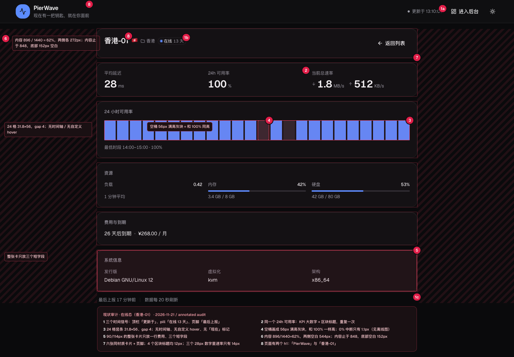
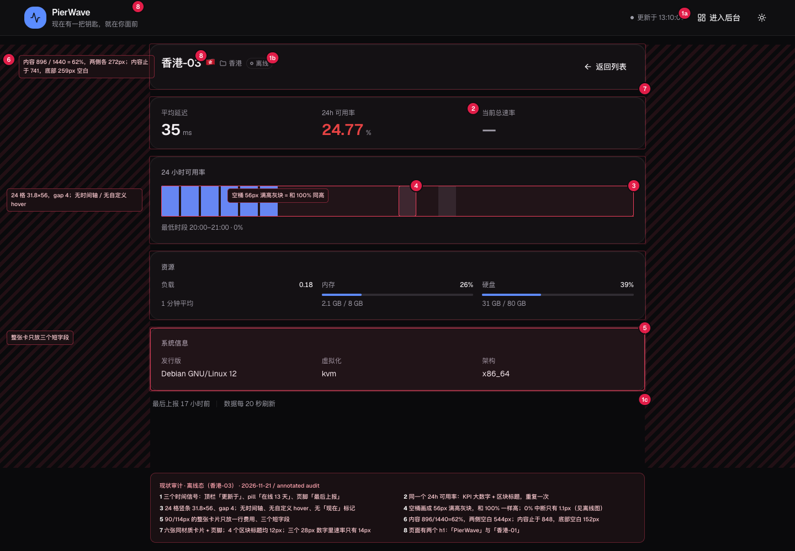

列表页对照（详情页要延续的“上一屏”）：

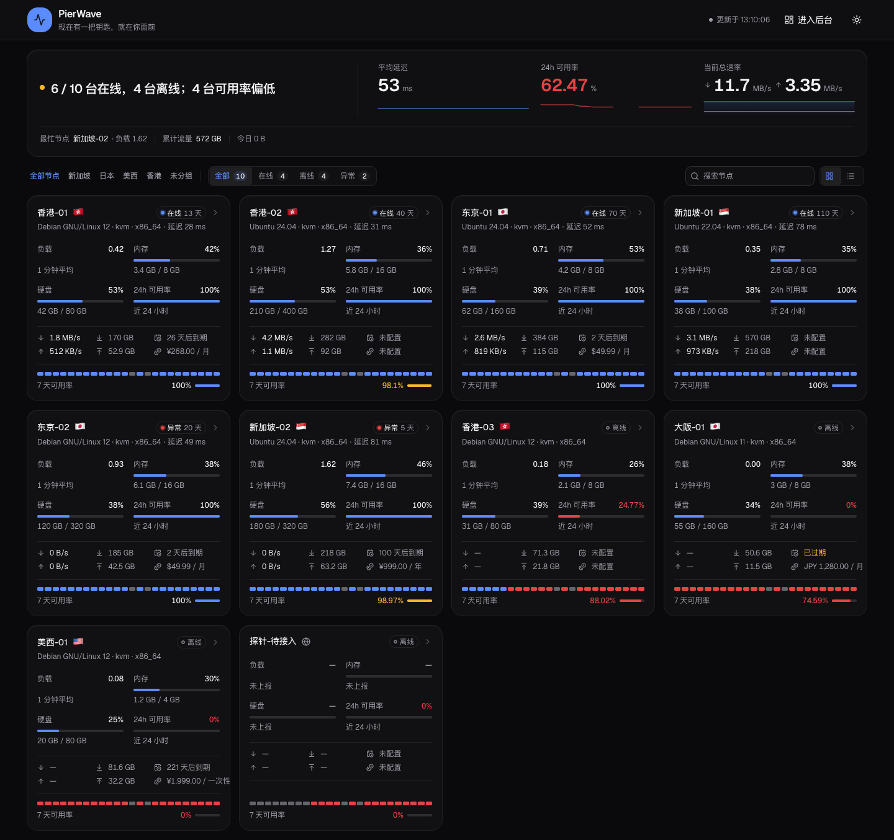

### 2.2 几何数据 / Measured geometry

来自 `audit/report.json`（当前构建 + 真实 fixture）：

| 指标 / Metric | 1440×1000 | 390×844 |
|---|---|---|
| 内容宽 / content width | **896**（62.2%；两侧 272+272） | **358**（91.8%；两侧 16+16） |
| 内容高 / content height | **766.8**（到 847.8） | **1147.9**（到 1228.9） |
| 页面高 / scrollHeight | **1000**（底部空 152） | **1245** |
| 卡片数 / cards | 6 + footer | 6 + footer |
| 卡片间距 / gap | **16** | **16** |
| 卡片内边距 / padding | **20** | **16** |
| 区块标题 / section heading | **12px** | **12px** |
| 三个数字 / KPI values | **28px**（速率 14px） | **19px**（速率 14px） |
| 页脚 / footer | **12px** | **12px** |
| 24 格尺寸 / bar | **31.83 × 56** | **9.75 × 56** |
| 24 格间隙 / gap | **4**（10.8% 宽度） | **4**（28.2% 宽度） |
| 24 格圆角 / radius | 2px（6.3%） | 2px（20.5%） |
| 24 格高度 / heights | **[56]**（22 ok + 2 null 全满高） | 同左 |
| 离线态高度 / offline | **6×56 + 16×1.11 + 2×56** | 同左 |
| h1 数量 / h1s | **2**（16px + 20px） | **2**（16px + 18px） |
| 横向溢出 / overflow-x | 无 | 无 |

### 2.3 24 格逐项判断 / Why the 24 bars do not work

| 因素 | 实测 / 观察 | 后果 |
|---|---|---|
| **高度** | 唯一编码；100% 和 null 都是 56px；0% 只有 1.12px | 高低不表达时间，故障反而消失 |
| **间隙** | 4px；桌面 92/856=10.8%，移动端 92/326=28.2% | 移动端近三成宽度是空白，格与格读不成连续时间 |
| **圆角** | 2px；移动端 9.75px 宽时占 20.5% | 像 24 个按钮/胶囊，不像时间轴 |
| **颜色档位** | ≥99% ok、95–99% warn、<95% down；91% 直接红 | 94.9% 和 0% 同色，降级被读成宕机；没有单独“无采样”语义 |
| **时间轴** | 无刻度、无 00/06/12/18、无 now | 不知道每格对应哪一小时 |
| **hover** | 只有原生 `title`；span 不可聚焦；无触摸反馈 | 精确值不可发现；键盘/读屏拿不到逐小时值 |
| **空桶** | 满高灰块（56px） | 和 100% 同高；无数据看起来比宕机更“完整” |
| **离线** | `online=false` 时 0% 桶画成 1.12px | 16 小时宕机是一条几乎看不见的红线（见离线图） |
| **采样** | 无采样数/置信度 | 22/24 和 24/24 在图上没有区别 |
| **健康态** | 22 个满高蓝块 + 2 个满高灰块 | 整条蓝带像一堵墙，没有“平静”的高级感 |

### 2.4 未用上的现有字段 / Available but unused (or under-used)

| 字段 / Field | 列表卡片 / list card | 详情页 / current detail | 方案 A / A | 方案 B / B |
|---|---|---|---|---|
| `uptime_7d` | ✅ “7 天可用率” | ❌ | ✅ KPI + 7d 条 | ✅ 图表页脚 |
| `net_rx_bytes` / `net_tx_bytes` | ✅ 累计流量 | ❌ | ✅ 页脚 | ✅ 底部流量带 |
| `last_seen` | 状态 pill / 心跳 | ⚠️ 只有相对时间，绝对时间在 `title` | ✅ 右侧元信息 + `title` | ✅ 状态卡页脚 + `title` |
| `xray_running` | 用于“异常”状态 | ⚠️ 只有 pill，原因在 `title` 里 | ✅ 结论副行“Xray 运行中 / 已停止” | ✅ 状态卡 chip |
| `country_code` | ✅ 国旗 + `title` 国家名 | ⚠️ 只有国旗，国家名在 `title` | ✅ 国旗 + 国家名 | ✅ 国旗 + 国家名 |
| `uptime_secs` | ✅ pill | ⚠️ 只在 pill | ✅ 副行；离线时“离线前在线” | ✅ 第三个大数字；离线时“最后值” |
| `paid_until` | ✅ 相对天数 + `title` 日期 | ⚠️ 只有相对天数 + `title` | ✅ 页脚相对 + `title` | ✅ 费用卡显示绝对日期 |
| `os_name` / `os_version` / `virt` / `arch` | ✅ 副行 | ⚠️ 一张整卡只放三项 | ✅ 页脚一行 | ✅ 系统卡 |
| `group_name` | ✅ 分组筛选 | ✅ 标题旁 | ✅ 地点行 | ✅ 标题副行 |
| `latency_ms` | ✅ | ✅（但叫“平均”） | ✅ “延迟” | ✅ “延迟” |
| `net_*_bps` | ✅ | ✅ | ✅ KPI | ✅ KPI |
| `buckets_24h` | ✅ 迷你 strip | ✅ 24 格 | ✅ 连续色带 | ✅ step curve |
| `summary` / `groups` | ✅ hero/分组 | ❌（页面级汇总，不应塞进单机） | 不用 | 不用 |
| `series` | ✅ hero 迷你图（站点级） | ❌ | 不用 | 不用 |

**`series` 是站点合计，不是单机历史。** 不能拿它给单台服务器画速率/延迟曲线；那是错误归因。

### 2.5 需要新接口才能有的 / Needs a new endpoint

| 能力 / Capability | 现在有什么 | 缺什么 | 不加的代价 |
|---|---|---|---|
| 7 天逐日条 | `uptime_7d` 一个标量 | 7 个日桶 / 168 个小时桶 | 只能画“7 天汇总”一根条；看不出哪一天掉过 |
| 每小时采样数 | `online_ratio` | `samples`（该小时有多少个心跳点） | 22/24 与 24/24 视觉上一样；不能表达“置信度” |
| 单机 24h 速率/延迟曲线 | 只有当前 `net_*_bps` / `latency_ms` | 单机时间序列（小时/5 分钟桶） | B 的右栏只有一条可用率曲线；无第二条趋势；公开页的 `series` 不能用 |
| 事件/事故记录 | 无 | 事件表（开始/结束/原因） | 只能从桶推断“某小时下降”，不能解释原因 |

**建议**：先加 `buckets_7d` + `samples`（低风险、只涉及已有的可用率聚合）；单机速率/延迟历史涉及公开页隐私和存储成本，默认不加，除非所有者明确要“公开每台机器的网络趋势”。

---

## 3. 任务 B：两个方案 / Two concepts

### 3.0 共同基线 / Shared baseline

- 色彩、圆角、字体 token 直接抄 `web/src/index.css`：深色 zinc + 单一 indigo primary，`--warning` / `--destructive` 只用于状态；没有新增色相。
- Geist Variable + PingFang SC；`tnum`；暗色默认，`?theme=light` 切亮色。
- 顶部沿用公开页的 `StatusHeader` 结构（品牌 / 更新于 / 进入后台 / 主题）。
- 同一份真实 fixture、同一台 `香港-01`（正常）与 `香港-03`（事故），没有假数据接口。
- 全部 14 张图：**无横向溢出**（`report.json` 的 `scrollWidth` = 视口宽）。

### 3.1 方案 A：状态报告 / A status report

**版式**：一张 1120px 的报告纸（不是六张卡）。顶部返回 → 地点/分组 → 名称 → **46px 结论「运行正常 / 离线」** → 一行三个关键数字（7d / 延迟 / 速率）→ **24h 连续色带** → 7d 概览条 → 资源双列 → 页脚（费用 / 累计流量 / 系统）。

**24h 换了什么视觉手法：**

- 24 个小时格 **无缝相连**，只有 1px 接缝；总高 46px，**高度不再编码数据**，只编码颜色。
- 颜色四档：正常 primary / 下降 warning / 中断 destructive / 无采样**斜线 hatch**；空桶不再是一个 56px 的灰块。
- 下方有 **14:00 / 20:00 / 02:00 / 08:00 / 现在** 时间刻度，最右一格有 2px “现在”标记。
- **自定义 hover + 键盘 focus**：显示“11月20日 19:00–20:00 / 100% / 正常”；空格显示“无采样”。
- 色带上方一行“100% · 可用率 · 22/24 小时有采样”，下方一行“有采样的 22 小时全部正常 · 2 小时无采样”；有下降时改成“最低 91% · 03:00–04:00 · N 小时下降”；有中断时列出中断小时数。
- 7 天：只用 `uptime_7d` 画一根**汇总条**，不伪造 7 个日格；下面标注“逐日明细需新增接口”（原型里的可见注记）。
- 健康态看起来是一条完整的品牌色带——这是“高级感”的主要来源；故障态是一条红色带 + 斜线缺口，语义一眼可读。

**为什么更好：**

1. 24 格终于像“时间”，不像 24 个按钮；移动端每格 **13.7px**（328/24），不再被 4px 间隙吃掉 28%。
2. 无数据 = hatch，中断 = 红色；两者不再同高、同灰。
3. 全 100% 时仍然完整、安静；不会出现“一堵蓝墙”或“一条空曲线”。
4. 一个结论 + 一条带，第一眼信息明确；六张卡片的“同等重要”被消除。
5. 7d 概览条在不新增接口的前提下，至少把 7 天标量变成第二层视觉。

**字段**：全部公开字段都在（`uptime_7d` KPI、累计流量页脚、`last_seen` 右侧、`xray_running` 副行、绝对到期日 `title`、国家名、OS/virt/arch）。`summary` / `groups` / `series` 是列表/站点级，不塞进单机。

**文件**：`a.html`、`a-dark-1440.png`、`a-light-1440.png`、`a-dark-390.png`、`a-light-390.png`、`a-incident-dark-1440.png`、`a-incident-dark-390.png`、`a-hover-dark-1440.png`。

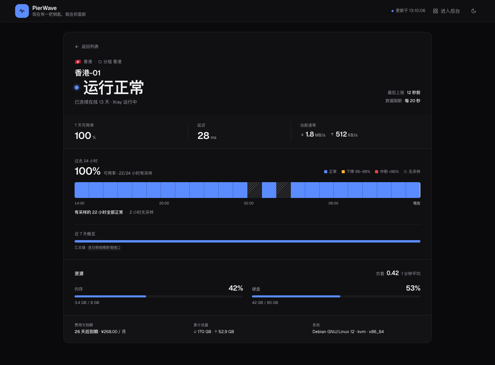
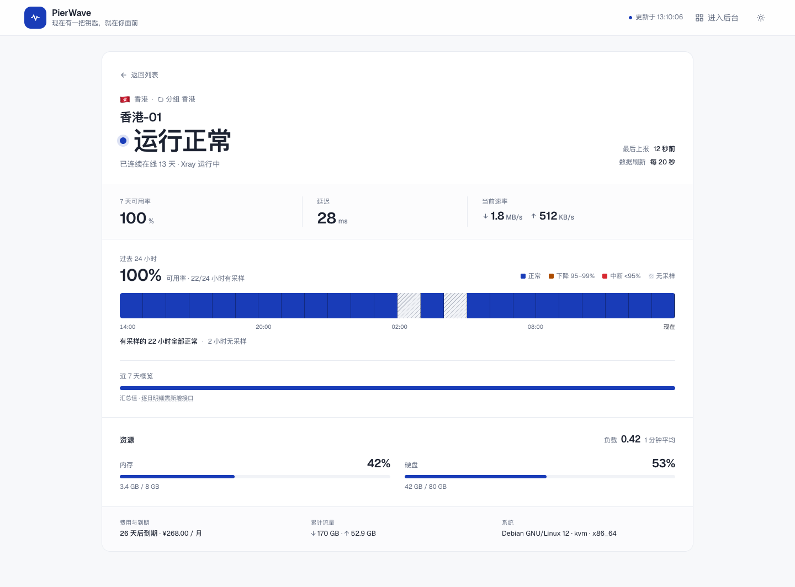
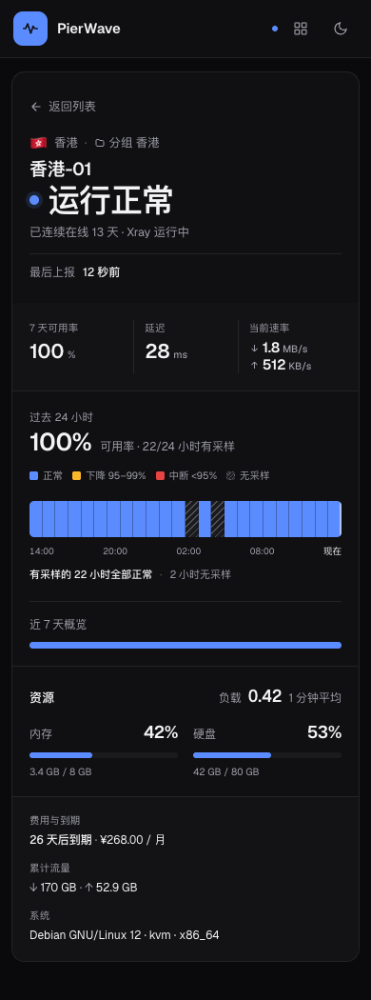
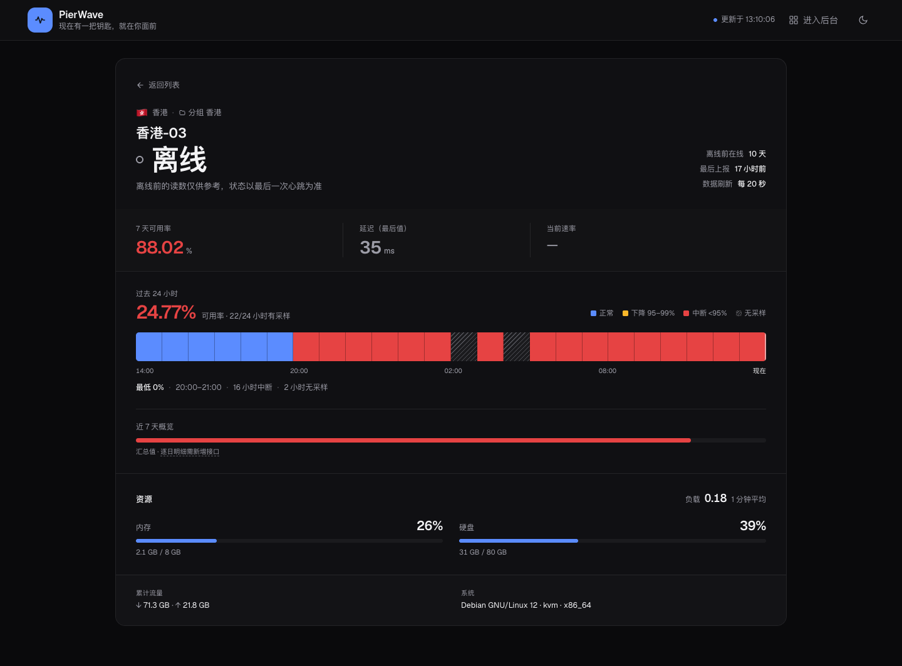
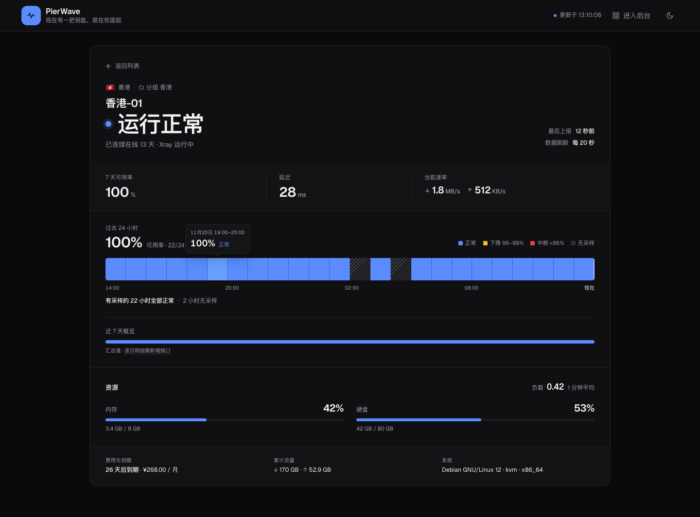

### 3.2 方案 B：仪表盘 / A dashboard

**版式**：1352px 两栏。左栏 420px：状态卡 → 三个大数字（在线时长 / 延迟 / 速率）→ 资源环（内存/硬盘 + 负载）。右栏：24h 可用率曲线 → 费用 → 系统。底部一条全宽累计流量带。标题行只有名称/国旗/国家/分组 + 返回，更新时间在顶部状态栏里（不再重复一次）。

**24h 换了什么视觉手法：**

- 真正的 **0–100% 纵轴 + 时间横轴**；24 个小时桶画成 **step line + area**，不是 24 根柱。
- 缺失小时画成 **斜线竖列**，不是 0%；相邻采样之间才连线，缺口断开。
- 每段线按档位着色（primary / warning / destructive），变化点和末端有小圆点。
- **crosshair + tooltip**：显示“11月21日 00:00–01:00 / 0% / 中断”；鼠标、触摸点按、键盘左右键都可用；另有一份 `sr-only` 逐小时列表给读屏。
- 7 天可用率放在图表页脚（数字 + 64px mini bar），不再单独占一行大数字。
- 资源用 **环形**（内存/硬盘）+ 负载数字；累计流量用上下行堆叠条；这是与 A 最明显的视觉差异。

**为什么更好 / 差在哪：**

- 信息密度更高：一屏同时看到状态、三数、曲线、资源、费用、系统、流量；更像 miniprobe 的详情页。
- 曲线对“有起伏”的数据非常有效：事故态从 100% 掉到 0%，一眼就是一次 cliff。
- **但**真实数据全 100% 时，曲线就是贴着顶部的一条直线，右栏会显得空；这是 24h 曲线在健康态的天然劣势，也是推荐 A 的关键理由。
- 390 下必须全部堆叠，页面高 **1396px**（A 是 1050px）；这是仪表的代价。

**字段**：全部公开字段（在线时长 KPI、7d 图表页脚、累计流量底部带、billing、system、xray chip、国家名、绝对到期日）。无套餐（`香港-03`）时费用卡消失，系统卡自动铺满整行。

**文件**：`b.html`、`b-dark-1440.png`、`b-light-1440.png`、`b-dark-390.png`、`b-light-390.png`、`b-incident-dark-1440.png`、`b-incident-dark-390.png`、`b-hover-incident-dark-1440.png`。

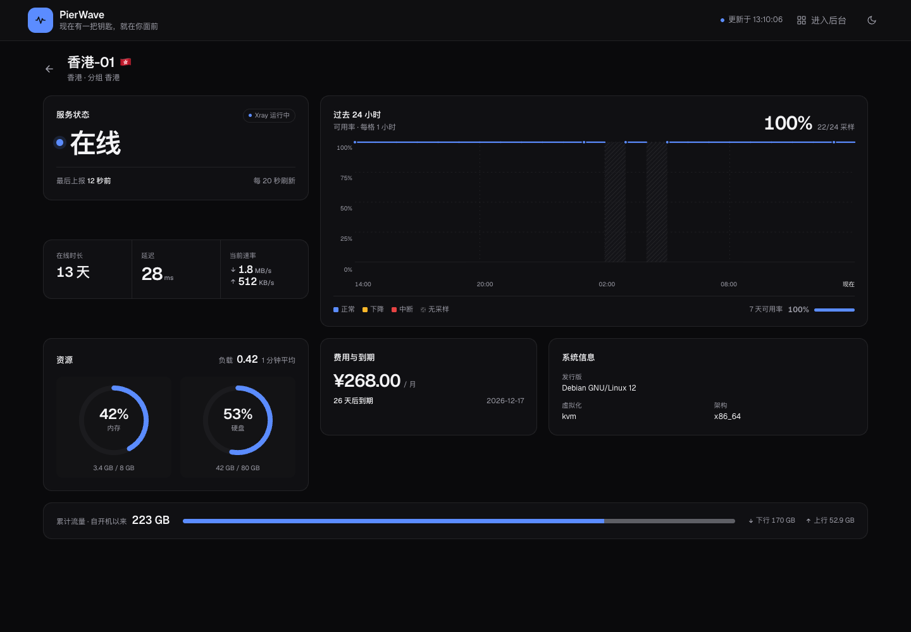
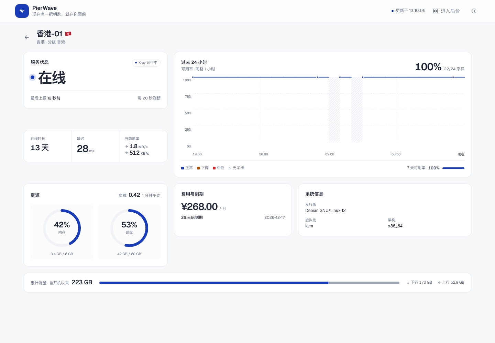
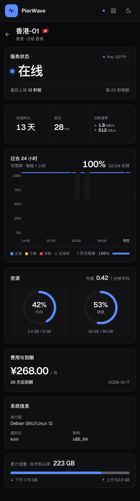
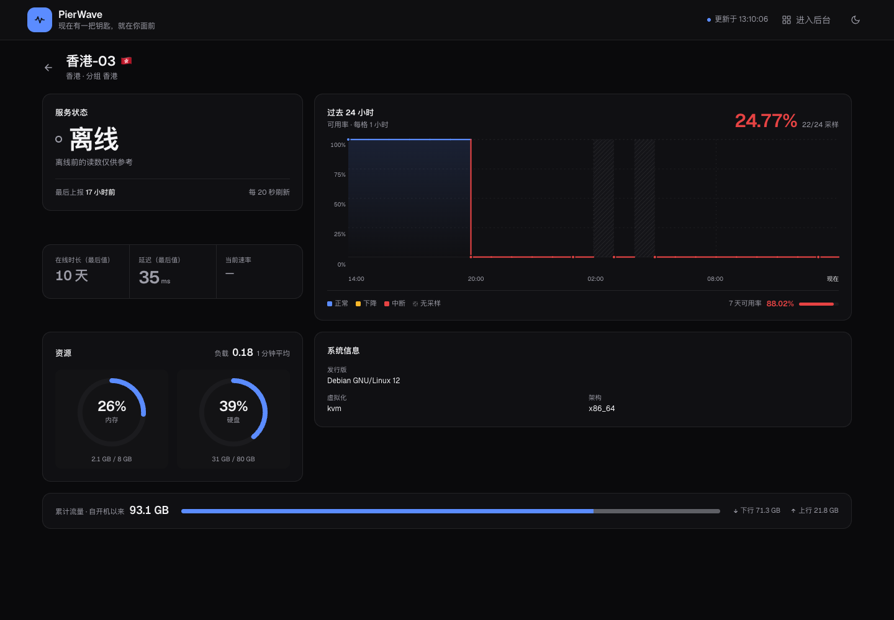
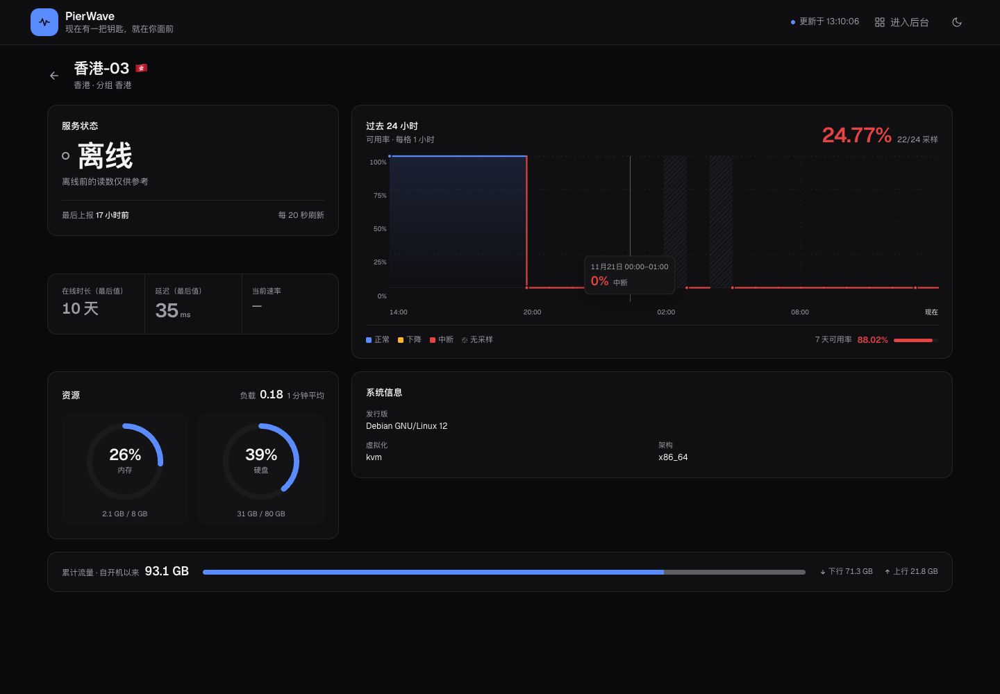

### 3.3 两个方案到底差在哪 / Differences

| 维度 | A 状态报告 | B 仪表盘 |
|---|---|---|
| 视觉隐喻 | 一份报告 / 一张纸 | 一块运维仪表盘 |
| 第一眼 | 大结论「运行正常」 | 状态卡 + 3 个大数字 + 曲线 |
| 24h 手法 | 连续色带（高度不编码） | step area/line（高度=百分比） |
| 健康态观感 | 完整、安静、品牌色带 | 一条贴顶直线，右栏偏空 |
| 事故态观感 | 红色带 + 斜线缺口 | cliff + 红段 + 0% 基线 |
| 桌面内容高 | 1064 | 1000 |
| 390 内容高 | 1050 | 1396 |
| 卡片数量 | 1 张报告纸 + 内部区段 | 6 张卡 + 1 条全宽带 |
| 信息密度 | 中（更好读） | 高（更多并置） |
| 与列表页关系 | 列表 hero → 单份报告，延续“状态结论” | 列表卡片 → 仪表盘，延续“卡片网格” |
| 新接口依赖 | 无；7d 汇总可先上线 | 无；但右栏第二条曲线需要新接口才成立 |
| 落地成本 | 中（1 个页面组件 + CSS） | 中高（SVG 曲线/环/断点/响应式排序） |
| 主要风险 | 页脚信息可能偏小；需要空态/离线态设计 | 健康态空、移动端长、曲线无数据源 |

---

## 4. 任务 C：推荐 / Recommendation

### 4.1 推荐 A

**高级感**：A 的层级是“结论 → 一行关键数字 → 一条时间带 → 资源 → 页脚”。一屏只有一个主角（运行正常/离线）和一条主角图形（24h 色带）；六张同权重卡片消失。B 的信息更多，但仍像“卡片仪表盘”，且健康态那条贴顶直线会把右栏留空。

**信息密度**：B 更高，A 也把现有字段全部用上（7d、累计流量、xray、绝对到期、国家名）。A 的密度是“每屏信息更少但更有用”，B 是“每屏信息更多但更平”。

**落地成本**：A 低。B 需要 SVG step/area、断点、crosshair、环形、网格重排；移动端 1396px 还需要额外的顺序/折叠决策。两者都不需要后端。

**移动端**：A 1050px vs B 1396px。390 上 A 的色带仍是 24 个可数、可点的格子；B 的曲线在 390 上更小，hover/触摸的命中区也更窄。

**结论**：先上 A。如果所有者更想要 miniprobe 那种“仪表盘密度”，再上 B，并同时补一条单机速率/延迟历史；否则 B 的右栏只有一条可用率曲线，投入产出比不如 A。

### 4.2 接口建议 / API recommendation

**不加接口也能上 A/B。** 但要知道缺什么：

- `uptime_7d` 是标量 → A 的 7d 只能是一根汇总条；B 的 7d 只能是一个数字 + mini bar。**不知道哪一天掉过**。
- 每桶没有 `samples` → 无法区分“1 个心跳”和“12 个心跳”的 100%；22/24 与 24/24 在图上同形。
- 单机没有 24h 速率/延迟历史 → B 的右栏只有可用率一条曲线；公开页的 `series` 是站点合计，**不能**当作单机数据。
- 没有事件表 → 只能从桶里看到“某小时下降”，不能解释原因。

**如果只加一项**：`buckets_7d`（7 个日桶或 168 个小时桶）+ 每桶 `samples`。这是已有可用率聚合的延伸，隐私风险低，收益明确。

**如果要做“完整仪表盘”**：再加单机 24h 速率/延迟序列；但这会把“公开每台机器的网络趋势”变成产品承诺，需要所有者明确拍板隐私边界与存储成本。默认**不建议**。

---

## 5. 需要所有者决策 / Owner decisions

1. **A 还是 B？** 推荐 A。若选 B，是否接受“健康态曲线是一条贴顶直线”，并补单机速率/延迟历史？
2. **7 天要不要逐日？** 只接受汇总条（不加接口），还是加 `buckets_7d`？A 的“逐日明细需新增接口”是否要出现在生产 UI，还是只写在文档？
3. **状态色语义**：24h 中断用 `destructive` 红，离线状态本身保持 muted（DESIGN 约定）；A 已按此实现。是否同意？
4. **术语**：公开页统一“节点”，但详情 404 是“该服务器不存在或已下线”。要统一成“节点”还是“服务器”？
5. **“平均延迟”是否改成“延迟”？** 当前 `latency_ms` 是单次 TCP RTT，不是平均。
6. **费用/系统信息是否继续公开？** 两个方案都保留；如果不希望公开，A 的页脚会少两块、B 会少两张卡。
7. **B 的移动端顺序**：状态 → 三数 → 曲线 → 资源 → 费用 → 系统；是否接受 1396px 长页？

---

## 6. 文件 / Files

| 文件 | 说明 |
|---|---|
| `a.html` / `b.html` | 两个静态原型；`?theme=light`、`?variant=incident` |
| `concept.css` | 共用 token / 顶部状态栏 / 字体；抄 `web/src/index.css` |
| `fixture.js` / `fixture.json` | 真实公开状态快照（`fixture.js` 供 file:// 直接加载） |
| `render.mjs` | 14 张截图 + 断言 + `report.json` |
| `audit.mjs` | 现状 8 张截图 + 几何 `audit/report.json` |
| `annotate.mjs` | 现状标注图（2 张） |
| `report.json` | 概念截图尺寸/无溢出断言 |
| `audit/report.json` | 现状几何明细 |
| `audit/current-*` | 现状 normal/offline/light/dark/1440/390 + list |
| `a-*.png` / `b-*.png` | 概念截图（亮暗 × 1440/390 + 事故 + hover） |

### 6.1 截图尺寸

| 文件 | 尺寸 |
|---|---|
| `a-dark-1440.png` / `a-light-1440.png` | 1440×1064 |
| `a-dark-390.png` / `a-light-390.png` | 390×1050 |
| `a-incident-dark-1440.png` | 1440×1064 |
| `a-incident-dark-390.png` | 390×988 |
| `b-dark-1440.png` / `b-light-1440.png` | 1440×1000 |
| `b-dark-390.png` / `b-light-390.png` | 390×1396 |
| `b-incident-dark-1440.png` | 1440×1000 |
| `b-incident-dark-390.png` | 390×1306 |
| `a-hover-dark-1440.png` | 1440×1064 |
| `b-hover-incident-dark-1440.png` | 1440×1000 |

所有 14 张均通过 `scrollWidth <= clientWidth + 1` 断言；见 `report.json`。

---

## 7. English summary

### 7.1 Audit

The current `/status/:id` page is a 896 px column (62% of 1440) of six equal cards. Five section headings are 12 px; only three values reach 28 px, and the rate value is 14 px. It shows less than a single list card: `uptime_7d`, cumulative traffic, the explicit Xray reason, the country name, and an absolute `last_seen` are all missing. Three different time facts (panel update, uptime, last report) are rendered as unlabeled 12 px grey text. The page has two `<h1>`s, and the 404 copy says “服务器” while the rest of the public page says “节点”. “平均延迟” is actually a single probe RTT, not an average.

The 24 bars are 31.8×56 px with a 4 px gap on desktop and 9.75×56 px with a 4 px gap on mobile; the gap consumes 28.2% of the mobile width. Height is the only encoding: a 100% hour is 56 px, a no-data hour is also 56 px (grey), and a 0% hour is 1.12 px. In the real offline fixture, 16 hours of downtime render as a barely visible red dashed line; two no-data hours render as full grey blocks. There is no time axis, no focusable hourly value, no custom hover, no “now” marker, and no sample count. The “lowest” line prints “100%” when every sampled hour is 100%.

### 7.2 Concepts

**A / status report** — one 1120 px sheet, one 46 px verdict, three KPIs (7d, latency, rate), a continuous 24h ribbon, a 7d aggregate bar, compact resources, and a footer for billing, cumulative traffic and OS. The ribbon is 24 flush segments (1 px seam, 46 px tall) with four semantic colours including a hatched “no data”, a five-label time axis, a “now” marker, and a custom hover/focus tooltip (“11月20日 19:00–20:00 · 100% · 正常”). Height no longer encodes data, so no-data and down can never be confused; all-green still reads as a calm, complete band.

**B / dashboard** — a 1352 px two-column layout: status, three large numbers (uptime, latency, rate) and resource rings on the left; 24h step area chart, billing and system on the right; a full-width cumulative-traffic band at the bottom. The chart has a real 0–100% axis, hatched gaps for missing hours, colour-coded segments, transition dots, a crosshair and a tooltip. It is denser and shows an outage as a cliff, but with the real all-100% data it is a flat line near the top and the right column looks empty; it also stacks to 1396 px on a 390 viewport.

### 7.3 Recommendation

Ship A first: stronger hierarchy, correct 24h semantics, a better healthy state, lower implementation cost and a shorter mobile page (1050 vs 1396). B is the better choice only if the owner wants miniprobe-style density and adds a second per-server history series.

No new endpoint is required for either. Recommended optional additions: `buckets_7d` and per-bucket `samples`. Without them, 7d can only be a single aggregate and hourly confidence is invisible. Per-server 24h rate/latency history should stay out of the public payload by default; without it, B’s right column has only one chart, and the site-wide `series` must never be used as if it were per-server.

Everything is static HTML + local fixture; no `web/src` change, no backend change, no commit.
