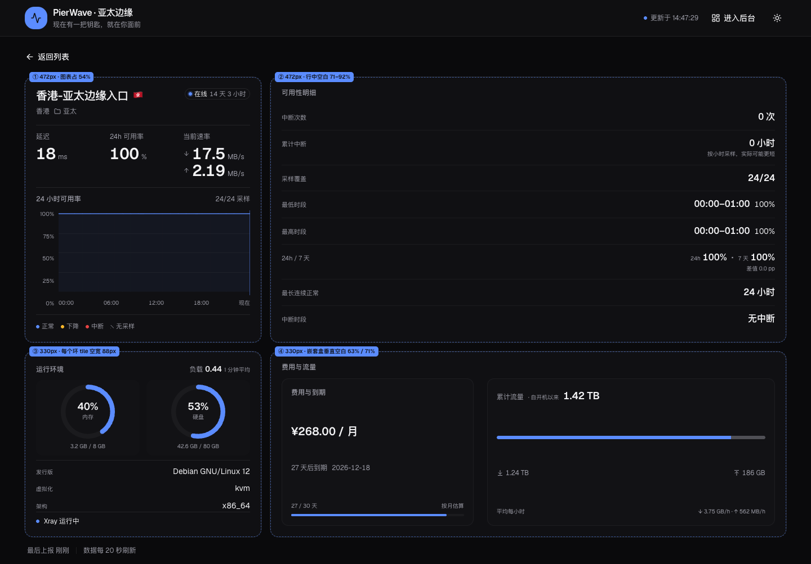
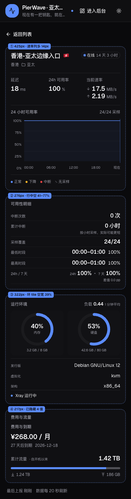
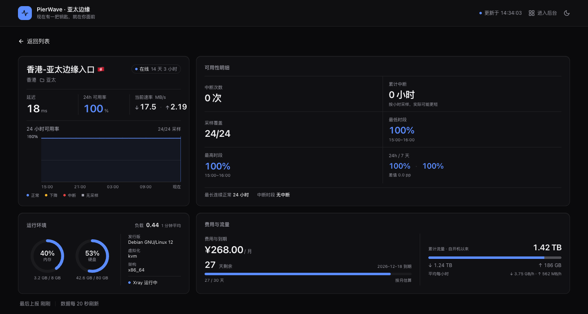
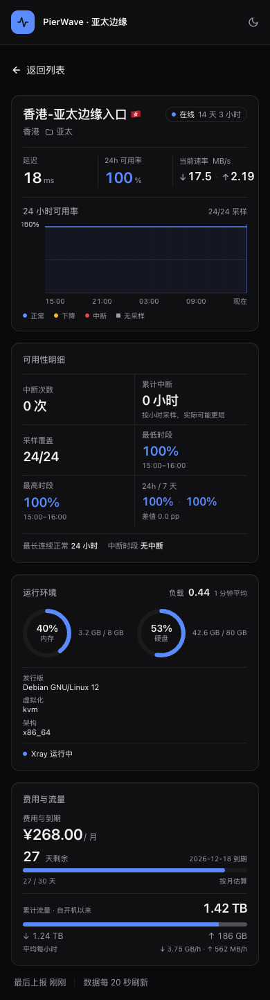
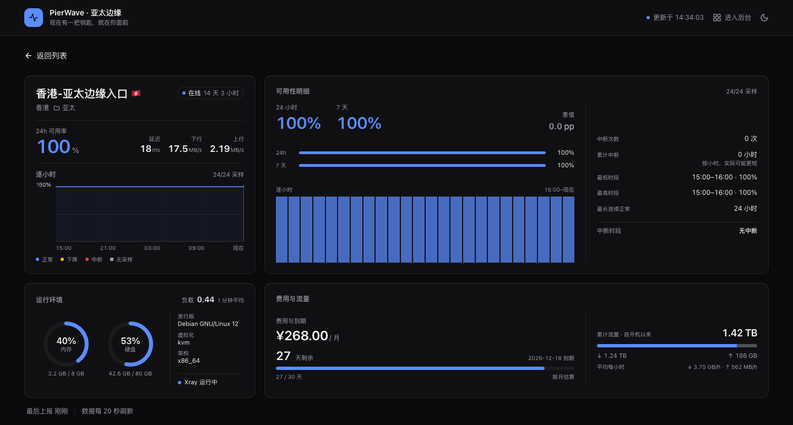
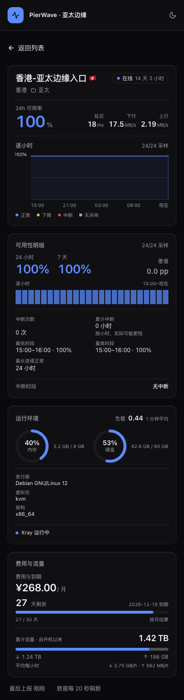

# 服务器详情 · 卡内布局审计与两套原型 / Server detail: card-internal audit & prototypes

范围：`/status/:id` 的四张卡（① 状态与趋势、② 可用性明细、③ 运行环境、④ 费用与流量）。
只测量与做原型，**没有修改 `web/src`，没有 commit**。原型全部在
`web/screenshots/detail-polish/`，用真实公开状态 fixture 静态渲染。

> 一句话结论：**先做 ② 的 2×3 指标栅格、④ 的去嵌套紧凑行、①/③ 的降高**。
> 桌面 1003 → **769px（−23.3%）**、390 1473 → **1442px（−2.1%）**，且手机端多显示 6 项数据；
> 后端第一个该加的是 `outage_minutes_24h`（0.5 天，能把「3 小时」从按小时近似变成精确值）。

---

## 0. 方法与证据 / Method & evidence

- 现状截图与几何：`audit.mjs` 用 Playwright 打开
  `vite preview` 的 `/status/srv-hk`，拦截 `GET /api/v1/public/status` 注入
  `fixtures.mjs` 的 healthy / incident fixture；1440 与 390、亮/暗各测一遍。
- 原型截图与几何：`render.mjs` 直接打开本地 `concept-1.html` / `concept-2.html`
  （`file://`，无网络请求），同一组 fixture 与视口。手动查看时用
  `concept-1.html?state=incident&theme=light` 切换状态/主题。
- 原始数据：`report.json`（现状，8 组）、`prototypes.json`（原型，16 组）、
  `current-internals.json`、`internal-geometry.json`、`comparison.json`。
- 标尺统一：页面外壳（顶栏 65px、返回行 56px、卡片间距 16px、页脚/页底各 16px）
  与现状一致，因此页面高可以直接横向比较。
- fixture 说明：原型把 24 个桶的时间改成**后端真实约定**（当前小时往前 23 小时）；
  旧 fixture 从当天 00:00 开始，会出现「现在 14:34」排在 18:00 之后的时间轴矛盾。
  数值、桶序号/中断位置、资源、费用不变；只有时钟区间随窗口平移
  （同一个 0% 桶在旧 fixture 显示 08:00–09:00，滚动窗口下显示 23:00–00:00）。
- 所有结论都同时验证了 **暗/亮** 与 **健康/事故**：几何完全一致，只有颜色和文字变化，
  所以下文数值以 dark + healthy 为主，事故态单独说明颜色与曲线。

现状标注图（暗色）：





---

## 1. 现状几何 / Current geometry

### 1.1 页面与卡片

| 项目 | 1440 | 390 |
|---|---|---|
| 页面高 | **1003px** | **1473px** |
| 内容宽 | 1352px（x=44…1396） | 358px（x=16…374） |
| 卡宽 | ①③ **420px** / ②④ **916px** | 四张均 **358px** |
| 第一行卡高 | ① **472.34** / ② **472.34** | ① **424.89** / ② **276.16** |
| 第二行卡高 | ③ **329.56** / ④ **329.56** | ③ **321.56** / ④ **217.00** |
| 卡间距 / 页脚 / 页底 | 16 / 16 / 16 | 16 / 16 / 16 |
| 横向溢出 | 无 | 无（390/390） |

### 1.2 字体与颜色基线（现状）

颜色：`foreground = oklch(0.965 0.003 285)`，`muted-foreground = oklch(0.70 0.015 285)`；
状态色只有 `primary`（正常）、`warning`（下降）、`destructive`（中断）三档。

| 元素 | 字号 / 字重 | 颜色 | tabular-nums |
|---|---|---|---|
| 服务器名 h1 | 20 / 600（390 18） | foreground | — |
| 卡片标题 | 12 / 500 | muted | — |
| ① 指标 label | 12 / 400 | muted | — |
| ① 主数字 | 28 / 600（390 19） | foreground（可用率按 tone） | ✅ |
| ① 单位 | 12 / 400 | muted | ✅（继承） |
| ② label | 11 / 400 | muted | — |
| ② 数值 | 16 / 600 | foreground | ✅ |
| ② 副行 | 10 / 400 | muted | ✅（继承） |
| ③ 负载数字 | 14 / 600 | foreground | ✅ |
| ③ 环内百分比 | 18 / 600 | foreground | ✅ |
| ③ 环 label / 用量 | 10 / 400 | muted | 用量 ✅ |
| ③ 系统值 | 14 / 400 | foreground | —（`x86_64` 非动态数） |
| ④ 价格 | 20 / 600，**单位同字号** | foreground | ✅ |
| ④ 到期 | 12 / 400 | muted / warning | ❌（「27 天后到期」） |
| ④ 进度 meta | 10 / 400 | muted | ❌（「27 / 30 天」） |
| ④ 累计总量 | 18 / 600，单位同字号 | foreground | ✅ |
| ④ 平均每小时 | 10 / 400 | muted | ✅ |

现状一共有 **7 档“数字”字号**（10 / 14 / 16 / 18 / 19 / 20 / 28），
3 档 label（10 / 11 / 12），但卡片标题和 ④ 的嵌套区块标题都是 12 / 500。
这让「主数字—次要数字—单位—说明」没有一条稳定的阶梯。

---

## 2. 卡内布局问题清单（按影响排序）/ Findings

每条都有截图与几何；数字来自 `report.json` / `current-internals.json`。

### P0-1 ② 用 916px 宽的一列行式列表装 8 个短指标，行中空白 71–92%

- 桌面 8 行：`中断次数 / 累计中断 / 采样覆盖 / 最低时段 / 最高时段 / 24h·7 天 / 最长连续正常 / 中断时段`。
- 行高 45.59–62.09px，`dl` 总高 **404.34px**，卡片 **472.34px**。
- label 宽 44–66px，value 宽 29.77–209.48px，**中间空白 622.52–802.23px（71.1–91.6% 行宽）**。
- 390 仍是一列 6 行（隐藏 2 行），行高 30.59–46.09px，中间空白 40.7–77.4%。
- 每行 `py-3`（24px 上下）只托一行 21.6px 的文字：**行高的 51.5% 是 padding**。
- 结果：② 与 ① 等高 472px，但视觉上是「左侧一个词 + 右侧一个数」，中间 700px 没有任何结构。

证据：`current-healthy-dark-1440.png`、`current-healthy-dark-390.png`、
`annotated-current-healthy-dark-1440.png`（② 标注「行中空白 71–92%」）。

### P0-2 ④ 卡片里再套两个盒子，垂直空白 63% / 71%，还产生三条左边缘

- 桌面两个 `section`：**340.8×261.56**（费用）与 **511.2×261.56**（流量），各自 `p-4 + border + bg-muted/15`。
- 费用盒内部可用高 229.56px，内容只有 85px（标题 16 + 价格 27 + 到期 16 + 进度 26），
  **空白 144.56px（63.0%）**；价格→到期 **43.53px**，到期→进度 **51.52px**。
- 流量盒内部可用高 229.56px，内容只有 66px，**空白 163.56px（71.2%）**；
  标题→进度条 **56.52px**，进度条→上下行 **52.53px**，上下行→平均 **52.52px**。
- 左边缘出现三条：卡片内容 **500**、费用盒内容 **517**、流量盒内容 **881.8**。
- 「1.42 TB」右边缘 **1064.92**，而流量盒内容右边缘 **1359**：**294px 悬空**，
  且 390 下 `ml-auto` 又把它推到最右——同一张卡的右对齐规则在断点之间翻转。
- 390 下嵌套盒消失（`lg:` 才加边框）、进度和平均行隐藏，视觉语言从「盒中盒」变成「平铺」。

证据：`current-healthy-dark-1440.png`、`annotated-current-healthy-dark-1440.png`（④ 标注「63% / 71%」）。

### P0-3 ① 三个 KPI 深浅不一；24h 曲线占 54% 卡高，但只有一条 100% 线

- 三个 `DetailStat` 同高 82px，但「当前速率」是两行：值区 **58px**，延迟/可用率只有 **28px**，
  所以后两列下方各有 **30px 死区**，三列没法共用一条数字基线。
- 390：值区 42 vs 28，死区 14px。
- 图表块 **256.34px / 472.34px = 54.3%**（390：235.59 / 424.89 = 55.4%）；
  plot 340×150.75（390：286×130），5 条 y 轴标签（100/75/50/25/0），4 个时间刻度 + 「现在」，图例 30.59px + 一条 `border-t`。
- 图表标题「24 小时可用率」与上方 KPI label 重复；健康态时 plot 里几乎只有一条顶线。
- 5 条 y 标签在 150.75px 里平均 37.7px 一条，信息密度低。
- **没有 0% 横轴线**：0% 被刻意跳过（只画 25/50/75/100 网格），0% 数据落在 96% 高度，
  下面紧接 x 轴文字，基线读起来像 label 行而不是坐标轴。
- 最后一个 x 刻度是「现在」而不是时间，和 `00:00/06:00/12:00/18:00` 不是同一类刻度。
- fixture 时间轴还有一处 QA 问题：旧 fixture 从当天 00:00 开始（含未来桶），
  所以 14:34 的「现在」排在 18:00 后面；真实 API 是滚动 24h，原型已修正。

证据：`current-healthy-dark-1440.png`、`annotated-current-healthy-dark-1440.png`（① 标注「图表占 54%」）。

### P0-4 ③ 两个环 tile 各浪费 88px 宽；390 仍固定 2-up

- 桌面 tile **184×134**，环直径 **96px**，每个 tile 横向空 **88px（47.8%）**，两个共 176px。
- 390 tile **157×134**，环仍 96px，每 tile 空 **61px（38.9%）**。
- 环是 `size-24`（96px），但 SVG 的 `size=92`，描边 8 被缩放到 8.35px——尺寸常量与渲染尺寸不一致。
- 系统信息 3 行（30.7px/行）+ Xray 一行，都是「左 10px label / 右 14px value」，信息本身很轻，
  却被放在 330px 高的卡里。
- 负载放在标题行右侧（12px 标题 vs 14px 数值），和其它三张卡的标题行规则不同。

证据：`current-healthy-dark-1440.png`、`current-healthy-dark-390.png`（③ 标注「环 tile 空宽 88px」）。

### P1-5 390 直接隐藏 6 项数据，虽然单列根本没有高度压力

- ② 隐藏 `最长连续正常`、`中断时段`（2 项）；
- ④ 隐藏 `27 / 30 天`、`按月估算`、`平均每小时 ↓`、`↑`（4 项）。
- 桌面 **36 项 → 390 只有 30 项**。
- 390 是单列，卡片高度由内容决定，不存在「桌面 stretch 才需要这些行」的约束；
  隐藏不是响应式，是桌面逻辑的遗留（`hidden lg:flex` / `hidden lg:block`）。

证据：`current-healthy-dark-390.png` vs `current-healthy-dark-1440.png`；
`current-internals.json` 中 `longest/periods hidden=true`、④ 的 `avg` 矩形为 0。

### P1-6 数字/单位/标题层级不统一

- 数值 7 档字号（见 §1.2）；② 的 16px 主数字和 ① 的 28px 主数字承担同样的「主要指标」角色。
- ④ 价格「¥268.00 / 月」整个 20 / 600，`/ 月` 与金额同权重；① 的单位是 12 / 400 muted。
- ② 的「0 次」「0 小时」把单位和数字一起做成 16 / 600。
- ④「平均每小时」的 10px 文本承载两个测量值（↓3.75 GB/h · ↑562 MB/h），是全页最小的数据文本。
- 卡标题、④ 的「费用与到期」都是 12 / 500 muted，嵌套层级无法靠字号区分。

证据：`current-internals.json` 的 leaf 字号 + 截图。

### P1-7 tabular-nums 漏了两处，数字会抖动

- 主数值都用了 `tabular-nums`（① 的 18/100/17.5、② 的 0/24/24、③ 的 40%/0.44、④ 的 ¥268.00/1.42 TB/平均）。
- 但 ④ 的到期天数 **「27 天后到期」是 12px / 400 / normal**；
  进度 meta **「27 / 30 天」是 10px / 400 / normal**（用 headless Chrome 取 computed style 验证）。
- 当 9→10 天、99→100 天时，日期和进度条文案会横向跳动；页面每 20 秒刷新一次，这种抖动可见。
- 修复：这两个元素加 `tnum`，或直接用后端 `outage_minutes_24h` / 数值字段渲染。

证据：`current-incident-dark-1440.png` ④；computed style 见本次审计脚本输出。

### P1-8 四张卡用了四种分隔线语言，卡内间距 8 / 12 / 16 混用

- ①：3 条水平线（KPI 上、图表上、图例上），其中 KPI 与图表的两条只隔 16px。
- ②：每行一条 `border-b`（桌面 6 条 / 390 4 条），像一张表单。
- ③：2 条水平线（系统信息上、Xray 上）。
- ④：2 个嵌套盒边框（只在 `lg`），盒内没有分隔线。
- 卡内 block 间距：① `mt-4/pt-3`（16/12），③ `mt-2`（8），④ `mt-3`（12）+ 盒内 `p-4`（16），② 行 `py-3`。
- 卡片之间的 16px、卡内 20/16px padding 是统一的——问题只在卡内部分。

证据：四张现状截图。

### P2-9 图表细节：五档 y 轴 / 无 0% 基线 / 图例常驻

- plot 高 150.75px（390 130px），5 个 y 标签，25/50/75/100 四条网格线；0% 没有网格线，也没有 x 轴线。
- 图例 30.59px + `border-t`，健康态只有一种颜色，四种图例仍然常驻。
- 事故态：缺失桶是 14.2px 宽的斜线列，0% 线落在基线，红/黄/蓝分段正确；这是现状做得好的部分。
- 事故态与健康态所有卡片几何**完全一致**（不跳动）。

证据：`current-healthy-dark-1440.png`、`current-incident-dark-1440.png`、`current-incident-dark-390.png`。

### P2-10 亮/暗：几何一致，但亮色下轨道与网格线对比偏低

- 1440 与 390、healthy 与 incident 的卡片高度/左右边缘在亮暗两套主题下完全相同。
- 亮色下：环形图未填充轨道用 `--muted`（0.964）压在白色卡片（1.0）上，明度差只约 3.6%；
  图表的 25/50/75 网格线用 `--border`（0.94），在白卡上几乎消失。
- 暗色下：④ 嵌套盒的 `--border` 是白色 8%，盒子的边界主要靠 `bg-muted/15` 才读得出来。
- 建议：亮色给环轨道/图表基线换 `--border-strong`，或把网格线从 25/50/75/100 收到 0/50/100。

证据：`current-healthy-light-1440.png`、`current-healthy-light-390.png`。

### P2-11 390 的「桌面设计」残留（逐卡）

- ①：三列 KPI 每列 **100.7px**，「↓17.5 · ↑2.19」在 19px 下单行刚好塞下；
  速率列仍比另外两列高 14px。
- ②：一列行式，行中空 40.7–77.4%；不是压扁，是把 358px 当 916px 用。
- ③：仍固定 2-up、环 96px，每 tile 空 61px（38.9%）。
- ④：实际在 390 已经变成上下两段，没有嵌套盒；问题不是压扁，而是隐藏了 4 个值。
- 页脚、返回、卡片间距在 390 都成立，横向无溢出。

证据：`current-healthy-dark-390.png`、`annotated-current-healthy-dark-390.png`。

### 现状里做得好的（不要回退）

- ② 的左右边缘严格对齐：label 全部 x=500，value 全部 right=1376。
- ① 的数字与单位用 `items-baseline`，基线对齐；主数值全部 `tabular-nums`。
- 健康/事故、亮/暗下卡片几何不跳；状态色语义正确（86% 红、98.7% 黄、100% 主色）。
- 卡片间距 16、卡内 padding 20/16、页脚/页底 16 一致。
- 390 无横向滚动，长 OS 名有 `truncate + title`。
- ② 的推导口径（null 不是 0、0 桶数 × 1h、覆盖度、最低/最高、连续正常）实现正确，原型沿用。

---

## 3. 两套原型 / Two prototypes

两套都保持四卡结构、2×2 外框（420px 左栏 / 916px 右栏）、16px 卡距、亮暗主题；
只改卡内布局。数字、单位、状态色全部来自同一 fixture。

### 方案 1「指标栅格」/ Metric grid





| 卡 | 改法 | 高度（1440 / 390） | 相对现状 |
|---|---|---|---|
| ① | 3 个 KPI 单行化（速率改为「↓17.5 · ↑2.19」，单位进 label）；图表 112px、3 档 y 轴、图例 12px | **368.38 / 340.72** | −103.96 / −84.17 |
| ② | **2×3 指标栅格**（6 格，每格小标签 + 大数字 + 10px 副行）；底部一条 2 项明细 | **368.38 / 318.13** | −103.96 / **+41.97** |
| ③ | 环 82px（非 96），环与系统信息 **56/44 左右分栏**，系统信息改成 label 上 / value 下的堆叠 | **198.98 / 283.98** | −130.58 / −37.58 |
| ④ | 去掉嵌套盒；**58/42**：左侧价格 + 剩余天数 + 进度 + 周期，右侧总量 + 堆叠条 + 上下行 + 平均 | **198.98 / 265.02** | −130.58 / **+48.02** |

- 页面：1440 **1003 → 769（−234，−23.3%）**；390 **1473 → 1442（−31，−2.1%）**。
- ② 桌面 2×3：每格约 437×87px，行中空白从 71–92% 变成 0；
  代价是每个短值右侧仍有空白，但纵向少 104px、6 个数字有了统一的标签/数值基线。
- ③ 桌面环从 96→82，tile 空宽从 88px 降到 20px；390 环改为「环 70 + 用量并排」，
  从 61px 纯空宽变成 0–13px（内存格 13px，硬盘格 0.4px）。
- ④ 用垂直 hairline 分栏代替盒中盒；总量右边缘与右栏内边缘对齐（1375）。
- 信息：桌面 36 项；390 也是 36 项（补回 ② 的 2 项、④ 的 4 项），**没有删数据**。
- 已知取舍：② 在 1440 每格 437px 宽，短值（如「0 次」）右侧留白仍多；
  若更在意横向密度，可在 ≥1280 用 3×2（2 行），但每格会变高，需重新平衡 ① 的高度。

### 方案 2「主次分栏」/ Primary–secondary split





| 卡 | 主信息（60–65%） | 次要信息（35–40%） | 高度（1440 / 390） |
|---|---|---|---|
| ① | 24h 可用率 **34px** 主数字 + 曲线（逐小时） | 延迟 / 下行 / 上行 3 个小读数（17px） | **361.03 / 338.63** |
| ② | 62%：24h vs 7 天两个大数字 + 差值 + 2 条 mini bar + **24 格逐小时柱带** | 38%：中断次数 / 累计中断（含「按小时」脚注）/ 最低 / 最高 / 最长 + 中断时段 | **361.03 / 347.34** |
| ③ | 60%：两个资源环（82px） | 40%：发行版 / 虚拟化 / 架构 / Xray 的 10–12px 微列表 | **208.98 / 291.98** |
| ④ | 62%：价格 + 剩余天数 + 进度 + 周期 | 38%：累计流量 + 堆叠条 + 上下行 + 平均（更小字号） | **208.98 / 263.67** |

- 页面：1440 **1003 → 772（−231，−23.0%）**；390 **1473 → 1475（+2，+0.1%）**。
- ① 的 3 个次要读数共用一条基线（y=245.84、h=34.19），主数字 34px 最高；
  曲线和数字共用 65→443 的左右内边界。
- ② 的主次分栏让「对比」和「明细」分开；24 格柱带是为了填满 stretch 后的高度，
  同时给逐小时一个比折线更精确的读取方式。
- ③ 的 60/40 让「Debian GNU/Linux 12」在系统栏里单行放下（桌面 135px 栏宽，11px 字）。
- ④ 左右首行顶部对齐（price 594.70 / total 593.55），右边缘统一到 1375。
- 信息：桌面 36 项；390 36 项（② 标题保留「21/24 采样」，④ 补回 4 项）。
- **主要取舍**：② 桌面必须靠 24 格柱带填高度；如果不要这个与 ① 同源的柱带，
  ② 在 1440 会留下约 100px 空白，或者必须把 ① 压到 ~300px。柱带是「同源再编码」，
  不是新数据；不喜欢重复编码就选方案 1。

### 两套原型的共同点

- 卡内最大间距：方案 1 **14px**，方案 2 **24px**（现状最大 56.5px）。
- 所有数值统一 `tabular-nums`；单位一律 10–12px muted，不再和数字同字号。
- 分隔线统一：② 用栅格线，③/④ 用一条垂直 hairline；不再「卡片里套卡片」。
- 390 的 ②/④ 补回现状隐藏的 6 项；①/③ 高度下降抵消了这些增量。
- 不改四卡结构、不改外框 2×2、不新增接口。

### 对比表 / Comparison

| 指标 | 现状 | 方案 1 | 方案 2 |
|---|---|---|---|
| **1440 页面高** | 1003 | **769（−234 / −23.3%）** | **772（−231 / −23.0%）** |
| 1440 栅格高 | 817.91 | 583.36（−234.55） | 586.02（−231.89） |
| 1440 第一行卡高 | 472.34 | 368.38（−103.96） | 361.03（−111.31） |
| 1440 第二行卡高 | 329.56 | 198.98（−130.58） | 208.98（−120.58） |
| **390 页面高** | 1473 | **1442（−31 / −2.1%）** | **1475（+2 / +0.1%）** |
| 390 ① / ② / ③ / ④ | 424.89 / 276.16 / 321.56 / 217.00 | 340.72 / 318.13 / 283.98 / 265.02 | 338.63 / 347.34 / 291.98 / 263.67 |
| 卡内最大间距 | 56.5px（④） | 14px | 24px |
| ② 行中空白 | 71–92%（390 41–77%） | 0（2 列栅格） | 0（62/38） |
| ④ 嵌套盒垂直空白 | 63% / 71% | 无嵌套盒 | 无嵌套盒 |
| ③ 环 tile 空宽 | 88px（390 61px） | 20px（390 0–13px，环+用量并排） | 29px（390 0–13px） |
| 信息项（桌面 / 390） | 36 / **30** | 36 / **36** | 36 / **36** |
| 卡面积（4 卡合计，1440） | 1.071M px² | 0.758M（−29.2%） | 0.762M（−28.9%） |
| 信息/面积（1440，项/10 万 px²） | 3.36 | **4.75（+41%）** | **4.73（+41%）** |
| 信息/面积（390） | 6.76（30 项） | **8.33（36 项，+23%）** | **8.10（36 项，+20%）** |

“空白”口径：行中空白是 label 右边缘到 value 左边缘；嵌套盒空白是盒内高减内容高；
卡内最大间距是卡片直接子块之间的垂直 gap。原始值见 `comparison.json`。

### 信息增减 / Information delta

- 桌面：三套都是 **36 项**（① 7 = 6 个数字 + 24h 曲线；② 10；③ 9；④ 11）。
- 390：现状 **30**；两套原型 **36**。补回：
  - ② `最长连续正常`、`中断时段`（+2）
  - ④ `27 / 30 天`、`按月估算`、`平均每小时 ↓`、`↑`（+4）
- 两套原型都**没有删数据**；方案 2 额外多一个 24 格逐小时柱带（同源可视化，不是新字段）。
- 两套原型都保留了「无采样 → —」的规则（见 `fixtures.mjs` 的 nodata 分支；
  本次截图矩阵聚焦 healthy/incident，未渲染 nodata 原型，但所有值都走同一 binding）。

---

## 4. 后端接口建议 / Backend proposals

原则：公开页只加「运营事实」，不加内部错误文本、IP、端口、配置。
现有公开接口已有 30 秒缓存（`state.public_status`），前端 20 秒刷新；
下表成本按「已有 `server_samples` 7 天保留」估算。

### 4.1 汇总表

| 字段 | 形状 | 数据来源 | 隐私风险 | 成本（迁移/查询/缓存） | 不加会缺什么 | 结论 |
|---|---|---|---|---|---|---|
| `outage_minutes_24h` | `int`，如 `35` | `server_samples` 24h 内 `SUM(CASE WHEN online=0 THEN 5 ELSE 0 END)` | 低（与现有 24h 可用率同源） | 无迁移；现有聚合多一个表达式；缓存不变；**~0.5 天** | 「3 小时」是 0 桶数 × 1h，短中断被放大，才需要「实际可能更短」的脚注 | **推荐（第一个做）** |
| `buckets_7d` | 固定 7 项（旧→新）：`{day:"2026-11-15", online_ratio:0.9986, sampled:288, expected:288}`，无采样为 `null` | `server_samples` 按 UTC+8 业务日聚合 | 低–中：暴露逐日中断窗口（比 24h 更粗） | 无迁移（原始 7d）；一次 `GROUP BY`，约 2016 行/台/请求；缓存 30s；**~1 天**。若要做 30d，建议日汇总表，+2 天 | ② 只有 98.7% 一个数，没有 7 天条带/趋势，也做不了「已稳定 N 天」 | **推荐** |
| `series_24h` | 复用 `PublicSeries`：`{window_secs:86400, step_secs:3600, t:[24], rate_rx_bps:[24], rate_tx_bps:[24], latency_ms:[24]}`，缺桶 `null` | `server_samples` 按小时 `AVG(rx_bps/tx_bps/latency_ms)`（离线样本排除） | 中：暴露一天的流量/延迟节奏；但已有当前速率 + 60 分钟 series，属同一类数据 | 无迁移；一次 `GROUP BY ts/3600`；payload 约 +1KB/台；缓存 30s；**~1 天** | ① 只能看「现在」和 24h 可用率，无法回答「03:00 是不是慢/断」 | **推荐（1h 粒度）** |
| `first_seen_at` | Unix 秒，如 `1746518400`；前端算 `age_days` | `servers.created_at`（现成）或新列首次心跳写入 + `MIN(server_samples.ts)` 回填 | 低：只暴露接入日期 | 复用 `created_at` 0 迁移、~0.25 天；独立列需迁移 0063 + 回填，~0.5–1 天 | 「已运行 N 天」做不了；`uptime_secs` 是开机时长，重启归零，不是服务年龄 | **推荐** |
| `inbound_count` | `u16`，如 `3`（仅数量） | `nodes WHERE server_id=? AND enabled=1` 批量 `COUNT(*)` | 低：不含端口/tag/协议名 | 无迁移；一次批量聚合；**~0.5 天** | ③ 只说「Xray 运行中」，用户不知道这台机器实际承载几个入口 | **推荐** |
| `xray_version` | `"25.9.11"`（可选，建议只到 major.minor） | Agent 心跳新字段 + `servers.xray_version`；需升 `PROTOCOL_VERSION` | 中：补丁级别是攻击面指纹；旧 Agent 必为 null | 迁移 + 协议版本 + Agent 发版 + 兼容；**~2–3 天** | 无法判断版本新旧/是否需要升级 | 可选（只展示 major.minor） |
| `events`（最近 5 次状态变更） | `[{at, kind:"online\|offline\|degraded\|recovered", reason_code:"heartbeat_timeout\|agent_restart\|xray_down\|manual\|unknown"}]` | 新表 `server_status_events`，在心跳超时/重连/Xray 翻转时写；`server_samples` 只能回填 online/offline，无 reason | 中–高：reason 会暴露故障模式；只能给粗粒度码，且建议 opt-in | 迁移 + 写路径 + 去重 + 90d 保留 + `(server_id, at DESC)` 索引；**3–5 天** | 只能看到「现在离线」，看不到「为什么、多久一次」；② 的 0% 时段无法区分维护/故障 | 可选（粗粒度、opt-in） |
| `availability_30d` + `longest_streak` | `availability_30d: 0.9991`、`longest_online_secs: 2678400` | 日汇总表（先聚合再清理 raw）；streak 用 servers 两个计数列在状态翻转时更新 | 低 | 日汇总表 + 调度任务 + 回填，~2–3 天；streak 列 ~0.5 天 | 只有 7d；没有长期可靠性和「最长连续在线」这类信任指标 | 可选（先日汇总） |

### 4.2 不推荐 / Not recommended

| 方案 | 原因 |
|---|---|
| 24h 速率/延迟用 **5 分钟 × 288 点** | payload 是 1h 粒度的 12 倍（每台 ~12KB），公开页只需要趋势；1h 平均值足够 |
| 暴露每个 inbound 的协议/端口/tag | 直接扩大攻击面，且不是「公开状态」必需；只给 `inbound_count` |
| 暴露完整 Xray 版本 / 原始配置 / 错误文本 | 版本+错误文本是指纹与内部拓扑；用 major.minor 或「需升级」布尔值 |
| 状态事件自由文本 / IP / 节点地址 | 会泄漏基础设施；只给 `reason_code` 枚举 |
| 30d 直接查 raw `server_samples` | 保留 7d 是当前设计；要 30d 必须先做日汇总，否则存储/扫描 ×4.3 |
| 把 `paid_until` 精度提高到小时 | 计费按业务日，小时级只会制造「今天/明天」的边界争议 |

### 4.3 建议的 JSON 形状（可直接评审）

```jsonc
{
  "servers": [{
    "id": "srv-hk",
    "first_seen_at": 1746518400,
    "inbound_count": 3,
    "outage_minutes_24h": 35,
    "buckets_7d": [
      { "day": "2026-11-15", "online_ratio": 0.9986, "sampled": 288, "expected": 288 },
      null,
      { "day": "2026-11-17", "online_ratio": 0.9123, "sampled": 288, "expected": 288 }
    ],
    "series_24h": {
      "window_secs": 86400,
      "step_secs": 3600,
      "t": [1795159200, 1795162800],
      "rate_rx_bps": [18350080, null],
      "rate_tx_bps": [2296381, null],
      "latency_ms": [18, null]
    },
    "events": [
      { "at": 1795201200, "kind": "offline", "reason_code": "heartbeat_timeout" },
      { "at": 1795204800, "kind": "online", "reason_code": "agent_restart" }
    ]
  }]
}
```

### 4.4 落地顺序建议

1. **`outage_minutes_24h`**（0.5 天，无迁移）：立刻去掉「按小时采样，实际可能更短」的模糊表达。
2. **`series_24h` + `buckets_7d`**（各 ~1 天，无迁移）：② 的 7 天条带、① 的 24h 速率/延迟 sparkline 才有数据。
3. **`first_seen_at` + `inbound_count`**（~1 天）：③ 从「主机信息」变成「节点信息」。
4. 有余力再做 `xray_version` / 粗粒度 `events` / 30d 日汇总。

---

## 5. 结论 / Conclusion

**最该先做的 3 条：**

1. **② 改成 2×3 指标栅格**：桌面 −104px，行中空白从 71–92% 清零；不改后端。
2. **④ 去掉嵌套盒，到期做成「价格 + 剩余天数 + 进度条」紧凑行**：桌面 −131px，
   390 同时补回 4 个被隐藏的值；不改后端。
3. **① 曲线降到 104–112px、y 轴收到 3 档；③ 环降到 82px、系统信息堆叠**：
   两者合计再省 ~100px（桌面）/ ~120px（390），并给 390 的 ②/④ 腾出补信息的空间。

如果只做一件事：先做 **②**。它的收益最大、风险最低、不动任何数据口径。

---

## 6. 截图矩阵 / Screenshot matrix

全部 34 张（当前 8 + 标注 2 + 原型 16 + 原型标注 8）。

| 组 | 1440 dark | 390 dark | 1440 light | 390 light |
|---|---|---|---|---|
| 现状 healthy | [current-healthy-dark-1440.png](current-healthy-dark-1440.png) | [current-healthy-dark-390.png](current-healthy-dark-390.png) | [current-healthy-light-1440.png](current-healthy-light-1440.png) | [current-healthy-light-390.png](current-healthy-light-390.png) |
| 现状 incident | [current-incident-dark-1440.png](current-incident-dark-1440.png) | [current-incident-dark-390.png](current-incident-dark-390.png) | [current-incident-light-1440.png](current-incident-light-1440.png) | [current-incident-light-390.png](current-incident-light-390.png) |
| 方案 1 healthy | [p1-healthy-dark-1440.png](p1-healthy-dark-1440.png) | [p1-healthy-dark-390.png](p1-healthy-dark-390.png) | [p1-healthy-light-1440.png](p1-healthy-light-1440.png) | [p1-healthy-light-390.png](p1-healthy-light-390.png) |
| 方案 1 incident | [p1-incident-dark-1440.png](p1-incident-dark-1440.png) | [p1-incident-dark-390.png](p1-incident-dark-390.png) | [p1-incident-light-1440.png](p1-incident-light-1440.png) | [p1-incident-light-390.png](p1-incident-light-390.png) |
| 方案 2 healthy | [p2-healthy-dark-1440.png](p2-healthy-dark-1440.png) | [p2-healthy-dark-390.png](p2-healthy-dark-390.png) | [p2-healthy-light-1440.png](p2-healthy-light-1440.png) | [p2-healthy-light-390.png](p2-healthy-light-390.png) |
| 方案 2 incident | [p2-incident-dark-1440.png](p2-incident-dark-1440.png) | [p2-incident-dark-390.png](p2-incident-dark-390.png) | [p2-incident-light-1440.png](p2-incident-light-1440.png) | [p2-incident-light-390.png](p2-incident-light-390.png) |

标注（卡片高度直接画在卡片上）：

- 现状：[1440](annotated-current-healthy-dark-1440.png) · [390](annotated-current-healthy-dark-390.png)
- 方案 1：[healthy 1440](annotated-p1-healthy-dark-1440.png) · [healthy 390](annotated-p1-healthy-dark-390.png) · [incident 1440](annotated-p1-incident-dark-1440.png) · [incident 390](annotated-p1-incident-dark-390.png)
- 方案 2：[healthy 1440](annotated-p2-healthy-dark-1440.png) · [healthy 390](annotated-p2-healthy-dark-390.png) · [incident 1440](annotated-p2-incident-dark-1440.png) · [incident 390](annotated-p2-incident-dark-390.png)

## 7. 复现 / Reproduce

```bash
# 1) 现状（需要已构建的 dist + preview）
cd web
NPM_CONFIG_CACHE=/Users/jlthzy/Documents/mmrust/.npm-cache npm run build
npx vite preview --port 4173 --strictPort
# 另一个终端
cd /Users/jlthzy/Documents/mmrust
node web/screenshots/detail-polish/audit.mjs
node web/screenshots/detail-polish/annotate-current.mjs

# 2) 原型（file://，无需服务）
node web/screenshots/detail-polish/make-fixture.mjs
node web/screenshots/detail-polish/render.mjs
```

产物：

- 现状 8 张：`current-{healthy,incident}-{dark,light}-{1440,390}.png`
- 现状标注 2 张：`annotated-current-healthy-dark-{1440,390}.png`
- 方案 1/2 各 8 张：`p{1,2}-{healthy,incident}-{dark,light}-{1440,390}.png`
- 原型标注 8 张：`annotated-p{1,2}-{healthy,incident}-dark-{1440,390}.png`
- 几何：`report.json`、`prototypes.json`、`current-internals.json`、
  `internal-geometry.json`、`comparison.json`

附带发现（不在本次卡内范围）：390 的真实顶栏把「更新于 / 进入后台 / 主题」挤在同一行，
`进入后台` 会换成两行（`current-healthy-dark-390.png` 可见）；原型外壳为了截图干净，
在 390 隐藏了「更新于」和「进入后台」，但页面高度仍按同样的 65px 顶栏计算，不影响对比。

---

## English summary

Scope: `/status/:id` four cards. **No product code changed, no commit.** All work is
under `web/screenshots/detail-polish/`. Evidence is screenshot-based and geometric
(Playwright at 1440/390, dark/light, healthy/incident).

### Findings (highest impact first)

1. **② is a 916px-wide one-column list of 8 short metrics.** Labels are 44–66px
   and values 30–209px, leaving **622–802px (71–92%) empty in the middle** of each row.
   Rows are 46.6px tall with 24px vertical padding for one 21.6px line.
   At 390 it keeps 6 rows with 41–77% middle void.
2. **④ nests two boxes inside the card.** The billing box is 340.8×261.6 with only
   85px of content (**63% vertical blank**); the traffic box is 511.2×261.6 with 66px
   of content (**71% blank**). There are three left edges (500 / 517 / 881.8) and the
   total “1.42 TB” ends at x=1064.9 while the traffic content right edge is 1359
   (**294px short**).
3. **① devotes 54% of the card to a chart with one series**, uses 5 y-axis labels in
   150.75px, has no 0% axis line, and duplicates its title. The rate column is 58px
   tall vs 28px for latency/uptime, leaving 30px dead space under two of three KPIs.
4. **③ wastes 88px of width per ring tile** at 1440 (184px tile vs 96px ring, 47.8%)
   and 61px at 390 (38.9%); the ring stays 96px at both sizes.
5. **390 hides 6 real data items** (② longest/periods; ④ remaining/total estimate,
   estimate label, avg rx, avg tx), even though the single column has no height
   pressure. Desktop has 36 items, mobile 30.
6. Typography has 7 numeric sizes (10/14/16/18/19/20/28) and units are inconsistent
   (① 12px muted; ④ unit at the same 20/18px as the number).
7. `tabular-nums` is missing on “27 天后到期” (12/400) and “27 / 30 天” (10/400).
8. Four cards use four separator languages (3 rules / 6 row hairlines / 2 rules /
   2 nested boxes) and mix 8/12/16px internal gaps.
9. Chart: 5 y labels, no 0% baseline, always-on 4-item legend, title duplicated.
10. Light theme: ring track and 25/50/75 grid lines have very low contrast on white.
11. At 390, ② still behaves like desktop (full-width label/value rows), ③ stays 2-up
    with a fixed 96px ring; ④ actually stacks but hides 4 values.

### Prototypes

| | Current | P1 Metric grid | P2 Primary–secondary |
|---|---|---|---|
| 1440 page | 1003 | **769 (−234, −23.3%)** | **772 (−231, −23.0%)** |
| 1440 row 1 | 472.34 | 368.38 | 361.03 |
| 1440 row 2 | 329.56 | 198.98 | 208.98 |
| 390 page | 1473 | **1442 (−31, −2.1%)** | **1475 (+2, +0.1%)** |
| Info items (desktop / 390) | 36 / **30** | 36 / **36** | 36 / **36** |
| Max internal gap | 56.5px | 14px | 24px |
| ② middle void | 71–92% | 0 | 0 |
| ④ nested blank | 63% / 71% | none | none |
| Info density (1440, items/100k px²) | 3.36 | 4.75 | 4.73 |

- **P1**: ① three single-line KPIs; ② 2×3 metric grid; ③ 56/44 rings + stacked system
  info; ④ 58/42 with no nested boxes (price + remaining + progress against traffic total).
- **P2**: ① 34px availability hero + three small side reads; ② 62/38 comparison + mini
  bars + 24-cell hourly histogram vs a compact detail list; ③ 60/40 rings vs micro
  system list; ④ 62/38 billing vs mini traffic.
- Both restore the six mobile-hidden values; neither removes data.
- P2’s main tradeoff: ② needs the hourly histogram to fill the stretched height; without
  it, ② has ~100px of blank at 1440 (or ① must shrink to ~300px). It is the same buckets
  re-encoded, not a new field.

### Backend

**Recommended:** `outage_minutes_24h` (0.5d, no migration; replaces the hourly
approximation), `series_24h` at 1h granularity (1d; reuses `server_samples`, ~1KB/server),
`buckets_7d` (1d raw / +2d daily rollup), `first_seen_at` (0.25–1d), `inbound_count`
(0.5d, count only).
**Optional:** `xray_version` (2–3d: Agent + protocol bump; expose major.minor only),
coarse status `events` (3–5d, opt-in, enum reason codes), `availability_30d` +
`longest_streak` (2–3d with a daily rollup).
**Not recommended:** 5-minute × 24h series (12× payload), per-inbound protocol/port/tag,
raw Xray config/error text, free-text event reasons, querying 30d from raw samples.

### Three things to do first

1. **② → 2×3 metric grid** (desktop −104px; removes the 71–92% middle void).
2. **④ → no nested boxes + compact price/remaining/progress row** (desktop −131px;
   restores 4 mobile values).
3. **① chart 104–112px / 3 y ticks, ③ rings 82px + stacked system info** (another
   ~100px desktop / ~120px mobile), which creates room for the restored 390 values.
