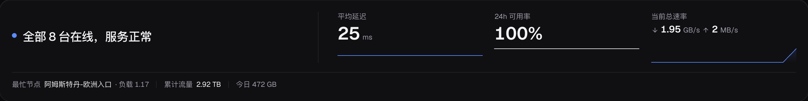
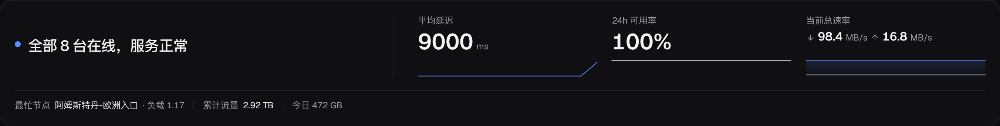
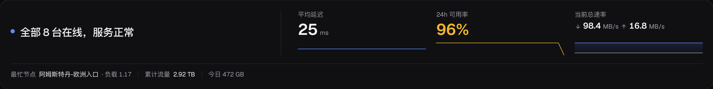
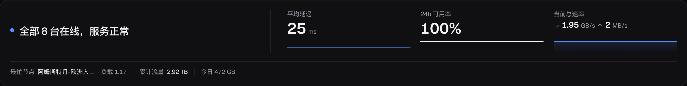

# 公开状态页 hero 三 KPI 极值审计

- 对象：`/status` hero 的「平均延迟 / 24h 可用率 / 当前总速率」
- 源码：`web/src/components/status/Hero.tsx`、`web/src/components/status/HeroSparkline.tsx`（只读，未改）
- 方法：Playwright 拦截 `GET /api/v1/public/status`，注入 fixture；尺寸 / 字号 / 基线 / 对比度全部取 headless Chrome 的计算值与 `getBoundingClientRect()`；曲线另做 2× DPR 像素行分析。
- 覆盖：主矩阵 264 jobs（33 fixture × 1440/390 × 亮/暗 × 中/英）+ 挤压 144 + A/B 40 + 边界 8 + null 补测 32 + series/buckets 64 = **552 次页面测量**，**297 张截图**。
- 结论前置：**没有发现横向溢出、文字被裁、卡片被撑破**（552 jobs 全 0）；真正的阻断项是「可读性 / 数据正确性 / 键盘可达性」，见第 1 节。

---

## A. 单序列量级突变（先回答：小值还能不能看见）

三张图都用**线性**映射（没有 log）：

| 图 | 映射 | 代码位置 |
|---|---|---|
| 速率 | `domain 0..max`（零基线） | `HeroSparkline.tsx` 的 `zeroBased: true` |
| 延迟 | `min..max` 自适应 + 上下各留 12% padding | `zeroBased: false`（默认） |
| 可用率 | 固定 `0..1` | `domain: [0, 1]` |

### A1. 速率 `[2 MB/s ×11, 2000 MB/s]`（1000 倍）

fixture：`temporal-spike-rate`（`tx = null`，避免上行线盖住同高度的小值）

- 2 MB/s → `y = 47 − (2/2000) × 46 = 46.95`（viewBox 48）→ **23.48 px**（图高 24 px）
- 2000 MB/s → `y = 1` → **0.5 px**
- 0 B/s 的理论线 → `y = 47` → 23.5 px；**2 MB/s 只比 0 高 0.046 viewBox px = 0.023 CSS px**
- 2× DPR 像素：小值段落在设备行 **46–47**，线宽 **1.0 CSS px**（2 设备行），**bottomGap = 0.0 px（贴底）**

结论：**小值段能画出来，但读不出「非零」**——它和 0 的线在同一个像素行。截图里只看得到一条贴底线 + 末尾尖峰；「尖峰前是 2 MB/s 还是 0」无法区分。**必须修**（至少让它离底 1–2 px）。

### A2. 延迟 `[28 ms ×11, 9000 ms]`（≈321 倍）

fixture：`temporal-spike-latency`

- 28 ms → y=42.55 → **21.28 px**（图高 24 px），离底 **2.73 px**
- 9000 ms → y=5.45 → **2.73 px**，离顶 2.73 px
- 小值段相对 0 ms 只高 0.058 CSS px（28 vs 0 仍不可分），但**线本身在离底 2.73 px 处，肉眼可见**
- 2× DPR 像素：小值段设备行 **42**，中心 **21.25 CSS px**，bottomGap **2.5 px**，线宽 1 px（栅格化后 1 行）

结论：**可以接受**。321 倍的尖峰被完整表达，小值段是一条离底约 2.7 px 的可见线；代价是 28 ms 与 0 ms、28 与 30 ms 无法区分。若要让「低延迟段的微小波动」也可读，才需要非线性或最小高度，当前 KPI 语义下不必先改。

### A3. 可用率 `[1.0 ×23, 0.0]`

fixture：`temporal-spike-uptime`（24 个小时桶，`uptime_24h = 23/24 = 0.9583`）

- 1.0 → y=1 → **0.5 px**；0.0 → y=47 → **23.5 px**
- 固定 0–1 域，没有压缩；末尾的 0 是右边缘一段可见的垂直下落
- 像素：顶部水平段设备行 **0–1**（1.0 CSS px），底部 0 点由 path 的 `yMax=47` 保证（贴底但可见）
- KPI 数字显示 **96%**（`Math.round(95.83)`，色阶 warn）

结论：**可以接受，确认无问题**。固定域正是为了避免 96%–100% 被拉成锯齿；0 落在底边是正确语义。

---

## B. 双线量级悬殊（2000 MB/s vs 2 MB/s，1000 倍）

fixture：`dual-gap-rx-high`（rx 高）/ `dual-gap-tx-high`（tx 高）

- **共用同一比例尺**：`multiSparkGeometry` 对两条线取同一个 0..max，实测 y 与上面 A1 完全一致。
- 高线：2000 MB/s → y=1 → **0.5 px**
- 低线：2 MB/s → y=46.95 → **23.48 px**；比 0 高 **0.023 px**
- 2× DPR 像素：低线设备行 **46–47**，中心 23.5 CSS，**bottomGap 0.0（贴底）**，线宽 **1.0 CSS px**；高线设备行 0–1。
- 390 下同样：高线 0.42 px，低线 19.56 px（图高 20），低线贴底。

回答：

1. **两条线共用同一比例尺**：是。
2. **小线是否可见**：作为一条 1 px 的线「能看见」，但它与 0 只差 0.023 px，渲染后落在同一像素行；**读不出 2 MB/s，也读不出它的趋势**。这正是「可见但不可读」。
3. **可接受的诚实还是必须改**：我判定为**必须改**。理由：
   - 这不是「比例真实所以可以接受」——像素分辨率已经把小值量化成 0，信息在渲染层丢失；
   - 这个 KPI 刻意画了两条线（↓/↑），用户会以为能比较两个方向；现在一个方向直接贴底，等于只画了主导方向；
   - 大数字虽然给了当前精确值，但趋势图的历史小值无法回看。
   - 若产品明确决定「这张图只表达主导方向」，则必须**明确标注**（例如只画一条线/写「仅显示较大方向」），否则是误导。

---

## C. 可落地方案（含代价）

### 方案 1（推荐先做，低风险）：非零值最小可见高度 + 单位自动进位

- 在 `multiSparkGeometry` 输出几何后，对 `value > 0` 的点做 `y = min(y, height - 2)`（至少离底 1.5–2 px）；0 仍贴底。
- 速率 `rateParts` 在四舍五入后再检查一次：若 `value >= 1024` 且还有更高单位，升一级（1024 GB/s → 1 TB/s）。
- 代价：所有很小的非零值会被抬到同一条「地板线」，**它们之间的相对大小失真**；但至少能区分「有流量 / 真 0」，且不改变大值区的线性比例。实现只在几何层，不动数据与 tooltip。

### 方案 2（信息更完整，但更重）：超过阈值切 log / symlog + 明示

- 当 `max / minNonZero >= 100`（或双线比值 ≥100）时，速率图改用 `log1p(value)` 映射；KPI 仍显示线性数值，tooltip 给精确值。
- 需要在图上加一个极小的 `log` / `对数` 标记，否则用户会把对数比例误读成线性。
- 代价：非线性会让「2→4 MB/s」和「1000→2000 MB/s」看起来变化一样大；必须加解释性文案（与「少写解释性文案」的约定冲突），且 0 要单独处理（log1p(0)=0）。**建议只在产品明确接受「对数」标记时使用。**

### 方案 3（不推荐）：双线各自归一化 + 「各自缩放」

- 两条线各自 0..max，形状都完整；但两条线的高度不再可比，**会制造「上行和下行差不多」的错觉**。
- 代价：失真 + 必须常驻「各自缩放」说明；在 24 px 的 hero 图上不值得。若一定要用，至少把说明放在图例/aria 里，并保持 tooltip 精确值。

**推荐组合**：方案 1 作为 P0；若监控语义确实需要看小值趋势，再在方案 2 上做产品决策。方案 3 仅作为最后手段。

---

## 1. 阻断级（最多 5 条）

> 552 个测量 job 中：横向溢出 **0**、卡片溢出 **0**、文字裁切 **0**、文字与图重叠 **0**。下面 4 条不是「被裁」，而是「读不到 / 读错 / 键盘不可达」。

### 1.1 键盘完全无法触发迷你图 tooltip

- fixture：`baseline`（1440/390 × 亮/暗 × 中/英 全部 8 组）
- 截图：`shots/tooltip-right-baseline-zh-CN-dark-390.png`、`shots/tooltip-firstrow-baseline-zh-CN-dark-390.png`
- 几何 / 行为：
  - 3 个 SVG 的 `tabIndex = -1`，`tabindex` 属性为 `null`
  - `svg.focus()` 后 `document.activeElement` 仍是 `BODY`（`focusSucceeded = 0`）
  - 连续 24 次 `Tab` 从未进入 `[data-slot="hero-sparkline"]`；`tooltipAfterTab = 0`
  - tooltip 自身 `aria-hidden="true"`，读屏只能拿到图的 aria-label（如「最近一小时总速率趋势」），拿不到任何采样值
- 建议：给 SVG `tabIndex=0` + `role="img"`（或 `role="application"` 的图表语义），左右方向键移动采样点、`Escape` 关闭；tooltip 与 `aria-describedby` / `aria-live` 绑定；焦点态用现有 `--focus-ring`（已有 ≥3:1 的焦点色）。

### 1.2 无数据迷你图标签 9px / 对比度 2.98:1

- fixture：`series-all-null`、`uptime-null`、`rate-both-missing`、`buckets-null`、`latency-null`
- 截图：`shots/hero-series-all-null-zh-CN-light-1440.png`（亮色最差）、`shots/hero-series-all-null-zh-CN-dark-1440.png`
- 实测：
  - 字号 **9px / line-height 9px**，色 `muted-foreground/70`
  - 对比度：**亮 2.98:1、暗 4.04:1**（12px 小字要求 4.5:1；9px 不能按大字号 3:1 算）
  - 文本盒约 53×9 px，位于虚线基线上
- 建议：改为 **11–12px + 不透明 `text-muted-foreground`**（或 `text-xs`），对比度 ≥4.5；文案可保持「数据收集中 / Collecting data」。

### 1.3 速率图 1000 倍突变 / 双线悬殊时，小值贴底

- fixture：`temporal-spike-rate`、`dual-gap-rx-high`、`dual-gap-tx-high`
- 截图：`shots/chart-temporal-spike-rate-rate-dark-1440.png`、`shots/chart-dual-gap-rx-high-rate-dark-1440.png`
- 几何 / 像素：
  - 2 MB/s → y=46.95/48 → **23.48 px**；0 → 23.5 px；差 **0.023 px**
  - 2× DPR 像素行 **46–47**，线宽 **1.0 CSS px**，bottomGap **0.0 px**
  - 2000 MB/s → y=1 → **0.5 px**；同一比例尺
- 影响：1000 倍差时，低值方向/低值段与 0 同像素；趋势信息丢失（详见 A/B 节）。
- 建议：先做方案 1 的最小 1.5–2 px 地板；若要保留小值形状，再评估带「对数」标记的方案 2。

### 1.4 99.99% / 99.9% 被显示成 100%

- fixture：`uptime-9999`（0.9999）、`uptime-999`（0.999）
- 截图：`shots/hero-uptime-9999-zh-CN-dark-1440.png`（与 baseline 的 100% 截图逐像素同尺寸、同文本）
- 实测：`availabilityPercent` = `Math.round(clamp(ratio)*100)` → **两者都输出 `100%`**；色阶也仍是 ok（≥99%）
- 影响：把「掉了 0.1% / 0.01%」显示成「完美 100%」，是数据正确性问题，不是四舍五入的美化。
- 建议：小于 100% 时保留 2 位小数（99.99% / 99.90%），或至少 1 位小数；只有 `ratio === 1` 显示 100%。

---

## 2. 一致性问题（三个 KPI 之间）

### 2.1 字号 / 行高实测

| KPI | 数值 1440 | 行高 1440 | 数值 390 | 行高 390 | 单位 | 标签 |
|---|---|---|---|---|---|---|
| 平均延迟 | **30px** | 30px | **20px** | 20px | `ms` **12px / 16px** | 12px / 16px |
| 24h 可用率 | **30px** | 30px | **20px** | 20px | `%` **30px / 30px**（和数字同一 span） | 12px / 16px |
| 当前总速率 | **16px** | 16px | **16px** | 16px | `MB/s` 等 **12px / 16px** | 12px / 16px |

- 「当前总速率」的数值只有另两个的 **53%**（1440）/ **80%**（390），视觉上像脚注而不是并列 KPI。
- `%` 没有弱化成单位，而是和 30px 数字同字号；`ms` 和 `MB/s` 是 12px。三个 KPI 的「数字 + 单位」结构不一致。
- 三个数值都有 `tabular-nums`（已实现，无需改）；标签都是 12px。
- tooltip 是 **10px / 13.5px**，比空态标签大 1px，但比所有单位小。

### 2.2 基线 / 图底（1440，baseline）

| KPI | 数字文本盒 y | 数字基线 y | 图顶 | 图底 |
|---|---|---|---|---|
| 平均延迟 | 118–157 | **148** | 163 | **187** |
| 24h 可用率 | 118–157 | **148** | 163 | **187** |
| 当前总速率 | 120–141 | **136** | 163 | **187** |

- **图的底边完全对齐**（187 / 187 / 187）；1024、768、1280、1100 也是三列同底。
- **数字基线不对齐**：速率比另两个高 **12px**。原因是 16px 数字在 `items-baseline` 的 36px 行里，基线自然比 30px 数字高；「共用骨架」保证了图对齐，但没保证数字基线。
- 390 堆叠：三行 label x = 32、数字 x = 32、图 x = 221.09 / right = 358，全部对齐；行距 79px。基线分别是 193.75 / 272.75 / 347.75（各自不同行，不能横向比）。
- 390 两行速率（`rate-1024-both`，两个方向都是 `1024 GB/s`）：速率 value 行高 36px（另两行 32px），卡片 **372.75px**（baseline 368.75，+4px）；图列 x/right 不变，未裁切。速率数字基线 347.75（第一行）/ 366.75（第二行），图底 351.75——图仍居中于两行块，未被挤破。

### 2.3 结论

**图底对齐做到了；数值字号和基线没有统一。** 最刺眼的是「当前总速率」16px，以及 `%` 以 30px 混在数字里。

---

## 3. 极值问题（单位换算 / 千分位 / 小数位 / null 与 0）

### 3.1 速率

| 输入 | 显示 | 判定 |
|---|---|---|
| 999 GB/s（单机） | `999 GB/s` | ✓ 可读，不截断 |
| 8 × 500 GB/s（合计 4000 GB/s） | `3.91 TB/s` | ✓ 自动进位 |
| 8 × 1,000,000 B/s（合计 7.63 MB/s） | `7.63 MB/s` | ✓ 百万级可读 |
| 1 B/s | `1 B/s` | ✓ |
| 0 B/s | `0 B/s` | ✓ 与 `—` 区分 |
| `1024^4 − 1`（1023.999… GB/s） | **`1024 GB/s`** | ✗ 应显示 `1 TB/s`；先缩放再四舍五入，舍入后没有再次进位 |
| 0.001 B/s / 0.4 B/s | **`0 B/s`** | ✗ 非零被 `Math.round` 成 0，和真 0 不可分 |
| 2 GB/s + 800 MB/s | `2 GB/s` / `800 MB/s` | ✓ MB/s 与 GB/s 可混排 |

- 速率小数位规则是「≥100 取整、10–100 一位、<10 两位」，所以 `2.12 GB/s`、`3.91 TB/s`、`999 GB/s` 并存；不是统一 1 位。
- 没有千分位：`1024`、`9999` 都不带逗号（B/s 分支 <1024 也走整数字符串）。

### 3.2 延迟

| 输入 | 显示 | 判定 |
|---|---|---|
| 1 ms / 9999 ms / 0 ms | `1 ms` / `9999 ms` / `0 ms` | ✓ 不截断；0 明确显示为 0 |
| 12345 ms | `12345 ms` | ⚠ 可读但**没有千分位**（`12,345`）；173px 英文列也放得下 |
| null | `—`（30/20px，muted） | ✓ 与 0 区分 |

### 3.3 可用率

| 输入 | 显示 | 判定 |
|---|---|---|
| 100% | `100%` | ✓ |
| 0% | `0%`（红色） | ✓；对比度 4.75:1（暗）/4.96:1（亮），≥4.5 |
| 99.99% | **`100%`** | ✗ 见 1.4 |
| 99.9% | **`100%`** | ✗ 见 1.4 |
| null | `—`（30/20px，muted） | ✓ 与 0% 区分 |
| 混合 null | 只对有采样的机器求均值（4 台 100% → 100%） | ✓ 分母正确 |

### 3.4 null 与 0 的视觉区分

- `0 B/s`：16px、前景色、对比度 17.14:1（暗）/15.88:1（亮）
- `0 ms`：30/20px、前景色
- `0%`：30/20px、`--destructive` 红
- `—`：muted 色，对比度 7.08:1（暗）/5.51:1（亮）
- **结论：0 与 null 可区分**。但「两个方向都缺」时 rate 的 `—` 是 30/20px，**只有单方向缺**时是 16px（见下）——同一个「无数据」语义有两种字号。

### 3.5 series / buckets 异常

| fixture | 结果 | 判定 |
|---|---|---|
| `series-all-null` | 延迟 / 速率图空态，可用率图仍由 buckets 画；空态标签 9px/2.98:1 | 空态可见性差，见 1.2 |
| `series-partial-null` | 3–4 段断线，x 位置保留 | ✓ 符合设计 |
| `series-5-points` | 5 个点画满整宽（x 用 5 点插值） | ✓ 不崩 |
| `series-40-points` | 40 个点全部画出（path 40 点） | ✓ 不崩 |
| `series-negative` | 负数被 `reading()` 过滤为缺口；延迟 11 点 / 2 段，速率 10/11 点、3/2 段 | ✓ 不画负值、不把轴拉坏 |
| 含 NaN | JSON 不可表示（`JSON.stringify(NaN) → null`）；前端 `reading()` 也把非有限数当 null | 无需特殊 UI，等价于 null |
| `buckets-5` | 24 点里只有 7 个有效点，线只占左侧约 1/4 | ⚠ 看起来像「数据只到一半」；契约固定 24，属脏数据容忍 |
| `buckets-40` | 只取前 24 个 | ✓ 多余被忽略 |
| `buckets-null` | 大数字 `100%`，图却是「数据收集中」 | ✗ 同一 KPI 自相矛盾（数字有值、图无数据） |

### 3.6 长文本 / 挤压

- 英文实际标签：`Avg latency` / `24h uptime` / `Total rate`；模拟更长标签：`Average latency` / `24h uptime` / `Current total rate`。
- 在 173px（1024 + 英文长标题）、177px（390）、199px（1024 中文）列宽下，标签都**没有 truncate**（`scrollWidth == clientWidth`）；`12345 ms`、`1024 GB/s`、`3.91 TB/s` 都放得下。
- 390 两个方向都是 `1024 GB/s` 时速率换两行（36px），卡片 +4px；单位没有被挤掉，图没有被裁。
- 容器宽度 | KPI 三列宽（zh baseline） | 结果
  - 1440：242.33 / 242.33 / 242.33
  - 1280：242 / 242 / 242
  - 1100：224 / 224 / 224
  - 1024：199 / 199 / 199（英文长标题时 173）
  - 768：213 / 213 / 213（md 三列，反而比 1024 宽）
  - 390：326 单列堆叠
- 横向溢出 0；1024 是「lg 并排 + 英文长结论」时最窄的列，但仍未裁切。

### 3.7 tooltip 裁切 / 焦点

- 右侧贴边（速率图 `index/length = 0.98`，1440）：tooltip `left 1278.67 / right 1375.98`；卡片内容右边界 **1376**，卡片右边界 1396 → **未被裁**。
- 390 右侧：`left 260.69 / right 358`；内容右边界 **358**，卡片右边界 374 → **未被裁**；tooltip 宽 97.31px，被 136.91px 的图列完全容纳。
- 390 左侧（`0.02`）：`left 221.09 / right 318.41`，仍在图列内；第一行（延迟图）tooltip `top 120.75 / bottom 165.75`，卡片内容顶 97 → 未被卡片 `overflow-hidden` 裁掉。
- 英文长标签 fixture 的第一行 tooltip 宽 116.36px，`right 353.95`，仍在内容边界 358 内。
- **结论：tooltip 本身没有被裁切**；`translateX` 的 0.15/0.85 翻转策略有效。
- 但 tooltip 10px 且 `aria-hidden`；键盘不可达（见 1.1）。焦点态不存在，因为 SVG 不可聚焦。

### 3.8 对比度汇总

| 元素 | 暗 | 亮 | 判定 |
|---|---|---|---|
| 0% 数字 | 4.75 | 4.96 | ✓ ≥4.5 |
| 标签 / 单位 | 7.08 | 5.51 | ✓ |
| 普通数字 | 17.14 | 15.88 | ✓ |
| `—` | 7.08 | 5.51 | ✓ |
| 空态「数据收集中」9px | 4.04 | **2.98** | ✗ |
| tooltip（10px，popover） | 未单独计 | 未单独计 | 视觉正常；但 `aria-hidden` |

---

## 4. 建议的统一规则

1. **数值字号**：三个 KPI 统一 `30px / line-height 1`（桌面）、`20px / 1`（<640），速率不再用 16px；空间不够时允许两行，而不是缩小字号。
2. **单位字号**：统一 **12px / 16px**、`font-normal`、muted；`%` 也拆成单位 span（12px），不要和 30px 数字同字号。
3. **标签**：统一 **12px / 16px**、muted；保持 `truncate`，但 173px 下已验证不截断。
4. **数字格式**：全部 `tabular-nums`（已实现）；**最多 1 位小数**；`≥1000` 自动进位（1024 GB/s → 1 TB/s）；`0 < x < 1 B/s` 显示 `<1 B/s` 或保留 1–2 位小数，不能写成 `0 B/s`；`≥10000` 可选千分位（`12,345 ms`）。
5. **可用率**：`ratio === 1` 才显示 `100%`；`<100%` 至少保留 1 位小数（推荐 2 位：99.99%）；`0%` 保留红色。
6. **null**：`—` 与数值**同字号、同基线、muted**；两个方向都缺 = 一个 30/20px 的 `—`，单方向缺 = 同一个 `—` 组件（16px 只在 rate 数字行内使用，但不应与「整组缺」相差一倍）。
7. **图**：
   - 速率：非零值最小可见高度 1.5–2px（方案 1）；当 `max/min ≥100` 再评估 log + 「对数」标记（方案 2）；
   - 延迟：自适应 + 12% padding 可保留；小值已离底 2.5px；
   - 可用率：固定 0–1 保留；
   - 图底在桌面三列必须严格同 y（当前已 187/187/187）；
   - 空态标签 11–12px、不透明 muted，对比度 ≥4.5。
8. **tooltip**：SVG `tabIndex=0`、方向键移动、Escape 关闭；tooltip 内容通过 `aria-describedby`/`aria-live` 可达；触摸端不抢手势的现状可保留。
9. **无数据一致性**：`buckets_24h` 全空但 `uptime_24h` 有值时，不要让「100% + 数据收集中」同时出现；要么隐藏图，要么把图也显示为 `—` 并说明。
10. **容器**：1024 是当前最窄列（199px，英文长标题 173px）；如果未来加长单位/数字，优先让速率换行/图下移，不要缩小字号，也不要 `overflow-hidden` 裁字。

---

## 5. 一句话结论：最该先修的 3 条

**先把「当前总速率」的 16px 数字抬到和另两个 KPI 一样的 30px/20px（`%` 改成 12px 单位），再把 99.99%/99.9% 从「100%」里救回来，最后给速率图和 `1024 GB/s` 加上小值最小可见高度与进位规则**——这三条分别对应「每次访问都看得见的层级错误」「数据说错」「1000 倍场景下趋势丢失」；键盘 tooltip 与 9px 空态标签是紧随其后的 P1。

---

## 附：证据文件

- 主报告：`report.json`（264 jobs）
- 挤压：`squeeze.json`（144 jobs）—— `shots/hero-*-1024.png` / `hero-*-768.png`
- A/B：`temporal.json` + `pixel-rows.json`；截图 `shots/temporal-spike-*`、`shots/dual-gap-*`、`shots/chart-*`
- 边界：`extra.json`（`rate-1024-both`）、`nulls.json`（null 补测）、`series.json`（series/buckets）
- 截图总量：`shots/` 下 297 张（含 1440/390、亮/暗、中/英）
