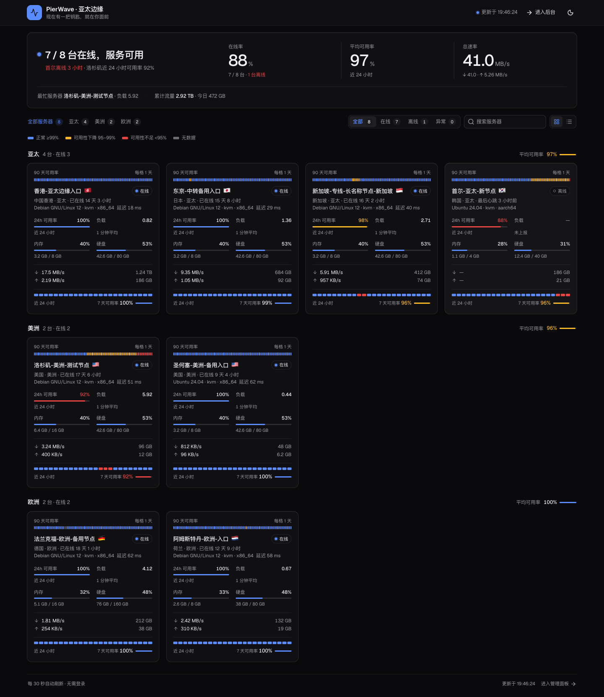
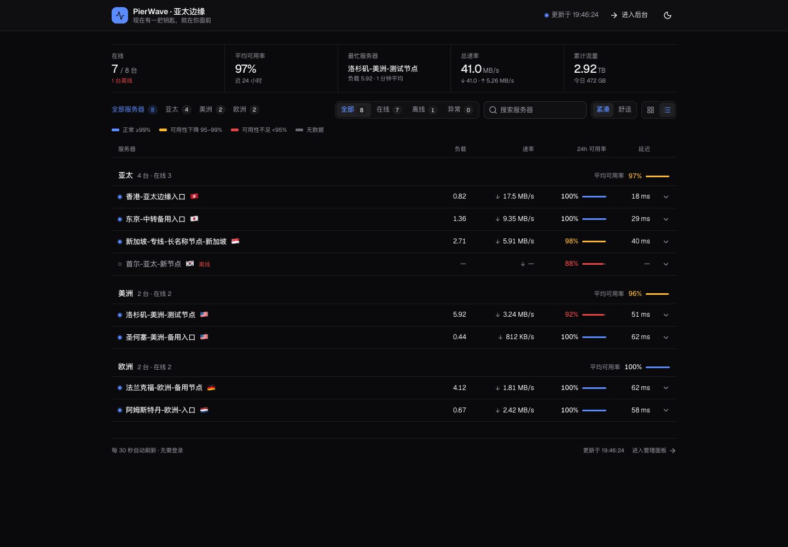
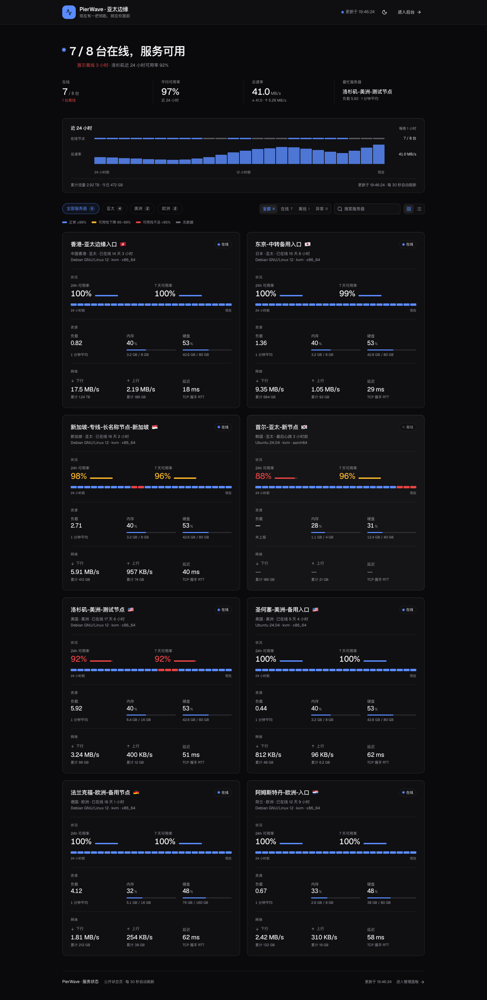

# 探针公开页 · 3 个概念方案 / Public status page — three concepts

> 只做概念设计与概念图。没有改 `web/src/`，没有改后端，没有提交。
> Concept only. No changes under `web/src/`, no backend changes, no commit.

三个方案都基于同一份“假的真数据”：8 台服务器、3 个分组，字段与
`GET /api/v1/public/status`（`web/src/lib/api.ts:204-295`）一一对应。
三个 HTML 都不发网络请求，只做静态渲染；唯一真实可用的交互是主题切换，
B 还额外实现了展开行与密度切换。

---

## 一、怎么看 / How to view

```bash
# 直接打开
open web/screenshots/probe-concepts/a.html
open web/screenshots/probe-concepts/b.html
open web/screenshots/probe-concepts/c.html

# 重新渲染图片（只读本地 file://，不启动服务）
node web/screenshots/probe-concepts/render.mjs
```

查询参数（三个页面通用）：

| 参数 | 值 | 说明 |
|---|---|---|
| `theme` | `light` | 不传即暗色（与产品「暗色优先」一致） |
| `state` | `offline` | 所有服务器离线：无在线节点 |
| `state` | `error` | 加载失败 / 连接中断 |
| `state` | `disabled` | 公开页已关闭（实现了，未截图） |
| `expanded` | B 专用，如 `hk` | 预展开某一行，用于看展开详情 |
| `density` | B 专用，`comfortable` | 舒适密度；默认紧凑 |

示例：`b.html?theme=light&state=offline&density=comfortable`。

`render.mjs` 需要 Playwright 和本机 Chrome；可用
`PLAYWRIGHT_MODULE=/path/to/playwright/index.mjs` 与
`CHROME_PATH=/path/to/chrome` 覆盖。默认会从仓库的
`.npm-cache/_npx/*/node_modules/playwright/index.mjs` 里找。

字体：HTML 通过 `@font-face` 引用 `web/node_modules/@fontsource-variable/geist`
里的 Geist；中文回落到 PingFang SC（截图机器是 macOS）。如果单独拷走 HTML，
字体缺失时会回落到系统字体，布局不受影响。

---

## 二、共同基线 / Shared baseline

### 2.1 设计 token

三个 HTML 的 `:root` / `[data-theme="light"]` 直接从
`web/src/index.css` 抄了同一套变量：深色 zinc 基座、单一 indigo primary、
`--warning`、`--destructive`、`--border`、`--card-shadow`。
没有新增色相；可用率与状态只使用产品里已经定义的四种状态色
（在线 primary / 离线 muted / 下降 warning / 错误 destructive）。

### 2.2 可用率三档怎么表达

| 档位 | 数值 | 颜色 | 第二信号 |
|---|---|---|---|
| 正常 | ≥ 99% | `--primary` | 数值 + 迷你条填充长度 |
| 下降 | 95–99% | `--warning` | 数值 + 迷你条填充长度 |
| 不足 | < 95% | `--destructive` | 数值 + 迷你条填充长度 |
| 无数据 | null | muted | `—`，不写 0% |

每个方案里的“主可用率”（A 的 24h/7d、B 的行内 24h、C 的 24h/7d）都是
**数字 + 颜色 + 填充长度**三重编码；点阵/热力条因为格子太小只保留颜色，
但悬停 title 给出具体百分比，紧邻的数字仍带填充条。

状态点也不是唯一信号：卡片有「在线/离线/异常」文字 pill，B 的离线行在
名称旁写了「离线」，读屏和色觉障碍用户不依赖红/蓝。

### 2.3 假数据

- 8 台：亚太 4（含 1 台离线）、美洲 2、欧洲 2。
- 在线 7/8（88%）；平均可用率 97%（近 24 小时）；总速率 41.0 MB/s
  （下行合计，上行合计 5.26 MB/s）；最忙 洛杉矶 5.92。
- 可用率三档都出现了：5 台 ≥99%，新加坡 98%，首尔 88%（离线前的历史），
  洛杉矶 92%。
- 三份 HTML 里的 fixture 是同一份手工数据，不是真实机房数据。

### 2.4 状态

- **正常**：12 张主图。
- **无在线节点**：`states/*-offline-dark-1440.png`。不是空页面：顶部结论/摘要
  变成 0/8，B 多一条警示行，A/C 保留历史可用率与卡片（置灰），因为访客仍然
  想知道“刚才发生了什么”。
- **加载失败**：`states/*-error-dark-1440.png`。页头保留，live 状态变
  「连接中断」（warning），正文是标题 + 原因 + 重试；A 用居中面板，B 用极简面板，
  C 沿用落地页版式（左侧标题 + 重试）。
- **页面关闭**：HTML 里实现了（`?state=disabled`），三份都是“管理员已关闭公开
  状态页 + 进入后台”，没有单独截图。现网对应的是
  `public_status_enabled = 0` 时的 404（`crates/master/src/routes/public_status.rs:117`）。
- **加载中**：没有另画骨架；现网的 `StatusSkeleton`
  （`web/src/components/status/StatusSkeleton.tsx`）与新结构一一对应即可。

---

## 三、方案 A · 状态仪表盘 / Status dashboard



**一句话定位**：把公开页当运维仪表盘——先给总体判断，再给三块大数字，最后按
分组看每台机器的 90 天履历。

### 结构

1. 顶栏：品牌 + 更新时间/连接状态 + 进入后台 + 主题。
2. Hero：一句结论（`7 / 8 台在线，服务可用`）+ 三个大数字
   （在线率 88% / 平均可用率 97% / 总速率 41.0 MB/s）+ 一条脚注
   （最忙服务器、累计流量、今日流量）。
3. 控件行：分组标签（全部/亚太/美洲/欧洲 + 计数）、状态筛选
   （全部/在线/离线/异常）、搜索、网格/列表切换。
4. 图例：≥99 / 95–99 / <95 / 无数据。
5. 分组分节卡片：每节标题带「台数 · 在线数」与组平均可用率；
   4 列（1440）/ 1 列（390）。
6. 卡片：顶部 90 天热力条（每格 1 天）→ 名称/国旗/状态 pill →
   国家·分组·在线时长 → OS·虚拟化·架构 + 延迟 → 2×2 指标
   （24h 可用率/负载/内存/硬盘，可用率优先）→ 上下行速率与累计 →
   近 24 小时点阵 + 7 天可用率。

### 适合什么

- 所有者本人/常驻访客需要“一眼判断整体”，再按分组定位到某台机器。
- 想把 90 天稳定性当作公开承诺展示：热力条能看出“最近两周开始变差”。
- 桌面宽屏浏览为主。

### 牺牲什么

- **信息密度最高**，390 下全页 3705px，第一屏只能看到 hero + 第一张卡的
  开头；移动端需要一直滚。
- 90 天热力条是**新数据**：现网只保留 7 天、API 只有 24h（详见第五节）。
  没有新数据时只能退回 7 天/24h，A 的“履历感”就少一半。
- 三块大数字中的“总速率”需要在浏览器里对在线机器的 `net_rx_bps` 求和，
  多一个纯函数与边界测试；数值会随离线机器变化。
- 卡片里同时有 90 天热力条、24h 点阵、7 天数字，三种时间尺度，需要靠
  标签讲清楚；比 B/C 更容易显得“仪表盘”。

### 数据

- 全部来自现有字段，除 90 天热力条外。
- 90 天热力条需要新增 `server_daily` 日聚合（或把 `server_samples` 保留期
  拉到 90 天）并在公开 DTO 增加 `uptime_daily_90`（详见第五节）。

---

## 四、方案 B · 极简列表 / Minimal list



**一句话定位**：一行一台机器，先给结论与数字，详细信息点开再看；最像“朴素但
可信”的公共服务页面。

### 结构

1. 顶栏：品牌 + 更新状态 + 主题 + 进入后台。
2. 摘要条（不是四张卡）：在线 7/8、平均可用率 97%、最忙服务器、总速率、
   累计流量；无在线时“1 台离线”变成“无在线节点”。
3. 工具栏：分组标签、状态筛选、搜索、**密度切换（紧凑/舒适）**、
   网格/列表切换。
4. 图例。
5. 列表：全局列头（服务器/负载/速率/24h 可用率/延迟）→ 分组标题
   （台数 · 在线数 · 组平均可用率）→ 紧凑行。
6. 行：状态点 + 名称 + 国旗（+ 离线/异常文字）→ 负载 → 速率 →
   24h 可用率（数字 + 填充条）→ 延迟 → chevron。
7. 展开：身份（在线时长/最后心跳/系统/虚拟化·架构/国家·分组）、
   资源（负载/内存/硬盘 + 条）、网络（上下行/累计/延迟）、
   可用率（24h/7d + 24h 点阵 + 「每格 1 小时」）。
8. 密度：紧凑 40px 行，舒适 52px + 一行 OS/国家子行；两种都在截图里。

### 适合什么

- 移动端优先：390 下全页 1193px，一屏能看到摘要 + 前 5–6 台机器；
  比卡片方案少 3–4 倍的滚动。
- 访客只是确认“某台机器是否在线、快不快”，不需要看装饰。
- 改动最小：只用现有字段，不动后端，不动数据保留策略。

### 牺牲什么

- 首屏没有“服务整体很好”的视觉锤；结论只在摘要条的数字里。
- 7 天可用率、累计流量、内存/硬盘都在展开里；默认态看不到“历史”。
- 展开是点击后才知道的交互，第一次访问的人可能不会点（需要 chevron 和
  hover 提示来补偿）。
- 极简意味着视觉记忆点弱；如果公开页同时承担品牌展示，会显得“太工具”。

### 数据

- 不需要任何新字段/接口。分组标题的组平均可用率可由 `uptime_24h` 现算。
- 网格切换沿用现有 `ServerCard` 网格，不在本方案里重画。

---

## 五、方案 C · 品牌化落地页 / Brand landing page



**一句话定位**：先像一张公开服务页——大标题结论、一条 24 小时趋势、更大的卡
片和留白，再把「状况 / 资源 / 网络」分区讲清楚。

### 结构

1. 导航：品牌 + 更新状态 + 主题 + 进入后台。
2. Hero：一句结论（34px）+ 一行异常说明 + 四块数字
   （在线、平均可用率、总速率、最忙）+ 大量留白。
3. 趋势卡：近 24 小时，两行——
   上行“在线节点”24 格存在条（8/8 实心，7/8 灰格），
   下行“总速率”24 根柱（当前 41.0 MB/s），下方时间轴与流量脚注。
4. 控件：分组 pill、状态筛选、搜索、网格/列表切换、图例。
5. 卡片：2 列（1440）/ 1 列（390），每张 24px 内边距；标题区（名称/国旗/
   状态）→ 国家·分组·在线时长 → 系统 → **状况**（24h/7d 大数字 + 填充条 +
   24h 点阵）→ **资源**（负载/内存/硬盘）→ **网络**（下行/上行/延迟 + 累计）。
6. 页脚：品牌、公开状态页说明、更新时间、进入管理面板。

### 适合什么

- 公开页同时是“服务门面”：发给客户/朋友看，第一眼要有结论和整体趋势。
- 桌面端浏览为主，愿意用更长的页面换更好的第一印象。
- 90 天历史暂时做不了，但想展示“最近 24 小时有没有抖动”。

### 牺牲什么

- 390 下全页 4805px，最长；虽然首屏（hero + 趋势）体验最好，但看完 8 台要
  滚很久。
- 更大的卡片 = 更少的机器同屏；8 台就要 4 行。
- 趋势里的“总速率”是**新字段**：现网只有单机当前速率，没有 24 小时合计
  （详见第五节）；没有它就只能保留“在线节点”一行，趋势卡会变薄。
- 分区标签（状况/资源/网络）会多出三行小字；在 390 下尤其占高度。

### 数据

- 在线节点趋势可由现有 `buckets_24h` 在浏览器聚合（每小时统计
  `online_ratio >= 0.99` 的台数），不需要新接口。
- 总速率趋势需要新增 `PublicStatusSummary.rate_24h`（24 个小时的合计
  字节/秒），数据源是 `server_samples.rx_bps/tx_bps`。

---

## 六、横向对比 / Side by side

| | A 状态仪表盘 | B 极简列表 | C 品牌化落地页 |
|---|---|---|---|
| 首屏 | 结论 + 3 个大数字 | 5 项摘要条 | 大结论 + 24h 趋势 |
| 每台信息 | 全展开卡片 | 行 + 点击展开 | 大卡片，内部三区 |
| 历史 | 90 天热力条 + 24h 点阵 + 7d | 展开内 24h 点阵 + 7d | 24h 点阵 + 7d |
| 1440 全页高 | 1661 | 1000（内容约 900） | 2953 |
| 390 全页高 | 3705 | 1193 | 4805 |
| 移动端首屏信息量 | 中 | 高 | 中（品牌强） |
| 需要新数据 | 90 天日聚合 | 无 | 24h 速率合计 |
| 初始工作量 | 3–4 人日 | 1.5–2 人日 | 2.5–3 人日 |
| 气质 | 运维仪表盘 | 朴素、可信 | 公开服务门面 |
| 主要风险 | 数据保留/存储 + 密度 | 历史被折叠 | 页长 + 速率趋势数据 |

---

## 七、技术上怎么落地 / How it maps to the code

### 7.1 现有可复用的东西

- `web/src/components/status/ServerCard.tsx`：状态 pill、2×2 Meter、速率格、
  24h 点阵；A/C 的卡片可以从它拆。
- `web/src/components/status/Availability.tsx`：`AVAILABILITY_BAR_CLASS` 与
  `AvailabilityValue`，三档颜色 + 填充长度已经是现成的。
- `web/src/components/status/Meter.tsx`：A/C 的指标条。
- `web/src/components/status/Toolbar.tsx`：分组标签、状态筛选、搜索、
  网格/列表切换；A/B/C 都复用它（B 只额外加密度段）。
- `web/src/lib/publicStatus.ts:121-175`：`availabilityTone` /
  `availabilityFill` / `availabilityPercent`，三档阈值（0.99 / 0.95）不改。
- `web/src/lib/api.ts:225-286`：`PublicStatusServer` / `PublicStatusSummary` /
  `PublicStatusGroup`；A/C 新增字段都加在这里。
- `crates/master/src/routes/public_status.rs:21`：`BUCKETS_24H = 24`；
  `:144` 按小时聚合；30 秒进程内缓存 `state.public_status`。
- `crates/domain/src/repo.rs:9341-9343`：5 分钟采样、保留 7 天；
  `:9424` `uptime_all`，`:9441` `hourly_buckets`。

### 7.2 数据缺口（重要）

#### (1) A 的 90 天热力条

- 现状：`server_samples` 5 分钟一条，**只保留 7 天**
  （`RETENTION_SECS = 7 * 86_400`），公开 API 只给 `buckets_24h`。
- 需要：
  - 新表 `server_daily(server_id, day, uptime_ratio, samples)`（迁移
    `000N_server_daily.sql`，只追加），每日聚合一次；
  - 或把 `server_samples` 保留期拉到 90 天（8 台 × 288 条/天 × 90 ≈ 20.7 万行，
    不算大，但读时聚合更慢，且和 7 天细粒度混在一起）。
  - 公开 DTO 加 `uptime_daily_90?: (number | null)[]`（或
    `buckets_daily: { day: number; online_ratio: number }[]`），旧前端忽略即可；
  - 路由聚合 + 30s 缓存；加 Rust 测试（空数据、某天无采样、90 个元素）。
- 兜底：没有新数据时，A 的热力条降级为 7 天（168 个小时桶）或直接复用
  24h 点阵，并在界面文案上写「近 7 天」。

#### (2) C 的 24 小时总速率趋势

- 现状：`server_samples` 已存 `rx_bps` / `tx_bps`（5 分钟），但公开 API 没有
  任何历史速率；单机只有当前 `net_rx_bps` / `net_tx_bps`。
- 需要：`PublicStatusSummary.rate_24h?: (number | null)[]`，24 个小时的
  在线机器速率合计（字节/秒）；如需上下行分开，再加 `rate_rx_24h` /
  `rate_tx_24h`。
- 不需要迁移：`server_samples.rx_bps/tx_bps` 已有；只是查询 + 聚合 + DTO +
  缓存。加 Rust 测试（无采样小时为 null，不写 0）。
- 兜底：前端 `rate_24h` 不存在时只画“在线节点”存在条，整行速率隐藏；
  在线节点趋势本身用现有 `buckets_24h` 就能算，不需要新接口。

#### (3) “7 天可用率点阵”的准确含义

- 现网卡片的点阵是 **24 个小时桶**（`AvailabilityStrip`，24 格），
  下面一行是 7 天可用率数字 + 填充条。需求里说的“7 天可用率点阵”在本次
  概念里沿用现网实现：24 格点阵 + 7d 数字。
- 如果所有者要的是真正的 7 × 24 = 168 格点阵，需要新增
  `buckets_7d?: (PublicStatusBucket | null)[]`（数据保留 7 天，够用），
  或者 7 个日聚合格。这属于新字段，不影响现有字段。

#### (4) 不需要新接口的部分

- A 的“总速率”大数字：在线机器的 `net_rx_bps` 求和（浏览器），
  另加一个纯函数 + 单测即可。
- A/B 的分组分节与组平均可用率：`group_name` + `uptime_24h` 现算。
- B 的全部内容：现有字段。
- 所有页面的 busiest server / 平均可用率：`busiestServer` /
  `averageUptime24h`（`web/src/lib/publicStatus.ts:263-307`）现成。

### 7.3 实现位置（如果选中）

- A：
  - `web/src/pages/Status.tsx` 的 `StatusContent` 重排；
  - 新增 `web/src/components/status/StatusHero.tsx`、`GroupSection.tsx`、
    `HeatStrip.tsx`；
  - `web/src/lib/publicStatus.ts` 加 `sumRates`、`dailyTone` 等纯函数与测试；
  - 后端 `routes/public_status.rs` + `repo.rs` 加日聚合；
  - i18n：`zh-CN.ts` / `en.ts` 同时加（`en.ts` 的 `satisfies Messages` 会兜底）。
- B：
  - 新增 `web/src/components/status/ServerList.tsx`、`ServerRow.tsx`、
    `ServerRowDetail.tsx`；
  - `Status.tsx` 的 list 分支改为列表；`publicStatus.ts` 加
    `density` 存储键（参照 `STATUS_VIEW_STORAGE_KEY`）；
  - 网格分支保留现有 `ServerCard` 网格；
  - 纯逻辑（密度持久化、默认值）加 `node --test`。
- C：
  - 新增 `StatusHero.tsx`、`TrendBand.tsx`、`ZoneCard.tsx`；
  - `TrendBand` 的在线数列由 `buckets_24h` 聚合；
  - `publicStatus.ts` 加 `hourlyOnlineCount`（输入 servers，输出 24 个数）；
  - 后端加 `rate_24h`（可选）；
  - 页脚沿用现有公开页 footer（目前 `publicStatus.footer` 只有 admin 文案）。

### 7.4 工作量估算

按“一个熟悉这个仓库的前端 + 半个后端”估：

| | 前端 | 后端 | 测试 / i18n / 截图 | 合计 |
|---|---|---|---|---|
| A（含 90 天） | 1.5–2 人日 | 1–1.5 人日 | 0.5–1 人日 | **3–4 人日** |
| A（90 天降级为 7 天） | 1.5–2 人日 | 0 | 0.5 人日 | **1.5–2.5 人日** |
| B | 1–1.5 人日 | 0 | 0.5 人日 | **1.5–2 人日** |
| C（含速率趋势） | 1.5–2 人日 | 0.5–1 人日 | 0.5 人日 | **2.5–3.5 人日** |
| C（无速率趋势） | 1.5–2 人日 | 0 | 0.5 人日 | **2–2.5 人日** |

以上不含“所有者反复调视觉”的时间；包含 i18n 双语键、纯函数测试、
`make check`、以及按本目录方式补回归截图。

---

## 八、推荐 / Recommendation

**推荐 B（极简列表）**，理由：

1. **移动端**：390 全页 1193px，摘要 + 前 5–6 台在一屏内；A 是 3705px、
   C 是 4805px。公开页的高频访问大概率发生在手机上。
2. **朴素但可信**：没有营销文案、没有“造出来的 90 天历史”，默认态只展示
   访客真正会看的状态点、负载、速率、可用率、延迟；细节点开才出现。
3. **可落地性最好**：0 个新接口、0 个迁移、0 个数据保留策略变更；
   直接复用现有字段和 `AvailabilityValue` / `Meter`。
4. **回归风险最小**：网格视图原样保留，列表是新增分支；不碰后端。

如果所有者更想要“仪表盘”的整体判断力，A 是第二选择，但要接受 90 天日聚合
的存储/迁移工作和更高的信息密度；如果公开页同时是服务门面、需要第一眼
品牌感，C 是升级路径，但应先把 `rate_24h` 字段补上，否则趋势卡会缺一条腿。

> 可选的小融合（不改变 B 的结构）：在 B 的摘要条上方加一句 C 的结论
> （如「7 / 8 台在线，服务可用」）。一句话 + 摘要条 + 行列表，
> 仍然是最省移动端高度的组合。

---

## 九、产物清单 / Files

### 主图（12）

| 文件 | 尺寸 |
|---|---|
| `a-dark-1440.png` | 1440 × 1661 |
| `a-dark-390.png` | 390 × 3705 |
| `a-light-1440.png` | 1440 × 1661 |
| `a-light-390.png` | 390 × 3705 |
| `b-dark-1440.png` | 1440 × 1000 |
| `b-dark-390.png` | 390 × 1193 |
| `b-light-1440.png` | 1440 × 1000 |
| `b-light-390.png` | 390 × 1193 |
| `c-dark-1440.png` | 1440 × 2953 |
| `c-dark-390.png` | 390 × 4805 |
| `c-light-1440.png` | 1440 × 2953 |
| `c-light-390.png` | 390 × 4805 |

### 状态 / 交互补充图（9，在 `states/`）

| 文件 | 内容 |
|---|---|
| `a-offline-dark-1440.png` | A 无在线节点 |
| `a-error-dark-1440.png` | A 加载失败 |
| `b-offline-dark-1440.png` | B 无在线节点 |
| `b-error-dark-1440.png` | B 加载失败 |
| `b-expanded-dark-1440.png` | B 展开详情（桌面） |
| `b-expanded-dark-390.png` | B 展开详情（手机） |
| `b-comfortable-dark-1440.png` | B 舒适密度 |
| `c-offline-dark-1440.png` | C 无在线节点 |
| `c-error-dark-1440.png` | C 加载失败 |

### 源码

- `a.html` / `b.html` / `c.html`：自包含静态原型（内联 CSS + fixture）。
- `render.mjs`：Playwright 渲染脚本，带横向溢出与卡片数量断言。
- 本 README。

---

## 十、English summary

### What this is

Three deliberately different concepts for the public probe page, rendered as
self-contained static HTML. The fixture is fake but shaped exactly like
`GET /api/v1/public/status` (8 servers, 3 groups); no request is made by the
pages. Nothing under `web/src/` was touched and nothing was committed.

### The three directions

- **A — Status dashboard**: a verdict line, three big numbers (online rate,
  average availability, total throughput), grouped sections, and a 90-day heat
  strip on top of every card. Dense, operations-console feel.
- **B — Minimal list**: a compact summary strip, grouped rows (status dot, name,
  load, rate, 24h availability, latency), click to expand identity/resource/
  network/availability details, and a compact/comfortable density switch.
- **C — Brand landing page**: a large conclusion, one 24-hour trend band
  (online-node presence rail + total-rate bars), bigger cards with generous
  whitespace, and cards split into 状况 / 资源 / 网络 zones. Closest to a public
  service page.

All three keep the existing information: title, group filter, search, theme
toggle, grid/list toggle, online x/y, average availability, busiest server,
no-online hint, and every per-server field (name, country/group, uptime,
OS/virtualization/arch, latency, load, memory, disk, 24h availability, the
7-day availability signal, current rates and cumulative traffic). The
availability tiers (≥99 / 95–99 / <95) are encoded by color **and** a filled
bar; unknown data stays `—`, never 0%. Light and dark themes are rendered, as
are 1440 and 390 widths. Offline-fleet and load-failure states are implemented
and captured.

### Trade-offs

| | A | B | C |
|---|---|---|---|
| First screen | verdict + 3 KPIs | summary strip | verdict + trend |
| Mobile full page (390) | 3705 px | **1193 px** | 4805 px |
| Per-server history | 90-day heat strip | inside expansion | 24h strip + 7d |
| New data needed | 90-day daily rollup | none | 24h total-rate series |
| Estimate | 3–4 days | **1.5–2 days** | 2.5–3.5 days |
| Risk | retention/storage, density | history hidden | page length, rate trend |

### Data gaps (technically required)

1. **A 90-day heat strip** — `server_samples` currently retains 7 days and the
   public API only exposes `buckets_24h`. Add a daily rollup
   (`server_daily`, append-only migration) or extend retention to 90 days, and
   expose `uptime_daily_90` on `PublicStatusServer`. Fallback: 7-day strip.
2. **C 24h total-rate trend** — `server_samples.rx_bps/tx_bps` already exist but
   are not exposed. Add `PublicStatusSummary.rate_24h` (24 hourly sums) and
   feature-detect it in the UI; the online-node rail can be derived from
   `buckets_24h` today.
3. **A true 7×24 matrix** — if “7-day dot matrix” means 168 hourly cells, add
   `buckets_7d`; the current UI’s strip is 24 hourly cells plus a 7-day number.
4. No new interface is needed for B, for A’s total-rate KPI (client-side sum),
   for grouping, or for the group average availability.

### Recommendation

**B**. It is the only concept that fits a phone screen (1.2k px vs 3.7k / 4.8k
full-page height), it stays honest and plain (no invented 90-day story), and it
needs zero backend or data-retention work. A is the runner-up if the owner
wants an ops-dashboard feel and accepts the 90-day pipeline; C is the upgrade
path if the page is also a brand surface, ideally after `rate_24h` lands.
